# Visual Suite (Studio Leiel)

Twelve nodes for ComfyUI, built for people who spend their day in the graph
rather than passing through it. They share one design language: the same palette, the
same chips, the same `?` button that opens a manual on the node itself.

## A sample workflow to start from

`example_workflows/Visual Suite - Sample Series (Krea 2).json` puts the nodes
together on Krea 2 Turbo, with a five-scene sample series, *The Keeper's
Letter*, already in the Series Book. In ComfyUI it is listed under the
templates of this pack; drop it on the canvas or open it from there. A note in
the workflow lists the three model files it needs and the five steps from a
first render to a laid-out series.

The same series is there as text too, in
`example_workflows/The Keeper's Letter - Series Pack.md` - the series note,
each scene's frame, note and caption, and its anchors - in the form the
Series Book's **Paste All** reads. Paste it into an empty Series Book to start
from the sample series, or use it as a model for a pack of your own. A whole
season of packs goes into Files at once, sorted into a folder, with **Make all
series** in the Files panel.

## The nodes

### [Visual Prompt Composer](docs/prompt-composer.md)

A prompt editor: named sections you can switch off, reorder, mark up and reuse.

Use it however you like: with a single section it is simply a free text input,
and you can split it into quality, subject, pose, scene and camera - or any parts of
your own - only if that helps. Nothing requires a particular layout.

A prompt usually arrives as one long string with nothing in it to hold on to, so
it gets pasted in and run, and when the result is wrong the whole thing is
replaced rather than examined. Here it has parts. Bypass one section to find out
what it was contributing without deleting it. Colour a clause you are unsure
about and it is still coloured next week. Save the part that worked and load it
into the next workflow. Read any of it back in 26 languages to check it says
what you meant. None of the styling reaches the model — it is metadata, the
output is plain text — so annotate as freely as you like.

And when you want it, a reader fills a section from a reference image, one layer
at a time: quality from one picture, clothes from another, a pose from a third,
scene and camera from others. That part needs `transformers`; nothing else here does.

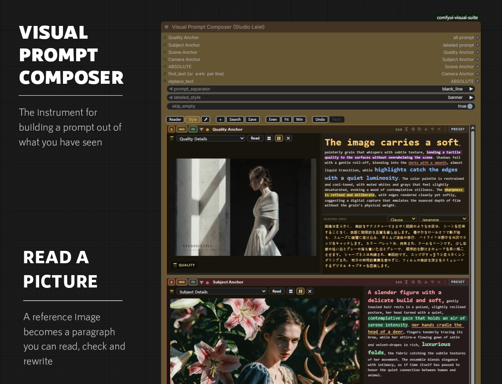

### [Visual Idea Box](docs/idea-box.md)

A box for ideas seen anywhere — kept in a second, sorted later, found again.

Ideas for a series turn up everywhere but the graph: a picture on a web page, a
frame of a film, a line someone says — and a week later they are gone. Here
keeping one asks nothing: drag a picture from the browser onto the node, paste
a screenshot with Ctrl+V, write a thought into the jot box, or let a screenshot
tool save into the box's inbox folder. Pictures, films, YouTube and Vimeo
links, sounds, PDFs and plain words are all kept the same way, and the address
of a magazine story brings the whole story as one idea — every picture in the
page's order, its credits as the notes.

The new ones wait at the top until there is a minute, then go by one at a
time — a few words on what caught the eye (the first line is the title), a
folder by its number key, Enter for the next. The names in the notes become
keywords, sorted by role — models, photographers, stylists, magazines — so one
click finds every idea that shares them. Pin a reference beside your own
renders to compare them, keep the sites you gather from one click away, and
send a picture to the Series Book's Reader to be read into a prompt. **Start a
series with this** opens a new series in the Series Book with the idea's
picture and its words in the production notes.

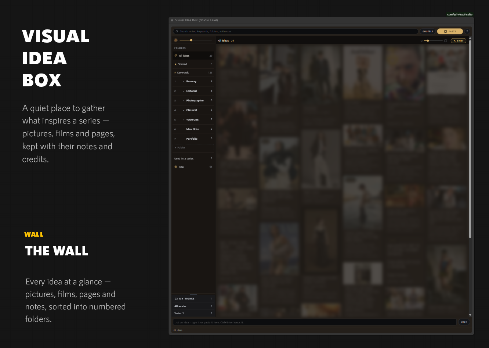

### [Visual Series Book](docs/series-book.md)

A whole series of prompts in one node, built from shared capsules.

A series is mostly the same words: the quality line and the person carried
through every scene, the pose, place and camera changing. Here each piece of
writing is kept once, as a capsule, and a prompt is a list of them - edit the
Subject in one scene and every scene using it follows. Paste a whole reply and
it becomes a new scene, named and split into its capsules - one button, on the
bar under the book, so the writing itself mostly stays folded away. Search and
replace across every prompt at once. Below the book sits the full Prompt
Composer, on whichever prompt is open, for the times a prompt needs editing by
hand.

**Files.** Two rooms, each folding away: **Book files** - the whole book as
you left it, saved by name - and **Series files**, each series on its own,
written a moment after every change so nothing is ever lost. Both sort into
folders, and any file or folder copies out as text without being opened.
**Save book** and **Make all series** wait as buttons on a room's title line:
Make all series takes a whole season of packs at once - pasted, or as `.txt`
files - shows what it read before anything is written, and makes a file for
every series in its folder, without opening them in the book.

**Notes in two languages.** A note written in English and another language
shows **EN**, the other language (**KO** for Korean) or **ALL** - one choice
for every Series Book and Series Report on the canvas. **Auto save** on a
series keeps its book file up to date a few seconds after each change, and a
workflow saved part way through a series, opened again, is brought up to date
from the series' own file.

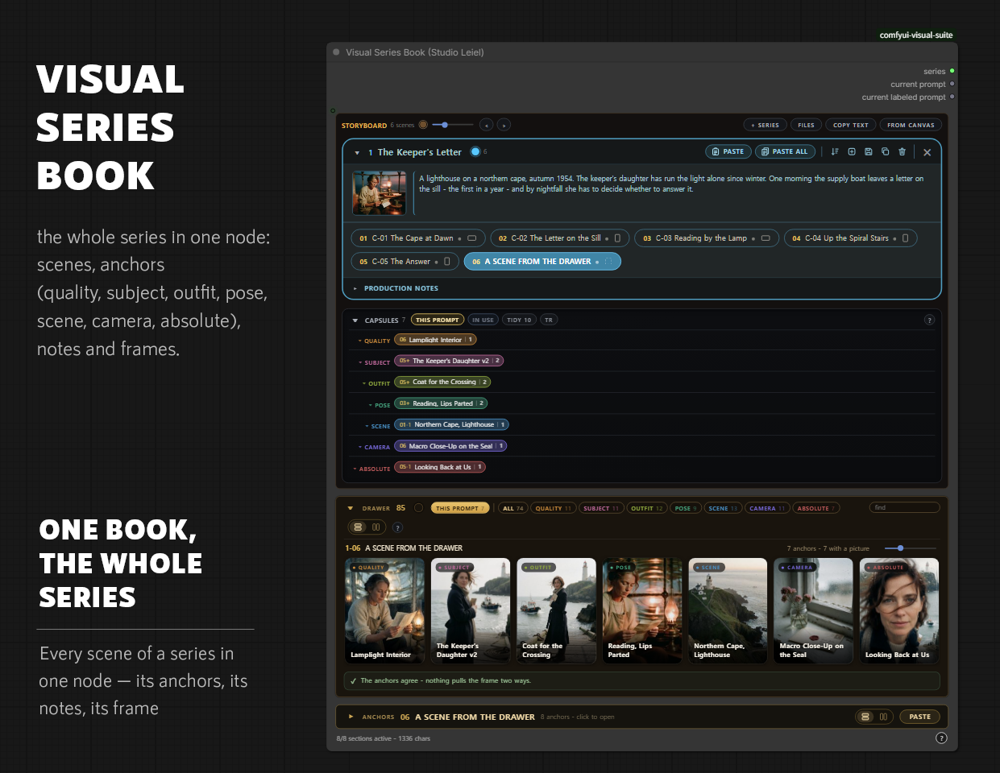


### [Visual Series Lab](docs/series-lab.md)

Ingredients on shelves, combined into recipes, cooked one after another — a
render queue you can see into and change while it runs.

A queued run is normally a sealed box: you cannot tell which of sixty renders
you are looking at, and you cannot change your mind without cancelling by hand.
Here every render says which prompt, which LoRAs and which settings made it,
while it happens — and a recipe can be pulled out, added, or given a bigger
count mid-run, with nothing already rendered repeated.

Starting takes three steps — click a prompt, `+ ADD TO QUEUE` and drag the
recipe into the queue box, `RUN ALL`. The rest — settings to sweep, a Series
Book's capsules, trigger words — waits until you want it. A recipe dragged
out of the queue part way keeps its count, and can be started over on its own.

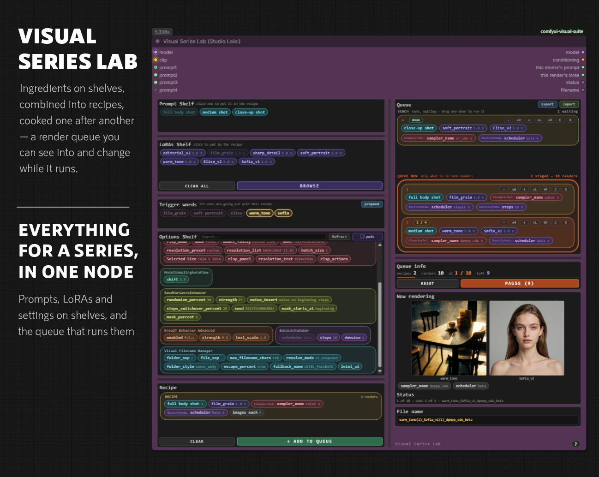

### [Visual Filename Manager](docs/filename-manager.md)

Names your renders after what made them — click any option in the workflow and
it becomes part of the folder or the file.

Twenty images called `ComfyUI_00017_` tell you nothing about which setting made
the one you liked. Building a useful name by hand takes dozens of nodes across
several packs, rewired every time you want a different setting in it. This reads
the workflow instead: every option is already listed, and a click puts it in the
folder or the file.

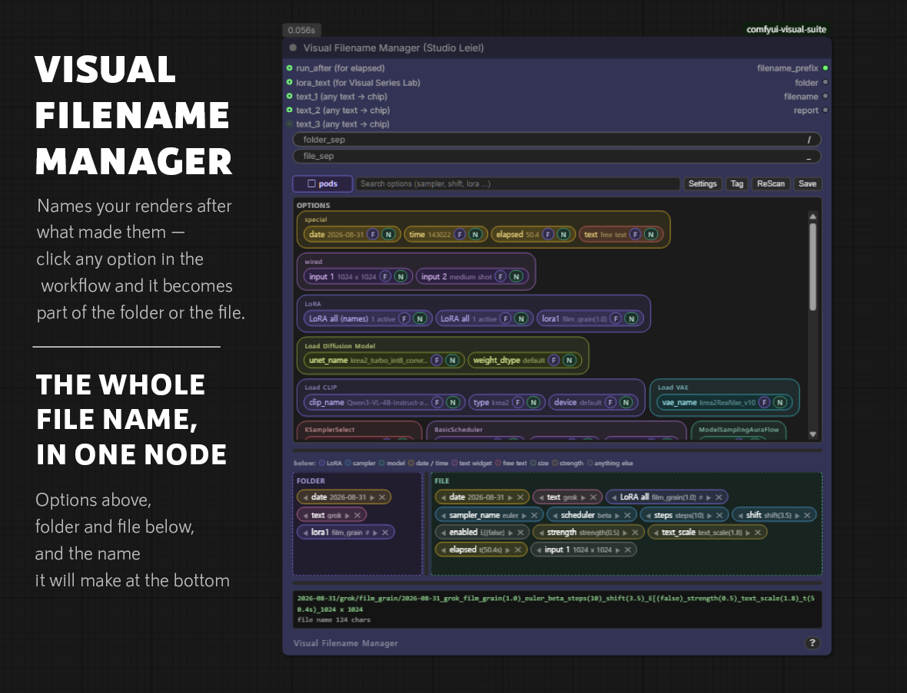

### [Visual Save Image](docs/save-image.md)

Saves what you rendered, and keeps the folder within reach.

ComfyUI's own Save Image appends a five digit counter to every name it is
handed. On a name that already carries the date, the settings and the size that
counter reads `00001` for ever, and costs seven characters on a name long
enough to be arguing with the path limit. This one writes the name as given —
and then, because the folder is right there, lets you walk it: arrow keys
through everything rendered into it, `t` to move a bad one to `_trash`, and
optional JPEG or WebP copies beside the PNG. Give the Filename Manager a `seq`
chip and that walk is in the order the renders were made.

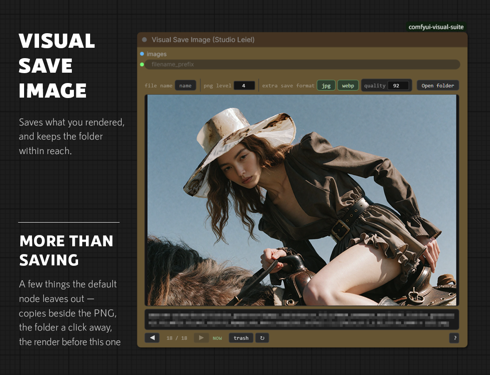

### [Visual Image Viewer](docs/image-viewer.md)

A folder of pictures inside the graph — thumbnails, a large view, 100%, and
two renders side by side.

Checking renders usually means leaving ComfyUI for a file browser that shows
them small, in the wrong order, and often balks at the long names a render
gets. This node lays a folder out as thumbnails on the canvas: click one to
see it large, step with the arrows, hold Space to go round the folder without
stopping, press `*` to look at a hand at 100%. Folders inside folders are
laid out in groups, path and all. Turn on FOLLOW and every picture a save
node writes is shown the moment it lands.

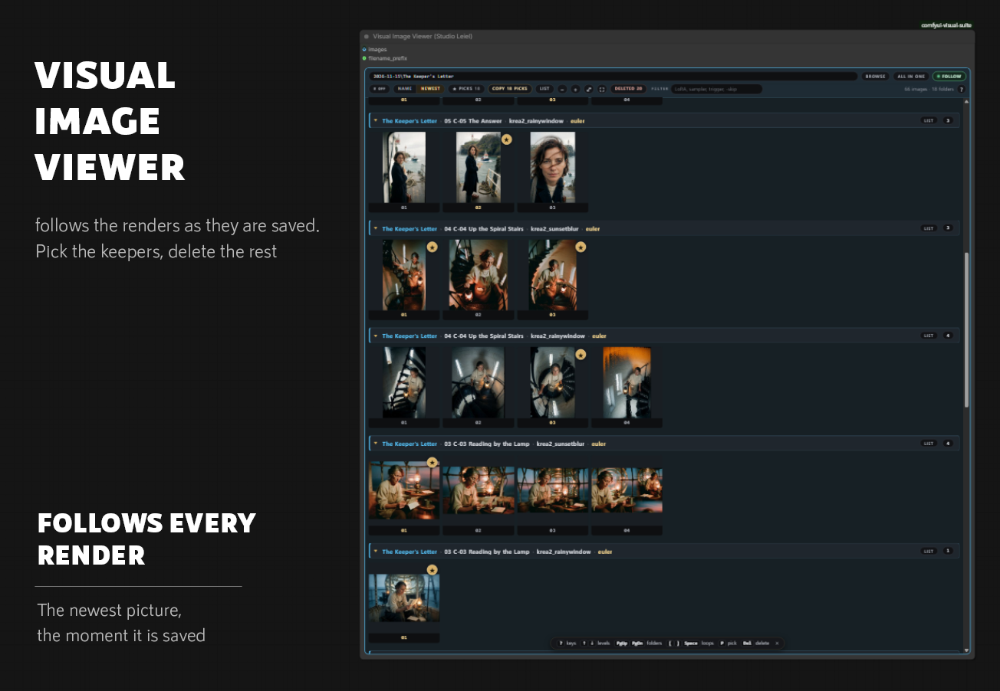

**Compare.** Most of the work of choosing a render is setting it against
another one — the same scene with another LoRA, the same seed with the
enhancer on — and looking closely. Press `C` to pin a picture, step to the
next, and the two stand side by side. Zoom in and drag, and both follow, to
the same place in both pictures: the same hand, the same eye, at 100%.

- `L` lets them go their own ways — each zooms and moves on its own, so one
  face can be lined up against the other half and half, or a close-up set
  against the whole frame.
- `W` lays one over the other with a line to drag across, for the small
  changes a side-by-side hides.
- `X` swaps them; `C` ends it. The keys sit on screen while you compare.

No second window to line up by hand, no leaving the graph.

**Picks, copying and deleting.** `P` marks the picture on screen as a pick, and
`★ Picks` narrows the folder to those — the keepers of a day of renders, in
one place. `Delete` takes a picture out of sight into a `_deleted` folder
beside it, and `Ctrl+Z` brings it back. **Deleted** opens the bin of the
folder on show, where each picture can be looked at again, restored or let
go; nothing is gone until you empty it. **Copy picks** gathers
the keepers into one folder — a series folder in `input`, ready for the
upscale.

**The prompt.** `I` shows what the picture on screen was rendered with,
read back from the PNG — a Series Lab render rebuilt anchor by anchor, the
swept capsule marked — with a button to copy it. No other viewer can do
this: only ComfyUI knows.

**Back to the Lab.** **→ Lab** puts the recipe that made a picture back on the
Series Lab's bench — its prompt, LoRAs and strengths, sampler and the other
settings, the capsules it swapped in. Pick the best of a sweep and render more
of it, or render it again after rewriting the scene: the prompt is the scene
as the Book holds it now.

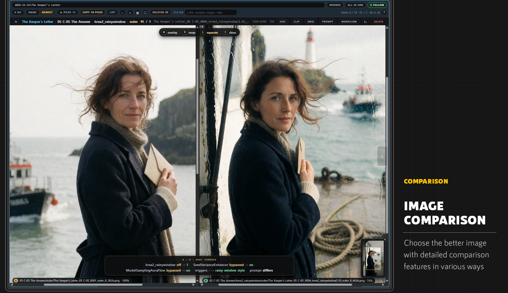

### [Visual Series Report](docs/series-report.md)

What a series has made so far, counted.

Every pick and every deletion made in the Image Viewer is a verdict on a recipe,
and a week later what is left of four hundred verdicts is an impression. The
report keeps them: each render under the LoRAs, sampler and options that made
it, split three ways - picked, left as it is, deleted - and each scene with the
picks it has so far. Click a scene or a bar and everything else is counted
inside it, which is how a sampler is compared on one scene rather than across
the whole series. It reads the recipe written in each PNG, looks at no pixels
and changes no file.

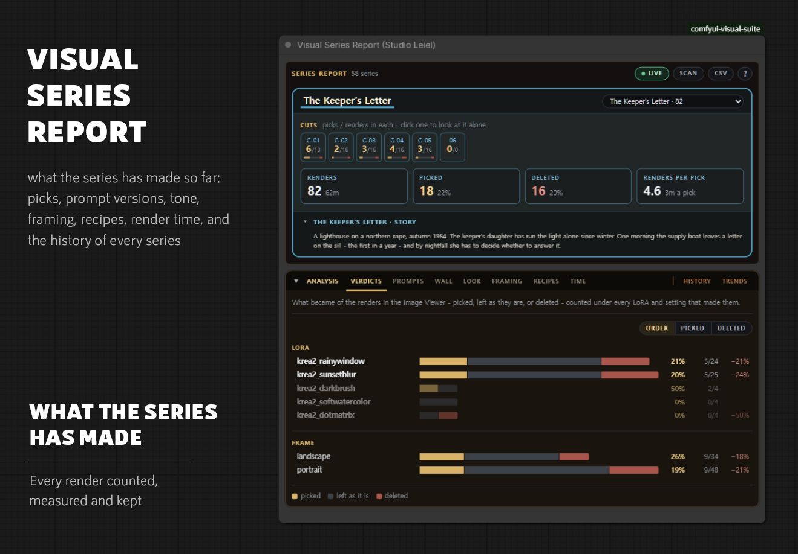


### [Visual Series Layout](docs/series-layout.md)

The series laid out — as spreads to print, frames to post and a short film.

A series that has been written, rendered and picked is still a folder of
files. Whether it works as a story — whether the rhythm of wide and close
holds, whether a cut is missing, whether two cuts belong side by side — only
shows when it is seen the way it will be read: in order, at size, with its
words. Everything that takes is already in the graph. The Series Book has the
title, the note and, for every cut, a number, a name and a caption; the Image
Viewer has the picks. This node puts them together. Nothing is typed twice and
no model is involved: the words are the book's, the pictures are your picks.

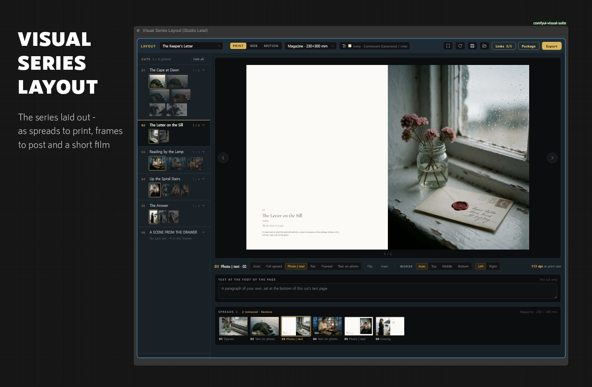

**Print.** Spreads of two pages, in magazine, A4, square or landscape: an
opener, a cut across a spread, a cut facing its words, two cuts framed inside
the margins, the words set on the picture, a closing page that lists every
cut. Each cut takes the layout its shape suggests, and any of it can be
changed — the pick, the layout, the side, where the words sit, which words a
page carries. Every pick chosen for a cut shares its place on the page, in an
arrangement picked from small drawings, and the lines between the pictures
can be dragged to size them.

**Web.** The same series as single frames for a feed, in 4:5, 1:1, 9:16 and
16:9, each scaled from its short side so the type keeps its proportion.

**Motion.** The picks become a film: a title, each picture moving slowly with
its caption - a pan or a slow zoom chosen by the shape of the picture against
the frame, a fade to black at the end, set to music. A timeline in the manner
of an editor — shots as wide as their time on screen over the music's waveform,
lengths dragged at their edges, a playhead to scrub. Markers find the accents
of the music without a model, and **Fit cuts** moves every cut onto the
nearest one — the difference between pictures shown and a film. Encoded frame
by frame in the browser to MP4, in every size at once.

**Music player.** The music kept for the films, played while you work: dropped
in from the computer, gathered in folders and favourites, heard once, through
the list or round and round, with its spectrum in a display set in the
series' colour. **Start here** makes the moment you are hearing the start of
the film's music. One button turns the node into the player alone.

**Out of the graph.** A PDF, pages as JPEG or PNG, a print package with every
picture at full size, and an InDesign document with its pictures linked and
its type in paragraph styles — so a layout made on the canvas carries on in
the studio. A post text from the series' own words, a logo on the closing
page, and the whole layout saved as a `.layout` file to open again.

### [Visual Latent Size Picker](docs/latent-size-picker.md)

A list of sizes that lives in one node — picked at random, stepped through in
order, or pinned to one.

A node graph cannot hold a list, so ten sizes mean twenty nodes and two switches
to choose between them. Most workflows give up and settle on one aspect ratio.
This one keeps the sizes on disk instead: every workflow sees the same list,
adding one costs a line of typing, and width and height can never come apart.

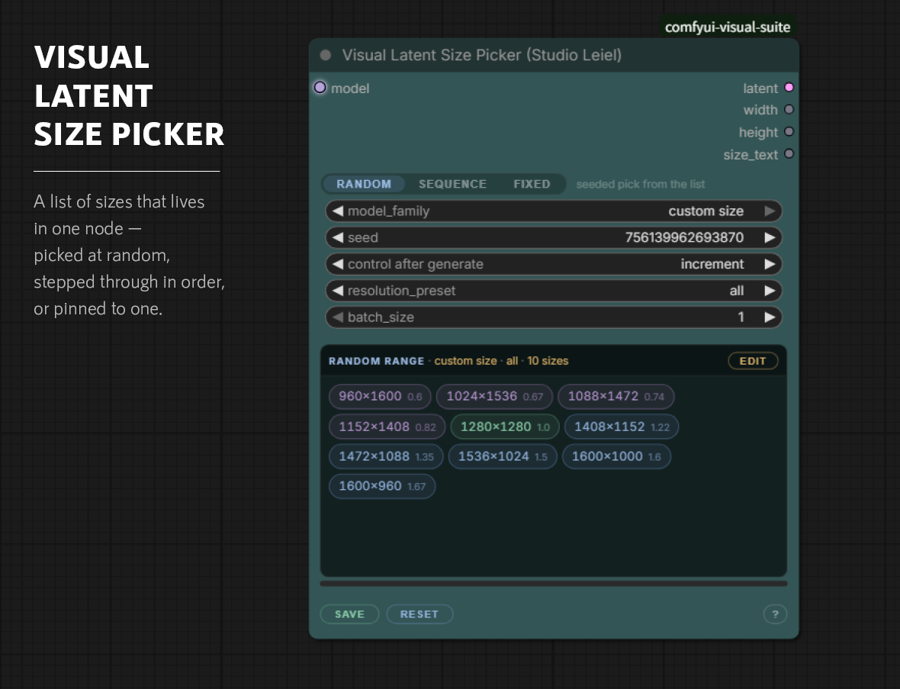

### [Visual Node Bag](docs/node-bag.md)

Drop nodes into a bag and they fold into chips — without touching the graph.

Most of a workflow is finished and never needs looking at again, but it still
takes up the screen and runs wires across whatever you are working on. A bag
puts those nodes away where they are: same links, same ids, same execution. Sort
them onto named shelves, open one in place to change a widget, and delete the
bag whenever you like — every node comes back as it was.

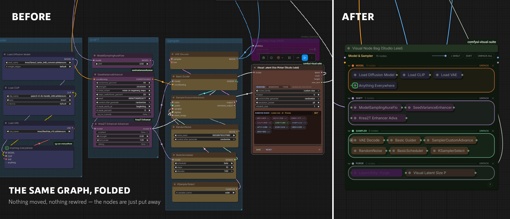

### [Visual Crop](docs/crop.md)

Drag the crop on the picture itself, and watch it as you do.

Cropping in a node graph usually means typing four numbers, running the graph,
and adjusting. Here the picture is on the node: draw a box on it, and the
coordinates follow — with the result shown underneath as you drag.

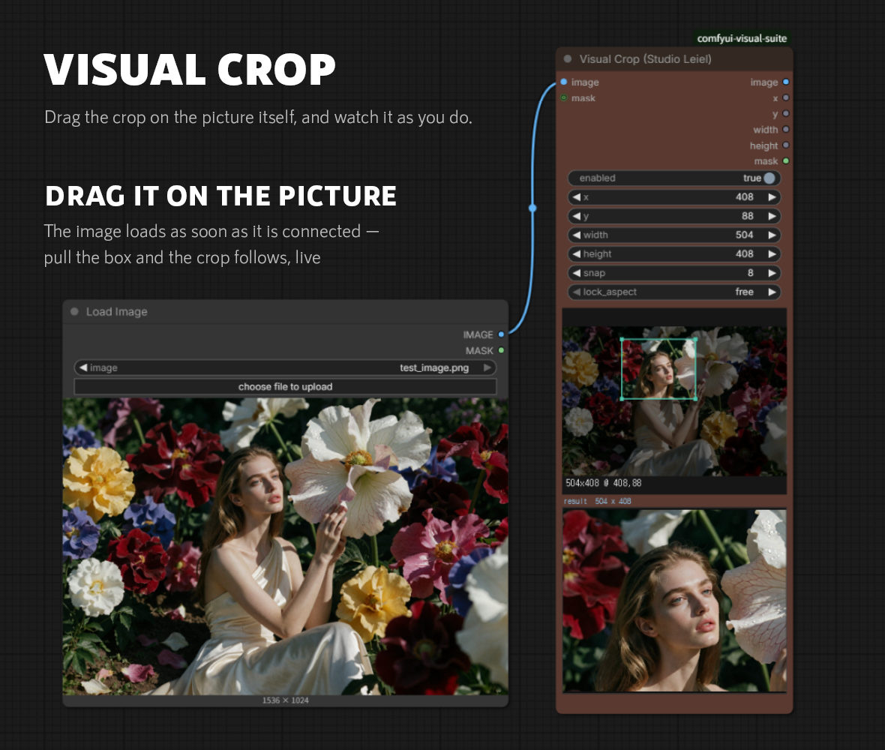

## Install

Search for **Visual Suite (Studio Leiel)** in ComfyUI Manager, or clone into
`custom_nodes`:

```bash
cd ComfyUI/custom_nodes
git clone https://github.com/StudioLeiel/comfyui-visual-suite
```

Restart ComfyUI. Nothing is installed beyond what ComfyUI already ships, and
there is no `requirements.txt` on purpose - the pack stays as light to install
as it has always been.

One optional feature asks for more. Reading a reference image in the Prompt
Composer needs `transformers`, which is a large install and is therefore left to
you:

```bash
pip install transformers accelerate
```

Run that in the environment ComfyUI runs in if you want it. Every other node,
and every other part of the composer, works without it; the Read button says so
plainly rather than failing quietly.

## How the pack is put together

```
nodes/<name>/     one Python package per node
web/<name>/       its frontend, served from /extensions/comfyui-visual-suite/<name>/
```

Each node is imported separately. If one fails - a ComfyUI frontend change, a
bad edit - it is skipped with a message in the console and the others still
load. The console line at startup says how many came up.

Nodes that keep state (prompt presets, series favourites, custom size lists, the ideas in the Idea Box)
write it to ComfyUI's `user/` directory, so updating or reinstalling the pack
never deletes it.

## A note on node ids

Display names are consistent; the internal class ids are not. `Visual Latent
Size Picker` is still `RandomLatentSizePicker` inside, because that is what it
shipped as a year ago and renaming it would break every workflow already using
it. The ids are invisible unless you read the workflow JSON.

## Nodes in this pack

| Display name | Class id |
| --- | --- |
| Visual Idea Box (Studio Leiel) | `LeielIdeaBox` |
| Visual Prompt Composer (Studio Leiel) | `LeielPromptComposer` |
| Visual Series Book (Studio Leiel) | `LeielSeriesBook` |
| Visual Series Lab (Studio Leiel) | `VisualSeriesLabSetup` |
| Visual Filename Manager (Studio Leiel) | `LeielFilenameStudio` |
| Visual Save Image (Studio Leiel) | `LeielSaveImage` |
| Visual Image Viewer (Studio Leiel) | `LeielImageViewer` |
| Visual Series Report (Studio Leiel) | `LeielSeriesReport` |
| Visual Series Layout (Studio Leiel) | `LeielSeriesLayout` |
| Visual Latent Size Picker (Studio Leiel) | `RandomLatentSizePicker` |
| Visual Node Bag (Studio Leiel) | `VisualNodeBag` |
| Visual Crop (Studio Leiel) | `VisualCrop_StudioLeiel` |

## History

Visual Crop and Visual Filename Manager were published separately first, as
`comfyui_visual_crop` and `comfyui-visual-filename-manager`. Both are folded
into this pack; the old repositories are archived and point here.

The image reader in the Prompt Composer was tried out the same way, as
`comfyui-visual-atelier`, so that a multi-gigabyte dependency could be lived
with for a while before being asked of anyone else. It is now part of the
composer and that repository is archived too. The node id, the routes and the
stored presets are unchanged, so workflows made with either carry on working.

## Licence

Apache License 2.0. See [LICENSE](LICENSE) and [NOTICE](NOTICE).

You may use, modify and redistribute this pack, including commercially. If you
redistribute it, keep the copyright and licence notices, state what you changed,
and pass on the NOTICE file. Contributors grant a patent licence for their own
contributions, which is the main thing Apache 2.0 adds over a shorter permissive
licence.

Using the nodes needs nothing from you at all: install and work.
