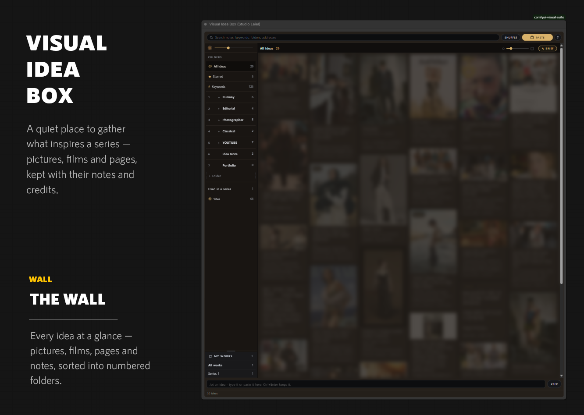
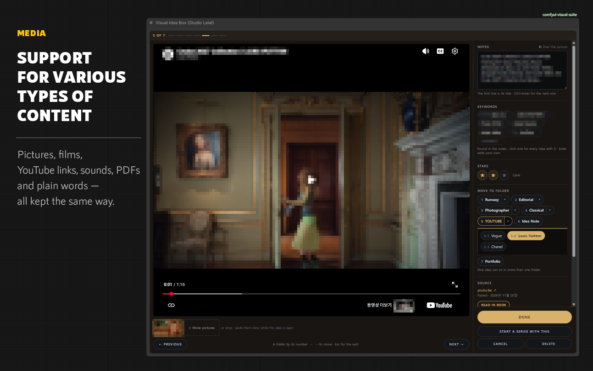
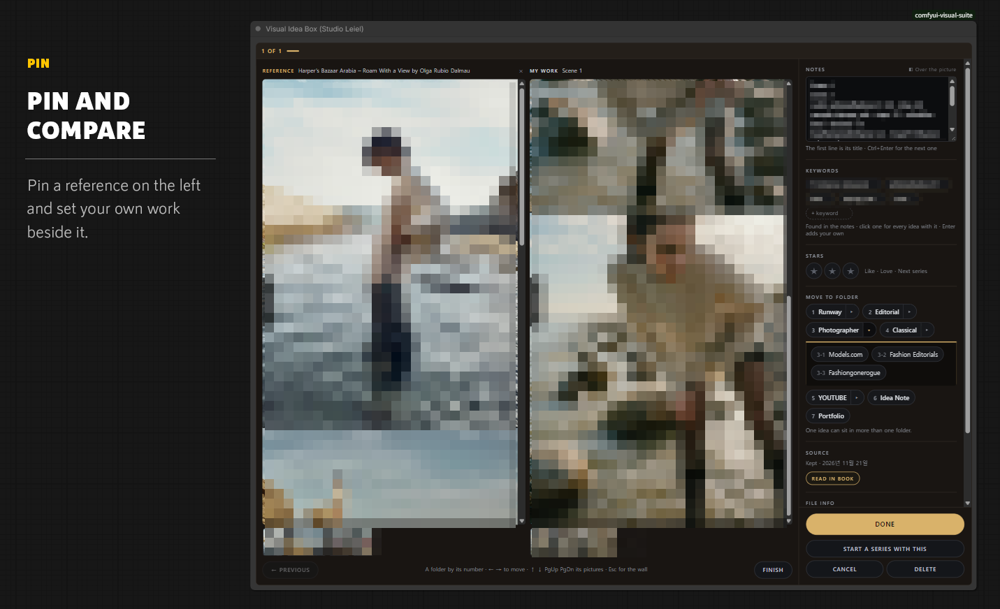
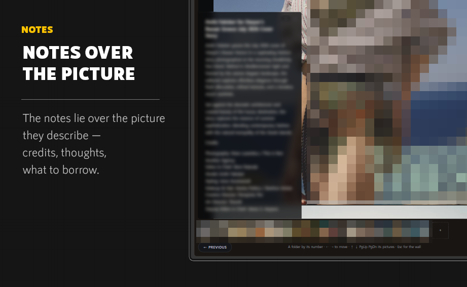
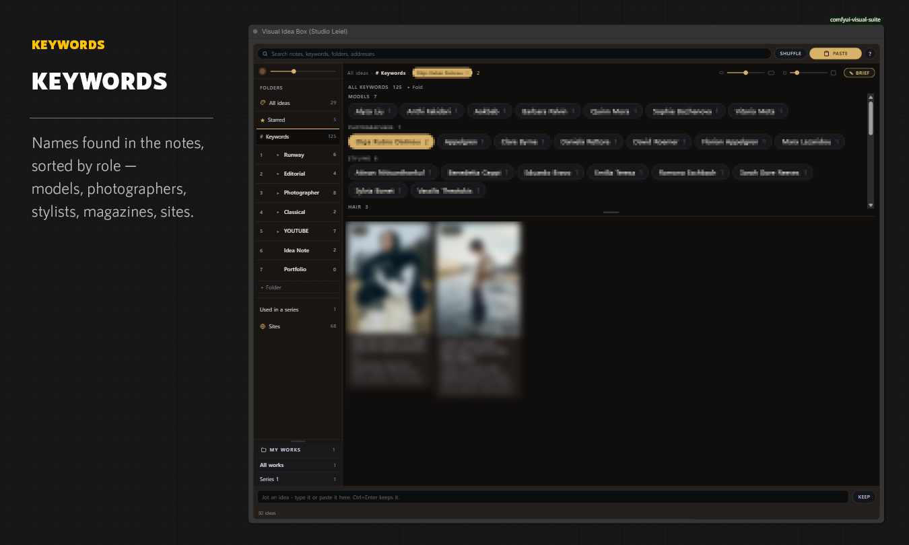
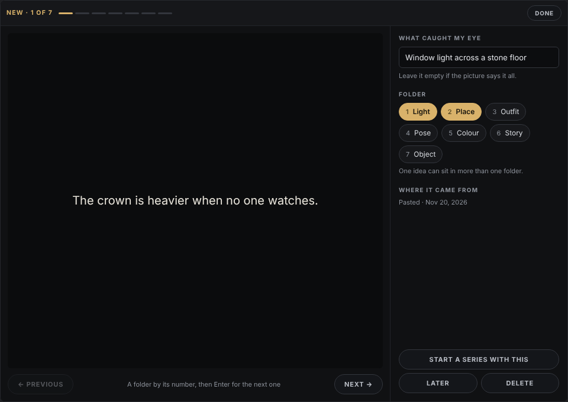
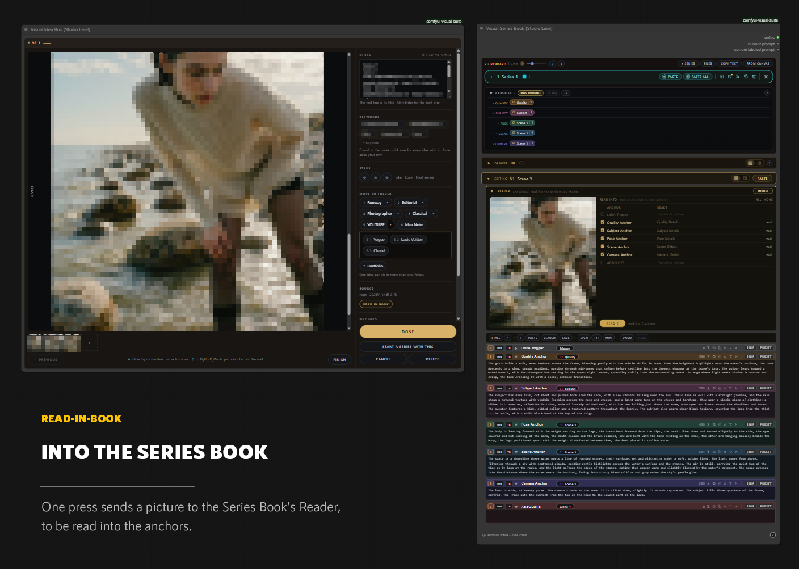

# Visual Idea Box

A box for ideas seen anywhere — kept in a second, sorted later, found again.



---

## Why a box

Ideas for a series rarely turn up in the graph. They turn up on a web page, in
a frame of a film, in a line someone says — and the thought "I should try that
some day" is gone a week later. Bookmarks and screenshot folders do not help
much: they fill up with things nobody looks at again, because nothing says why
each one was kept.

The box is built around one rule: **keeping an idea must take a second, or it
is not kept at all.** So keeping asks nothing. The notes and the folder come
later, when there is a minute — while a render runs, for instance.

---

## Keeping

Four ways in, none of which asks a question:

| What | How | What comes with it |
| --- | --- | --- |
| A picture on a web page | Drag it from the browser onto the node | The picture, the words the page wrote for it (its alt text) as the notes, and the article it links to — or its own address — as where it came from |
| A frame, a part of the screen | Win+Shift+S, then Ctrl+V on the node | The screenshot |
| A line of text | Copy it, then Ctrl+V on the node | The line |
| A web page | Copy its address, then Ctrl+V on the node — or drag the link onto it | The address, as a link |
| A film (mp4, mov, webm) | Drag the file onto the node, or save it into the inbox folder | The film |
| A sound (mp3, wav, m4a, ogg, flac) | The same | The sound, and its file name |
| A PDF — a lookbook, a scan | The same | The PDF, and its file name |
| A thought of your own | Type or paste it into the jot box, then Ctrl+Enter or **Keep** | The words |

**Paste** on the bar does the same as Ctrl+V.



Web addresses are not read by the server. A picture dragged from a page is
kept when the site lets the browser read it; one that does not is kept as its
address - save the picture and drop the file, or copy the picture itself and
press Ctrl+V. An address of a page is kept as a link.

**AVIF and HEIF.** Many magazines send their pictures as AVIF. They are kept
as pictures — not taken for films, as they once were — and, where the server's
Pillow reads them (11.3 and later), as a JPEG, so the Series Book can read
them too. One kept as a film before is made a picture again by itself.

### Sounds and PDFs

A sound has no picture: its card shows a note and its name, and **▶** on the
card plays it there and then, one sound at a time, without opening it. Opened,
it plays with its controls. A PDF shows its **first page** on the wall, with a
small PDF mark — drawn by pypdfium2 or PyMuPDF where either is installed, and
otherwise taken from the first picture inside the PDF, which is the first page
for a PDF of photographs or scans, as the Series Layout writes them; a PDF of
text alone keeps a plain page with its name. Opened, it is
read in the node with the browser's own reader, page by page — and the gold
**⤢ Full screen** at its bottom left, clear of the reader's own buttons, or
**F**, lays it over the whole window, the same reader larger. Both keep the
name of the file they came with, which is their title until the notes say
otherwise, and which search finds.

A moving GIF or WebP moves on the wall as well.

### Films

A film file is kept as it is. On the wall it is shown at a frame a little way
in — a fifth of its length, between a second and a half and eight seconds — so
a film that opens on black, fading in as the Series Layout's films do, does not
show as a dark card. Opened, **◉ Set as cover** at the top left makes the frame
shown in the player the film's picture on the wall; pause where you want it
first. The button then says which moment it is, and pressing it again moves
it. On the wall it shows its first frame and plays,
muted, while the pointer is over it; opened, it plays with its controls and its
sound. Up to about 95 MB can be dropped on the node (a sound or a PDF too) — ComfyUI takes no more in
one go — and anything larger goes in through the inbox folder, where there is
no such limit and the film is moved in rather than copied. A film still being
copied into the inbox is left until its size stops changing. Whether a film
plays is up to the browser: mp4 and webm always do; a mov from a phone, in
HEVC, may not.

An idea from a YouTube or Vimeo link shows ▶ on the wall. Open it and press
the play button on the picture: the film plays in the node, in the site's own
player. A film whose owner does not allow it to be played elsewhere says so in
the player; the address under *Where it came from* still opens it on the site.

#### Stills from a film

**◧ STILL** keeps the frame a kept film shows now as a picture under it, at the
film's own size — a light, a pose, a set. It sits beside **◉ Cover** at the top
left: pause where you want it and press it. The film is not opened again, so it
stays where it was and the next still can be taken straight after.

The stills sit in the strip under the film, numbered from one, each with the
moment it was taken (*2:14*). The strip starts with **▶ FILM**, back to the
player; the film always stays first. A still is like any other picture of the
idea: click it to see it, ⤢ for the whole window, drag along the strip to change
its place, × twice to take it out, **Read in Book** or a drag puts it into the
Series Book's Reader. On the wall a film with stills shows how many in the
corner. Cancel takes out the stills taken since the idea was opened.

A YouTube or Vimeo film plays in another site's player, which lays its own
title, buttons and offers over the picture and which a page may not read. For
a still from one, take a screenshot of the moment (Win+Shift+S) and paste it
with the idea open: it is kept with the idea's other pictures, after its own.

### Straight into a folder

Whatever is dropped **on a folder** in the list goes into that folder at once,
sorted — it does not wait with the new ones. The folder lights up under the
pointer. With a folder open on the wall, whatever is dropped on the wall,
pasted, or written in the jot box goes into that folder too; with **All ideas**
open, it waits with the new ones.

An idea already on the wall can be dragged onto a folder as well, to put it
there too.

### My works

One's own renders are kept apart from the references, in **My works** (marked by a folder icon) — a
section of its own at the foot of the folders, in silver as the references
are gold: the heading, **All works** under it, then a row for each series in
the order they came. The bar above the section drags it taller or shorter;
the node keeps the height.

Works come from two places, straight into My works, under their series — never
with the new references waiting to be sorted:

- **Series Layout** — its **Idea Box** button: pages, a PDF or a film.
- **Image Viewer** — **→ Idea Box**: the pictures selected, or the one open
  large, each with what made it in its notes — the prompt's name, the series,
  the LoRAs and strengths, sampler, scheduler, steps, CFG, the enhancer — and
  its LoRAs, sampler and scheduler as keywords.

Renders from one folder — one scene, LoRA, sampler and enhancer, as the
Series Lab files them, a band of the Image Viewer — are **one idea** with
several pictures: a render sent from the Image Viewer from a folder already
sent goes in beside the others from it, whatever the strengths. The idea's
notes are those of the first; each picture keeps its own as well — LoRAs,
strengths, file — and the notes laid over the picture follow the one in view
as the wheel runs down them. The folder is read from the **File:** line. Those kept apart before
are put together by **⧉ Group alike**, over the wall in My works, which says
how many it will take in.

**All ideas** — marked with a painter's palette, as My works is with a folder
— shows the references only. A work can also be put into a folder of
references, to sit beside them; it is marked **MY WORK** in silver there.
Starred and Keywords show both.

### Comparing

**◫ Pin**, among the zoom buttons on the picture of an idea opened — or **C**
— keeps it on the left.
Step on, from any folder or from My works, and each idea comes up on the
right beside it: a reference beside one's own renders, or one render beside
the references. Each side is labelled — **REFERENCE** in gold, **MY WORK** in
silver. Both zoom alike — a click, the wheel, a drag — and **⤢** on either
shows it over the whole window. Each side is whole: an idea of several pictures shows them one under
another, the wheel running down them, with a strip under it and its notes
over it from its own **NOTES** tab; a click on one looks at it closer, **↕**
goes back to all. **◫ Unpin** is on the pinned picture itself, so it is plain
which is pinned. The keys — `*`, `/`, `+`, `-`, `F`, the arrows when zoomed —
act on the side the pointer is over. On the
wall, the pinned idea is marked **◫ PINNED** in gold — whatever it is, a
picture, a film, a PDF or words. It stays pinned when another workflow is
opened and this one come back to: the node and the browser both keep it. **×** on the left, **◫ Unpin**, or **C** again
lets it go.



### Notes over the picture

Long notes — a museum's label, a magazine's credits — can be read with the
picture. The picture opens whole; the narrow **NOTES** tab at its left lays
the notes over its left side, see-through, so the picture keeps its size: the
first line as the title, the rest under it, set at the foot as a caption is —
the see-through ground as tall as the words, rising as there are more, and
scrolling by itself once they fill the picture's height — changing as
the notes are typed. They stay out while the ideas are looked through; **×**
— or **◧ Over the picture** over the notes — puts them away again. A picture
with no notes has no tab.



### Notes translated — TR

**TR**, on the notes laid over the picture, puts each line's translation under
the line itself, a step quieter and in gold — the English stays, the Korean
follows it. It is only for reading: the notes stay as they were written, and the
keywords and the search go on working in those words. A line already in the
reader's language is left alone, and Italian or French lines are translated
from their own language. Once on, TR stays on from idea to idea, and after the
page is reloaded, until it is pressed again.

The notes are translated into the browser's own language — Korean here, and the
reader's own language elsewhere; a browser set to English only puts the other
languages into English. It uses Chrome's built-in translator, so nothing leaves
the machine and there is no key or cost. The first time, Chrome fetches its
language model and the button counts the download. A browser without it says
so instead.

### Keywords

Under the notes, the idea's **keywords** — found in its words without any AI.
Fashion pages write their credits the same way every time, so the box reads
them:



| Written | Keyword |
| --- | --- |
| photographed by, shot by, photographer | **Photo** — David Roemer |
| styling by, styled by, stylist, fashion editor | **Styling** |
| hair by · makeup by | **Hair** · **Make-up** |
| casting by · set design by · directed by | **Casting** · **Set** · **Film** |
| starring, featuring, model — or a name at the head of a line, "… by" a photographer | **Model** — Barbara Palvin |
| … by someone **for** a magazine | **For** — M Milenio |
| any other name written with capitals, two words or more | the name — Louis Vuitton, Nicolas Ghesquière |
| the address | **Site** — vogue, YouTube |

Credits written without a colon are read too — *Photography Daniela Rettore,
Fashion Stylist Benedetta Ceppi, Hair & Makeup Agata Branchina, Model Vitoria
Mota* — and so is the way a story is titled: *Olga Rubio Dalmau for Vogue Korea
with Sophie Bozhenova* gives the photographer, the magazine and the model.

Titles written in capitals before a name are left off, so only the name is
kept: *Featuring House Ambassadors Alysa Liu* gives **Alysa Liu**, and the same
goes for Global Ambassador, Creative Director, Muse, Actress and the like. A
credit at the head of a line — *Styling by …* — is never taken for a model.

They change as the notes change. **Click** a keyword for every idea with it,
over the whole box — David Roemer's work, side by side. The keyword stands as
a gold chip over the wall; its **×** brings the wall back as it was.

**# Keywords**, under Starred, shows every keyword in the box, set out by what
it is — models, photographers, styling, magazines, names, your own, sites —
the most used first, each with how many ideas have it. Click one to see its
ideas under them; click more, and they combine as a search would:

- keywords of the **same kind** widen the wall — David Roemer **or** Txema
  Yeste: the work of either;
- keywords of **different kinds** narrow it — (David Roemer or Txema Yeste)
  **+** Vogue Italia: their work for that magazine.

The chips over the wall say which — **or** between those of a kind, **+**
between kinds. A chosen one is gold; click it again, or its ×, to let it go;
**Clear** lets them all go.

Once a keyword is chosen the ideas come first: the keywords shrink to a short
band over them that scrolls on its own, and **▴ Fold** puts them away to one
line (**▾ Show** brings them back). The short bar at the band's foot drags it
taller or shorter — more room for the keywords, or for the ideas; the node
keeps the height, and a double click gives back the one it had. Names — the most of them, and the least
sure — show those found in two ideas or more; **+ more** shows the rest. A
headline, where every word has a capital, gives no names: a name can't be
told from the rest there. **×** puts a found one
aside; type in **+ keyword** and Enter to add your own — several at once with
commas; your own have a gold edge. Search finds ideas by their keywords too.
What a picture shows — denim, a blue light, the sea — is not in its words; for
that, add it by hand.

### More pictures in one idea

A page often has several pictures that belong together — a look from three
sides, a whole editorial. They are kept as **one idea**, not one each: open
the idea and a strip under its picture shows every picture it holds, its own
first.

- **+ More pictures** at the end of the strip chooses files. With the idea
  open, pictures **dropped** on the node or **pasted** with Ctrl+V go into it
  as well — from the browser, a folder or a screenshot.
- The pictures are shown **one under another, joined**, as down a page: the
  wheel runs through them all, the strip marks the one in view and the
  corner counts it — 3 / 5. A click on a picture in the strip runs to it.
- A click on a picture looks at it **closer, alone** — the wheel zooms then,
  as with any picture; **↕ 5** in its corner goes back to all of them, at the
  one you were looking at. Full screen, **Read in Book** and dragging onto a
  Series Book anchor all take the picture in view.
- **◉** on a picture makes it the idea's own — the one on the wall.
- **Drag** a picture along the strip to change its place among the others — a
  gold mark shows where it will land. Put first, it becomes the one on the wall.
  **×** takes a picture out, pressed twice; it goes to the trash.
- On the wall, an idea holding more than one picture has their number in its
  corner. **Cancel** puts the pictures back as they were when the idea was
  opened, those taken out included.
- A brief attaches them all: 01, then 01-2, 01-3 beside it.

Only a picture idea holds more pictures; up to sixty.

### From the Series Layout

**Idea Box** on the Series Layout's bar, beside Export, sends what is made
there. A small window asks how: in Print and Web as **JPEG** or **PNG** — the
page shown now or every page, each an idea of its own — or as one **PDF** to
page through here; in Motion the film is exported first and then sent. Pages
are drawn as an export draws them, 2400 pixels on the long side, with the
series and the page in their notes. They wait with the new ones, marked *from
the Series Layout* — the finished work kept with the ideas it came from, at
hand for the next series or for choosing a portfolio.

### The jot box

The box at the bottom of the node is for whatever comes to mind — an idea for a
scene, a line for a story, a word to look up. It opens up while it holds words;
Enter is a new line, **Ctrl+Enter** keeps it. It waits with the new ones like
everything else.

Words kept — written here or pasted — open as a page: the whole width, at
reading size, from the top, the first line a little larger as the idea's name.
Click anywhere on the page to change the words — add to them, cut, break
lines; no styles. They are kept a moment after the typing stops and when the
page is left; **Esc** or **Ctrl+Enter** stops editing, and **Cancel** puts
the words back as they were when the idea was opened.

### The inbox folder

Anything saved into the inbox folder comes into the box the next time the node
looks — every few seconds while it is open. Its path is at the bottom right of
the node; click it to copy it.

Point a screenshot tool at it and screenshots land in the box without ComfyUI
being open at all. Windows' Snipping Tool, for instance, has a setting for the
folder screenshots are saved to. Pictures (png, jpg, webp, gif, bmp) and text
files (txt, md) are taken in; a taken file is moved to `inbox/_taken/`, one
that cannot be read to `inbox/_unread/`. Nothing in the inbox is ever deleted.

**Sub-folders are folders.** A file in a sub-folder of the inbox goes straight
into the folder of that name, sorted — `inbox/VOGUE/` into VOGUE,
`inbox/VOGUE/Runway/` into Runway inside VOGUE — and a folder the box does not
have yet is made, inside the one it belongs in. So a collection already kept in
folders comes in as it is: copy its folders into the inbox. A few dozen come
in at each look, so a few hundred take a minute or two; a file still being
copied waits for the next look. The sub-folders stay, empty, ready for the
next ones.

---

## Sorting



Whatever was kept waits in the **New** strip at the top. **Sort** goes through
them one at a time, large:

- **Notes** — what caught the eye, the text from the same page as the
  picture pasted in, or anything about it. There is no separate title: the
  **first line of the notes is the idea's title**, and a series started from
  the idea is named after it. Enter is a new line here; **Ctrl+Enter** goes to
  the next one.
- **Move to folder** — press its number (1-9, the top folders; a folder inside
  another by its chip). The top folders sit side by side, as many to a line as
  fit. A top folder holding folders has a small **▸** beside its chip: press
  it and the folders inside show right under the line that chip is on, on a
  dark ground with a gold bar, as a cut is shown in the Series Layout — one
  open at a time, ▾ closes it. When an idea opens, the group it already sits
  in opens with it; a top folder whose chip and opener are drawn in gold holds
  the idea in a folder inside it, open or not. An idea can sit in more than one
  folder. An idea given a folder is sorted then and there: it leaves the New
  strip whether you go on or press **Done**.
- **Enter** — the next one. It leaves the New strip, with a folder or without.
- **Done** — the large button above Start a series: back to the wall.
- **Cancel** — beside Delete: puts back whatever was changed on this idea
  since it was opened — folders, stars, notes, cover — and goes back to the
  wall. For trying things out without keeping them.

**Later** leaves an idea with the new ones and goes on. **← →** move without
sorting, **Esc** goes back to the wall. While typing in the notes, numbers are
typed as numbers; **Esc** leaves the notes so the number keys pick folders
again.

On the wall, a card shows the title and the next lines of its notes.

Under **Source** — where an idea came from, and how it came in — **File info**
says what the file is, in a small table: its kind and format (PNG picture,
MP4 film, PDF document…), its size in pixels with megapixels and ratio, a
film's or a sound's length, a PDF's pages, its weight on the disk, the name it
came with, when it came in and when it was last opened. A link is said as what
it is — *YouTube film · link*, *Web page · link* — and the picture kept with it
as its **cover**, its size and weight under Cover and Cover file; a page
captured is *Web page · captured*. The sections of the
panel scroll; **Done** and the buttons under it stay at its foot.

### Looking closer

An open picture can be looked into without making the node larger. The
**wheel** zooms in and out about the pointer; once it is larger than its frame,
a **drag** moves it; a **click** zooms in on the spot clicked and
**Ctrl+click** zooms back out, as in the Image Viewer. The pointer stays a
magnifier, and turns to a hand only while the picture is being dragged. The
small bar on the picture does the same with **−**, **+** and the percentage
(back to fit), and **⤢** lays the picture over the whole window — the same
wheel, drag, click and Ctrl+click there, **Esc**, **F** again or **Close** to come
back. It takes the whole screen — the browser's tabs and bars go too — on
black, and once the mouse rests the bar and the arrows fade, leaving nothing
but the picture; moving the mouse brings them back. An idea of several
pictures shows them all there: **‹ ›** at the sides,
or **← →** while the picture is not zoomed, step through them, and the bar
counts them — *3 / 10*. Keys, as in the Image
Viewer: **\*** goes to 100% — one pixel of the file to one pixel of the screen —
and **/** back to fit; **+** and **−** zoom, **0** fits too, **F** opens the whole
window. Zoomed in, the **arrow keys** move round the picture (**Shift** for a
longer step) — at fit size they step to the next idea as before. An idea of
several pictures goes through them by the keys too: **↓** the next one, **↑**
the one before, **Page Down** (or **End**) the last, **Page Up** (or **Home**)
the first — one under another the page runs to it, alone it is shown. **Delete**
takes the picture shown out of the idea — pressed once it asks (*Delete?* on
its place in the strip), pressed again it goes, to the trash folder. An idea of
one picture is deleted whole the same way, Delete twice. The
percentage on the bar is the file's own size, so 100% is the picture as it was
made. Zoomed in, the
whole picture is fetched rather than the copy made for the screen. At fit size
the picture can still be dragged onto a Series Book anchor.

Click any idea on the wall to open it the same way and change its line or its
folders.

---

## Stars

A favourite here says how much an idea is wanted, not only that it is liked:

| | |
| --- | --- |
| ★ **Like** | worth keeping in sight |
| ★★ **Love** | to be tried |
| ★★★ **Next series** | for the series to come |

Stars are given on an open idea — the stars under the notes, or **S**, which
steps 0 → ★ → ★★ → ★★★ → 0, so sorting goes number key for the folder, S for the
stars, Enter for the next. A starred card wears its stars in its corner.

**★ Starred**, under All, shows every starred idea. Above them: **★**, **★★**,
**★★★** — at least that many stars — and the order: **Most stars** first, or
**Longest unseen** first. Every idea remembers when it was last opened, and in
that order an idea starred and not looked at for weeks comes back to the top,
with how long — *6 wk unseen* — on its card. A loved idea does not sink out of
sight under the newer ones.

## Where you are

Over the wall, a line says where it is: **All ideas**, **★ Starred**, or a folder's
path — *All › VOGUE › Runway* — with how many are shown in gold. Each folder on
the path is a step back up. A search adds its words to the line.

## Tooltips

Holding the pointer on anything shows a card, as in the Series Book and the
Series Layout: what it is first, then each action — Click, Ctrl+click, Drag… —
on a row of its own under a gold label. The card goes away on a click, the
wheel or a key. A card shows only where the pointer rests: every move starts
the wait again, and moving away from where it showed puts it away, so it
never follows the pointer. Half a second of rest brings it.

An idea on the wall lifts a little under the pointer, slowly and softly. Rested on, its card
shows the idea itself rather than what the hand does: its title, its notes
(the first few hundred letters), who made it — photographer, stylist,
magazine — and its folders, beside the idea so the idea stays seen; what a
click and a drag do is written small at the foot.

## Finding again

- **Folders** on the left, in the order you put them in. **+ Folder** adds
  one at the end; drag a folder up or down to move it — its number key moves
  with it. Double click a folder to rename it. The **×** that shows on a
  folder under the pointer takes it away: press it, then **Delete?** to be
  sure — left alone for four seconds, Delete? lets go. Its ideas stay in the
  box.
- **Folders hold folders.** The **+** on a folder under the pointer makes a
  folder inside it — VOGUE, and inside it Runway, Street, Backstage. **▾**
  folds a folder away and **▸** opens it again; the node remembers which are
  folded. Clicking a folder shows its own ideas **and those of every folder
  inside it**. A folder dragged to the top or bottom edge of a folder beside
  it moves there; dragged onto the **middle** of any folder it goes inside
  that one — a gold frame shows which; dragged onto **All ideas** it comes back to
  the top. It always takes its own folders along, and every idea in them
  keeps its place; renaming or taking one away does the same. A folder can't
  go inside itself or inside a folder of its own, and not where one of the
  same name is already.
- **Groups.** As in the Series Layout, no colour draws the eye away from the
  pictures. All, Starred and each top folder with the folders inside it are
  blocks with a hairline between them. The block holding the folder open is
  a darker ground with a gold bar along its top in place of the hairline — a
  folder inside is opened, and its whole group darkens with it, as a cut does
  in the Layout. In the block the folder open has its number in gold and its
  name brighter, on the same dark ground as the rest; the top folder of the
  block has its name in gold.
- **The folders' width.** Drag the right edge of the folders to make the
  column wider for long names, or narrower for more wall. It is kept with the
  node and in the browser, so it holds when the workflow is opened again
  unsaved or the node is made anew. Double click the edge for the width it
  starts at.
- **Numbers** are given as the Series Book gives its capsules theirs: 1, 2, 3
  at the top, 1-1, 1-2 inside the first, 1-1-1 inside that. They sit in their
  own column, and only the names are set in. The keys 1-9 pick the top
  folders when sorting; a folder inside another is picked by its chip.
- **The wall** is a step darker than the folders beside it, so the pictures
  stand out; both follow the node's colour and brightness.
- **Size.** The slider over the wall, beside **✎ Brief**, makes the ideas
  smaller — more of them at a glance — or larger, to look at them; the node
  keeps it, and the pictures are fetched sharper when they are drawn larger.
  Double click it for the size they had.
- **Search** looks through the lines, the notes, the folders and the addresses.
- **Shuffle** shows the folder in a random order, to meet the forgotten ones
  again. Press it again for the order they came in.
- **Used in a series** lists every idea a series was started from.

---

## Sites

**Sites**, at the foot of the folders — under *+ Folder* and *Used in a series*, apart from the folders of ideas — lays bookmarks of the places ideas
come from on the wall — as many to a line as fit, so however many
there are, and however narrow the node, every one is in sight. Click one and it
opens in a new tab of the browser, ready to gather from. Each shows the site's
own small icon (its first letter when there is none); the count beside
**Sites** says how many there are.

- **+ Site** at the end adds one: a name, and the address.
- **Right click** a site to change its name or address, or to **Remove** it
  (pressed twice).
- **Drag** a site onto another to move it before or after it; otherwise they
  stay in the order they were added.
- The slider at the top right, with round marks, makes the sites larger or
  smaller; double click it for the size they had. The **Keywords** page has the
  same slider, and the two share one size — kept with the node, apart from the
  cards' own slider.

The first time, the page starts with two — **Vogue Runway** and **Fashion
Editorials** — to add to and change as you like. The sites are kept in
ComfyUI's user folder, apart from any workflow, so every Idea Box shares them.

## Reading a picture in the Series Book

Drag a picture from the box — a card on the wall, or the large picture when an
idea is open — onto the picture square of the **Reader** in the Series Book, the
panel between its *Editing* line and the toolbar. The whole picture goes, not
the small copy on screen: tick the anchors it should fill, press **Read**, and
the words become capsules. Dropped back on the box, a picture is not kept twice.



Or with one press: **Read in Book**, under *Where it came from*, puts the picture
into the Reader of the prompt open in the Series Book — the panel opened, the
picture in it — and leaves the rest to you: tick the anchors and press
**Read**. The Reader's square lights up for a moment. While an idea is open,
what the box has to say is written in the bar above it — a Series Book from
before this update asks for the page to be reloaded (Ctrl+F5) first.

While a picture is dragged out of the box, the Reader's square says **Drop here
to read it**. With the Reader folded away, the box says to open it first. An
open idea says so too, on its picture under the pointer.

## A brief for the AI

**✎ Brief**, at the end of the line over the wall, puts the ideas shown as a
request to whoever writes the series — an AI in a chat, most often. Its window
has the ideas on the left, each with a tick (the first 24 ticked; **All** and
**None** above them), and on the right:

| | |
| --- | --- |
| **Title** | a working title — the folder's name to start with |
| **Story** | what the series is about, a line or a page, in any language |
| **Scenes** | up to you, 5-6, 10-13 or 15-18 |
| **Frames** | mixed, portrait or landscape |
| **Model**, **Mood** | who it is about; light, colour, era, feeling |

**The brief** under them is written as it is set: the request for a Series Book
pack for Paste All and a scene-by-scene summary, then the references numbered
01, 02… — each with its title, kind, stars, the rest of its notes, its folders
and its address. **Copy brief** puts it on the clipboard. **Save pictures**
writes the chosen pictures — a PDF by its first page — into
`output/Idea Box/Briefs/<title>/` as `01 <title>.jpg`, `02 …`, numbered as in the
brief, and says where the folder is, so they can be dragged into the chat
with it. What is typed is kept with the node for the next brief.

## Starting a series

**Start a series with this** opens a new series in the Series Book on the
canvas. The idea's title becomes the series name, and the picture the series
picture. The notes, the folders and the address go into the series'
**Production notes** — not the series note, which the Series Layout prints on
the opening page and which is left for the series' own words. The series opens
on an empty first scene, ready for its pack.

The idea is marked *Used* and stays in the box.

---

## The manual

**?** on the bar opens a page on the node itself: keeping, sorting, finding
and using, in four short columns. Esc or **Close** goes back.

## Colour

The dot and the slider above the folders set the node's colour and
brightness, as on the Series Book: click the dot for the next colour,
Shift+click for the one before. They are kept with the node in the workflow.

## Where it is kept

```
user/visual_idea_box/
  ideas.json   the folders (one inside another as "VOGUE/Runway") and every idea
  sites.json   the bookmarks on the Sites page
  files/       the pictures
  inbox/       the inbox folder
  trash/       pictures of deleted ideas
```

Every Idea Box node — in any workflow — shows the same box. Deleting an idea
takes it out of the box and moves its picture to `trash/`, in case it was a
mistake. Updating or reinstalling the pack never touches this folder.

The node is never run: it has no inputs or outputs and does nothing when the
graph is queued.
