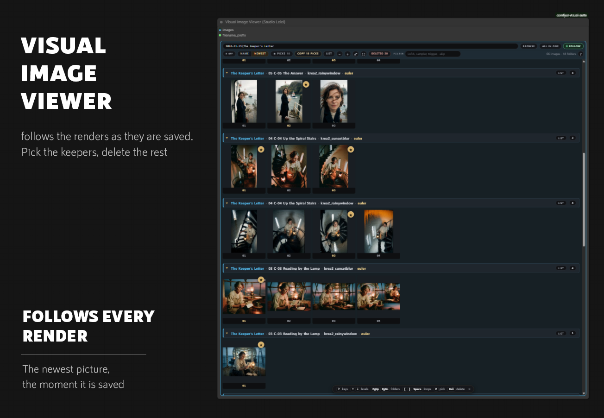
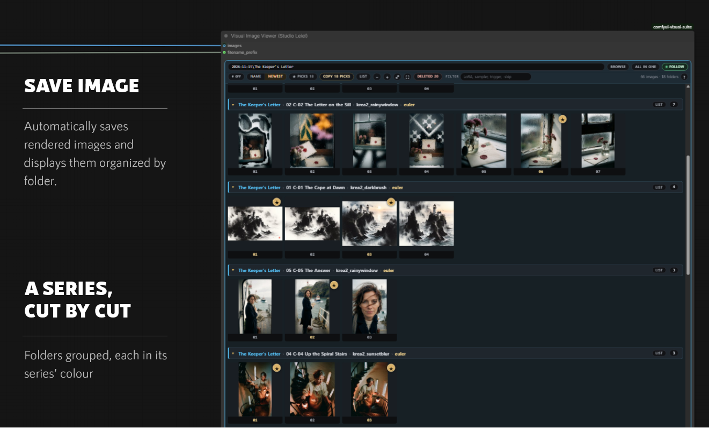
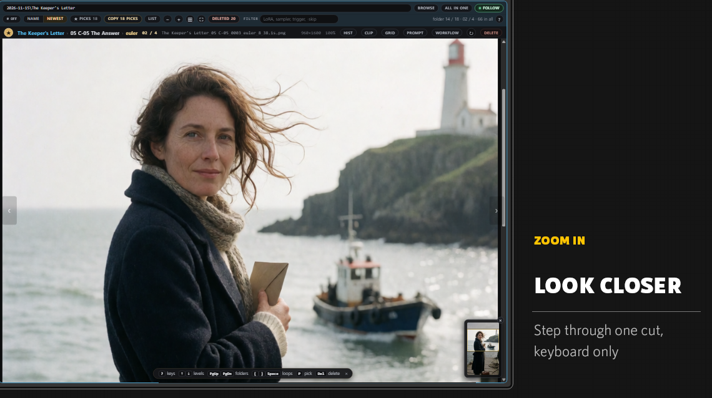
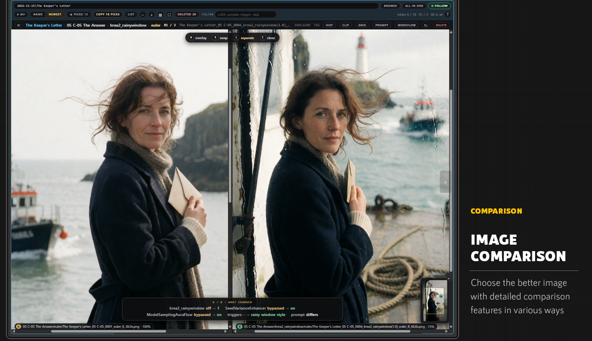
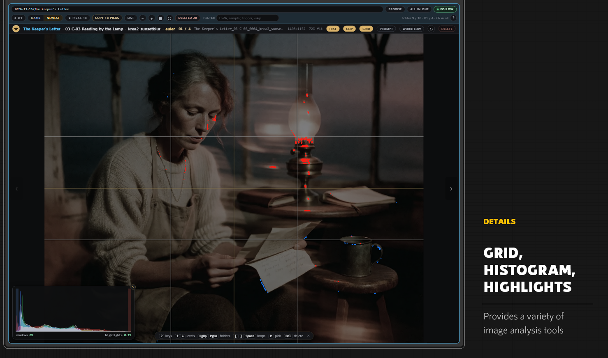
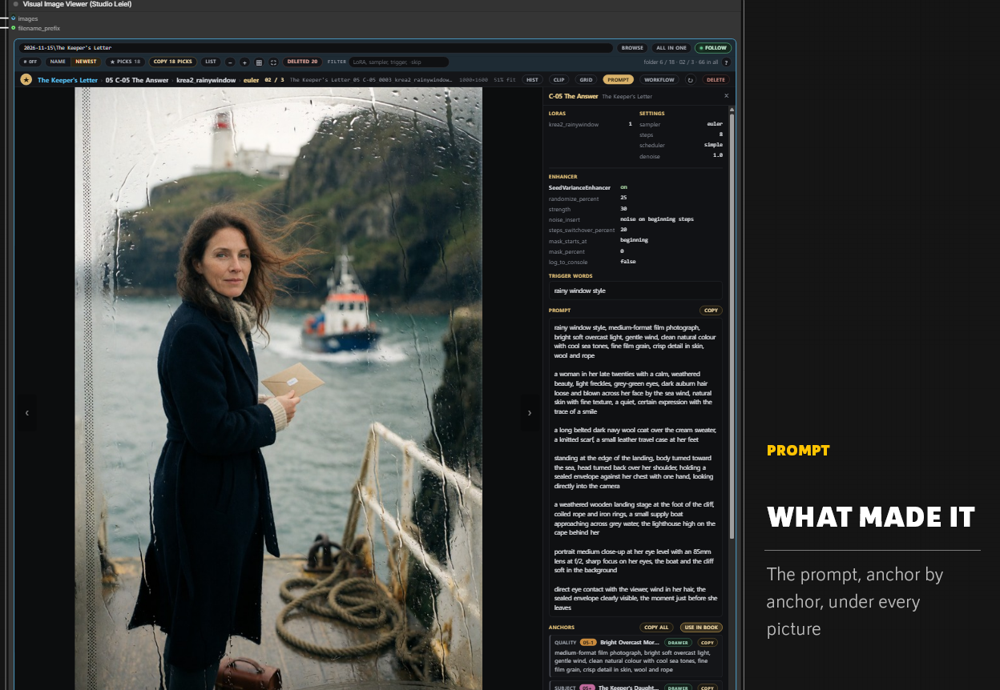
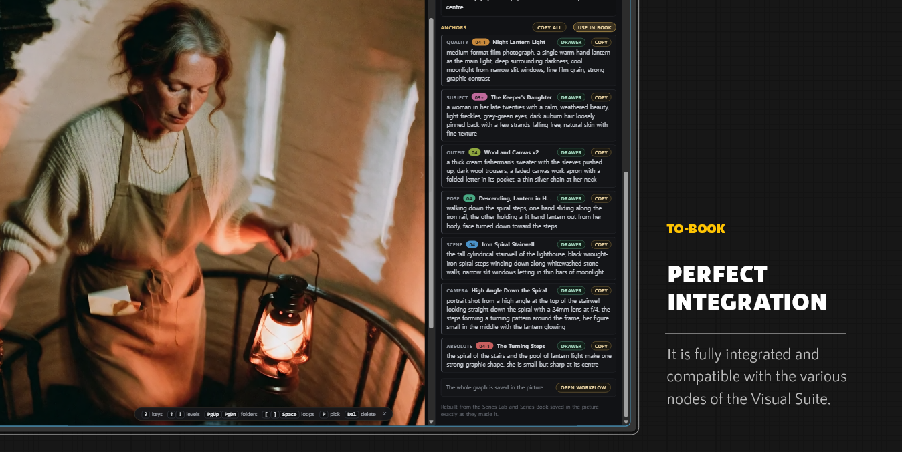
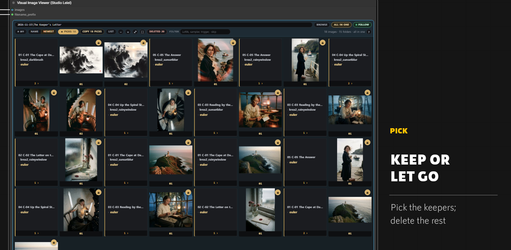

# Visual Image Viewer

A folder of pictures inside the graph — thumbnails, a large view, 100%.



---

## Why this exists

A render is judged by looking at it, and looking at a folder of renders
usually means leaving ComfyUI. The file browser shows the pictures small and
in the wrong order; the image viewer opens one at a time; and many of them
give up on the long names a render gets — a name that carries the date, the
series, the LoRAs and the settings can pass the length an older program will
open at all.

This node is a viewer that lives on the canvas. It reads the folder through
ComfyUI itself, and it takes nothing and returns nothing: it is a window, not
a step in the workflow. Put it beside the save
node and leave it there.

---

## The folder



The box at the top is the folder on show. A viewer opens where the last one
was left - the folder last looked at in this browser, in any viewer and any
workflow - so the work picks up where it stopped.

- **Empty** is ComfyUI's output folder.
- **A relative path** — `2026-10-05/Controluce` — is read from the output
  folder, the way a save node's subfolder is.
- **A full path** is taken as it is, if the viewer may open it (see below).

Press **Browse** to pick a folder from a tree instead: click a folder to see
how many pictures it holds and the first of them, double click to go in,
**Use this folder** to open it.

**Folders inside folders.** A folder with folders in it - a day of renders
sorted by scene, then by LoRA, then by sampler - is shown in groups, one per
folder, each under a band with its whole path from here, every folder in it
readable and the last one picked out. Click a band to fold the group away.
The series in the path - its name, and the stripe down the band's left edge -
wears the series' own colour from the [Series Book](series-book.md) on the
canvas. The viewer looks at the book four times a second, so a series colour
changed in the book or in the Series Lab shows here within a quarter of a
second. A series the book has not shown yet gets a colour of its own, picked
from its name.
The whole node wears a colour too, as the Series Layout and the Series Report
do: the colour of the folder opened when it is a series the book shows, or
else of the series open in the book. With no book on the canvas the node
keeps its plain dark look.
Open a picture and the large view steps through its own folder only: the
arrows stop at that folder's ends, Space goes round it. `Page Down` and `Page Up` (or
`Shift+→` and `Shift+←`) go on to the next or previous folder, in the grid
and in the large view alike, and the folder's path shows for a moment as
you arrive.

**All in one** runs every folder's pictures on in one grid, without the
break of a new row per folder: where a folder starts, a tile the size of a
thumbnail names it, path and all, so the grid stays full and the folders stay
readable. Click a tile to open that folder's first picture. The large view
then steps through every picture, folder after folder. Up to 5000 pictures
are listed.

**Several folders at once.** In **Browse**, Ctrl-click (or Shift-click for
a run) two or more folders - two days of renders, say - and the button at the
bottom reads **Open 2 folders**. Press it and the viewer shows all of them
together, each with its subfolders. Each picked folder stays its own group,
its subfolders under it - `2026-11-10/S1E4 The Burning Rose Garden`,
`2026-10-26/Ne Bougez Plus` - and every order on the bar works as it does in
one folder. A folder whose parent is picked as well is shown once, under the
parent. The path box shows the folders joined by `|`; a path typed that way
opens the same view. FOLLOW stays on it when a render lands in any of them.

The folder a picture came from shows after its name. Picks, delete and undo,
the bin, the prompt and copying all work as in one folder.

**Merging folders.** In **Browse**, Ctrl-click (or Shift-click for a run)
two or more folders and press **Merge**. Choose the folder to keep - the
newest is chosen at first - and press Merge again. Everything inside the
others moves into it, each file at the same place below it, so the scene
folders of four days come together as one. A name already taken there gets
` (1)`, ` (2)` on the end, the way Windows does it; nothing is ever written
over. Every folder left empty afterwards is removed - the merged folders, and
the day folders they sat in when nothing else is left in them (a lone
Thumbs.db or desktop.ini does not count). The top folders, output and input,
are never removed. Picks move with their pictures. A merge is not undone with
Ctrl+Z, so check the folder to keep before pressing.

**Thumbnails** are made the first time a folder is opened - the ones on
screen first, the rest in the background in the order of the grid, so they
are ready by the time you scroll to them. Several are made at once, as many
as the machine's cores allow with two left for ComfyUI. A render saved by
[Visual Save Image](save-image.md) - or by the viewer itself - has its
thumbnails made the moment it is written, from the picture still in memory,
so a folder of new renders opens at once. They are kept in
`ComfyUI/user/visual_image_viewer/thumbs`, so a folder opened once opens at
once from then on, after a restart too. The oldest are let go when there are
more than 40,000; the folder can also be deleted at any time and is simply
made again.

**List** shows a folder as rows instead of thumbnails, the way a file window
lists it: a small thumbnail, then the name, the date, the size in pixels and
the size on disk, under a row of column names. With folders inside, each
folder's band has its own **List** / **Grid**, so one folder can be read as a
list while the next stays a grid; **List** in the toolbar switches them all,
and shows `List 1/3` when only some are. Each folder remembers which it was,
by its path. Picks, selection, folding and the arrow keys work on rows as on
thumbnails, and `+` / `−` size the row thumbnails too.

The column names sort the pictures inside that folder: **Name**, **Date**,
**Pixels** or **Size**, a second click the other way, with an arrow on the
column in use. Only that folder changes - the order of the folders is still
**Name** / **Newest** on the bar - and it keeps its order when switched back
to **Grid**.

**Name** and **Newest** set the order. They are two switches, and both can
be on; at least one always is. **Newest** clicked again turns to **Oldest**,
and once more - while **Name** is on - turns date off.

- **Name** alone: folders and pictures in name order, numbers read as
  numbers.
- **Newest** (or **Oldest**) alone: the folder with the newest picture first.
  A scene rendered again later jumps back to the top.
- **Both**: the first folder level - one folder per scene, such as
  `17 C-16 The Night Procession` - stays in name order, the highest number
  first with **Newest** (lowest first with **Oldest**), so the run of scenes
  keeps its sequence. The folders inside one scene - Enhancer on or off,
  another LoRA or sampler - and the pictures in them go by date, the newest
  first. A folder picked with **Browse** brings
the picker's order with it: **Date ↓** opens it newest first, **Date ↑**
oldest first, **Name** in name order. In the picker, **Name** and **Date**
sort what is inside the selected folder only - opening it if it is closed -
and with nothing selected, the whole list. Its **Recent** list holds the last eight folders opened -
picked there, or opened by a Series Book - and is kept in
`user/visual_image_viewer/recent.json`, so it stays after a restart, in
another browser, or with ComfyUI on another address. Newest first is the one for watching
renders come in; name order is the one for a folder whose names carry a
sequence.

### Follow

With **Follow** on, every picture a save node writes is opened as soon as it
is saved — in whatever folder it went to — and marked `NEW` until the next one
arrives. Visual Save Image and ComfyUI's own Save Image are both followed;
previews are not. The viewer then works as a monitor for the render: leave it
in the large view and each new picture replaces the last.

**A series opens whole.** A render of a series the
[Series Book](series-book.md) on the canvas holds is usually saved deep -
`2026-11-15/The Keeper's Letter/05 C-05 The Answer/krea2_sunsetblur/euler`.
Follow then opens the series folder, `2026-11-15/The Keeper's Letter`, not
the last folder of the path: every scene, LoRA and sampler under it is its own
group, the new picture marked in its group, so the whole series stays in sight
while it is being made. The series is found by its name, spelled loosely - case
and punctuation do not matter. When the view already holds the picture - the
series folder, the whole day, several folders at once - it stays where it is.
Without a Series Book, or for a picture of no series of its, Follow opens the
folder the picture went to.

With Follow off, a finished render still makes the viewer look at its folder
again, so a picture saved into the folder on show appears without a click.

### Following a Series Book

When a series is brought back from a [Visual Series Book](series-book.md)'s
**Files**, or a book file is opened there, the viewer goes to that series'
pictures. Where they were saved is whatever the filename was built to say, so
the viewer looks through output - five folders deep - for a folder named after
the series, spelled loosely: case and punctuation are ignored, so
`L_Impératrice Absolue II` is found for `L'Impératrice Absolue II`, while
`... I` and `... II` stay apart. When several folders carry the name - one per
day of rendering, say - the one rendered into last is opened, and the bar
says how many others there are. A book opens on the series that was open in
it. Nothing found leaves the viewer where it was. Input is not searched.

To see a series' renders from several days at once, open those days
together from **Browse** (Ctrl-click each), or build the filename with the
series folder first and the date inside it.

### Saving from the viewer

The viewer can do the saving itself. Wire the images into its `images`
socket and the Filename Manager's prefix into `filename_prefix`, and each
render is written exactly as Visual Save Image would write it - the same
code, the name as given, the workflow kept in the PNG - and then shown. A
workflow needs no separate save node. With nothing wired in, the viewer
saves nothing and only looks.

`sequence_number` puts the five digit counter on the end of each name -
`name_00001_.png`, the way ComfyUI's own Save Image does - and is on to begin
with. Off, the name is written exactly as the prefix gives it, and a name
already taken gets `_2`, `_3` instead of overwriting.

---

## Looking



Click a thumbnail to open it large. Click the picture or press `Esc` to go
back to the grid; `Enter` goes the other way, into full screen, and `Enter`
again comes back out.

The keys work while the pointer is over the viewer, but only once the browser
window has the keyboard. With the viewer the only node selected, the ones
that step through pictures - the arrows, `PgUp` / `PgDn` and `P` - work with
the pointer anywhere; the keys the graph also uses (`Space`, `Ctrl+C`,
`Ctrl+Z`, `Delete`) still need the pointer on the viewer. Coming back from another app - on another monitor,
say - the first click is the one that hands it back, and on the picture that
click does nothing else: the large view stays open and full screen does not
zoom. Every click after it works as usual.

| Key | |
| --- | --- |
| `←` `→` | previous / next — stops at either end |
| `↑` | up a level: full screen → large view → grid |
| `↓` | down a level: large view → full screen; in the grid, a row down |
| `Space` / `]` | next, and round from the last to the first |
| `Shift+Space` / `[` / `Backspace` | previous, and round from the first to the last - `Backspace` in the large view and full screen only |
| `Home` / `End` | first / last |
| `Page Down` / `Page Up` | next / previous folder (also `Shift+→` / `Shift+←`) |
| `*` | 100% — one pixel of the file to one pixel of the screen |
| `/` | fit the picture to the panel |
| `+` / `−` | zoom in the large view, thumbnail size in the grid |
| `F` | full screen |
| `R` / `Shift+R` | turn the view a quarter round, either way - the file is not changed |
| `I` | the prompt the picture was rendered with |
| `Ctrl+C` | copy the picture |
| `Alt+C` | copy the picture only - for a web page or a chat |
| `O` | open the workflow the picture was made with |
| `P` | pick this picture - again to unpick it |
| `Shift+P` | only the picks, or everything again |
| `Delete` | delete it - into a `_deleted` folder beside it |
| `Ctrl+Z` | bring back what was deleted, undo a pick |
| **Deleted** | the bin of this folder - restore from it or empty it |
| `C` | pin this picture to compare it with the next ones; again to stop |
| `W` / `X` / `L` | compare side by side or with a wipe / swap the two / link or separate their zoom |
| `?` | the list of keys, on the viewer itself |
| wheel | next / previous in the large view; `Ctrl` + wheel zooms |
| click / `Ctrl`+click | in full screen: zoom in on the spot clicked / zoom out |

Holding `Space` goes round the folder without stopping — the way to compare
a set of renders without the break of jumping back to the start.

When a zoomed picture is taller than the panel, `↑` and `↓` scroll it
instead, and go back to changing level once it fits again; when it is wider,
`←` and `→` scroll it across, and go back to changing picture once it fits.

At any zoom above fit, drag the picture to look around it; a click without a
drag goes back to fit. In full screen a click zooms in instead, on the spot
clicked, and `Ctrl`+click zooms out, back as far as fit; `↑` or `Esc` leaves
full screen. 100% is worked out from the file's own size, so it is
right whatever the graph's zoom and the display's scaling.

### Compare



Two renders of the same scene are mostly compared up close - a hand, an
eye, the grain - so here the two pictures zoom and move together.

In the large view press `C`: the picture on screen is pinned as **A**. Step
to any other picture - arrows, Space, another folder - and the view splits,
A on the left, the picture you are on as **B** on the right. Zoom with `*`,
`+`, `−` or Ctrl+wheel and drag either side: both follow, to the same place
in both pictures.

The keys that step and the ones that mark go to the side under the pointer.
Over A, the arrows, Space, `[` `]`, `Home` `End` and the wheel step A through
its folder while B stays put, `P` picks A and `Delete` deletes it - the next
picture takes its place and the comparison goes on. Over B, or anywhere
else, they work on B as always. Laid over with `W`, the side is the side of
the wipe line the pointer is on.

`L` unlinks them: each picture then zooms and moves on its own - the one
under the pointer takes the wheel, `*`, `/`, `+`, `−` and the arrow keys, and
a click fits it again. `L` once more links them back. Unlinked is the way to
set a close-up of one against the whole frame of the other.

Above the two names at the bottom, a box headed **A → B · what changed**
says what differs between the two renders: each LoRA turned on, off or to
another strength, the sampler, steps and the rest, any other node switched,
set differently or bypassed - an enhancer on in one and off in the other -
the trigger words only one of them had, and a different prompt -
`style_v2 0.9 → 0.7  ·  sampler dpmpp_sde → euler`. When nothing but the
seed differs, it says so: the difference you see is chance.

`W` lays A over B instead, with a line down the middle that can be dragged
across - the way to see what changed between two renders of the same seed.
Laid over, the two always move together. `X` swaps A and B; `C` again, or
`Esc`, ends the comparison.

While comparing, these keys sit in a small bar at the top of the picture -
click them there too. The bar fades after a moment and comes back as soon as
the pointer moves. A stays pinned
while you go back to the grid, so the next picture you open is set against
it straight away.

The `?` button at the end of the toolbar opens the same list on the
viewer, in full screen too; until it has been opened once, a line of the
main keys sits at the foot of the grid.

The keys only work while the pointer is over the viewer, or in full screen.
ComfyUI uses the same keys for itself, and they keep working everywhere else.

---

## Reading the exposure



Three tools in the large view look at the picture as a photographer would.
None of them changes the file.

- **Hist** (`H`) - the histogram, its brightness with red, green and blue
  over it, and below it how much of the picture is lost at either end:
  `shadows` for pixels with every channel at 6 or less, `highlights` for
  pixels with any channel at 248 or more. Under half a percent reads green.
  It sits at the bottom left; drag its top right corner to make it larger.
  Hovering it shows the three keys.
- **Clip** (`E`) - those same pixels painted over the picture: blown
  highlights red, crushed shadows blue, each spread a little and the rest of
  the picture dimmed to grey, so even a few lost pixels show at fit. Zoomed in past the screen-sized picture, the painted one is kept
  rather than the full-size original.
- **Grid** (`G`) - composition guides over the picture as it sits on screen,
  fitted or zoomed: thirds, then the centre, then both, then off.

They stay on from picture to picture, and with the workflow.

**Navigator** (`N`) - zoomed in past the view, the whole picture appears
small at the bottom right with the part on screen boxed. Drag the box to
move around the picture, or click anywhere on it to jump there. The `x`
hides it; `N` brings it back, and the choice stays with the workflow.

## The prompt



Two renders of the same scene with the same LoRAs, and one looks like a
photograph. Was it the quality anchor? The camera? Press `I` in the large
view - or **Prompt** above the picture - and a panel beside it shows what
the picture was made with. It follows you from picture to picture, so two
renders can be read one after the other.

ComfyUI writes the graph it ran into every PNG it saves, and the prompt is
read back from that. A render made by the [Series Lab](series-lab.md) from a
[Series Book](series-book.md) is rebuilt exactly as the Lab built it - the
book as it was at that moment, the prompt the recipe picked, the capsules a
sweep put in, the trigger words - and shown anchor by anchor too, each with
its capsule's name, the swept ones marked. Other graphs give the text that
went into the text encoder, followed back through a Prompt Composer where it
came from one.

With a Series Book on the canvas, each anchor has a **Drawer** button too: it
keeps that anchor in the book's Drawer with this very picture as its card - the
render that made it worth keeping. An anchor whose words are already a card
in the drawer reads **Kept** instead, in gold, so a picture is never kept
twice by mistake: point at it and it reads **Replace image**, and a click puts
this picture on that card in place of the one it had.

With a Series Book on the canvas, each anchor also wears the number its
capsule has on the book's shelf - `02-2`, `01+` - in the colour of its kind,
so a render is read by number the way the shelf is. The number is looked up
now, from the words: an anchor whose capsule has been edited since the render
gets none, which says the picture was made with words the book no longer has.

**Use in book**, beside the anchors' heading, puts those capsules back into
the Series Book on this canvas in one step - into the picture's own prompt
when the book still has one by that name, into the open prompt otherwise - so
the picture can be rendered again here instead of in a workflow of its own. A
kind the picture had none of is taken out of the prompt; an anchor whose words
the book no longer holds is left as the prompt has it, and named. Undo in the
book takes it back.

To take one anchor only - the camera of one render with the light of
another - click its number: that capsule goes into the prompt open in the
book, in place of the one of its kind, as a click on the shelf does.

**Copy** copies the whole prompt, or a single anchor - the words only; shift+click copies the anchor with its label and name (`POSE · Standing, Sword Hanging`), ready to paste into a Series Book. **Copy all** beside the anchors' heading copies every anchor that way under the scene's name. The LoRAs and their
strengths, the trigger words and the sampler settings - seed, steps, cfg,
sampler, scheduler - are listed underneath.

A picture saved without ComfyUI's graph - by another program, or with the
metadata turned off - says so.

**Open workflow**, at the foot of the panel, or `O`, opens the whole graph
the picture was made with - the same as dropping the file on ComfyUI.



## A picture for a Series Book

With a Series Book on the canvas, right click a picture - in the grid or open
large - to make it a thumbnail in the Book, under **Series Book · set as
thumbnail**. The menu reads the picture first: when it was rendered by a
Series Lab from a Book scene, **Thumbnail of its scene** and **Thumbnail of
its series** set it on the very scene and series it was made from, whichever
is open. **Thumbnail of the open scene** and **Thumbnail of the open series**
set it on whatever the Book has open. The Book keeps a small copy: a scene's
shows on its card with its note, a series' beside the series' note and in the
Files panel.

## To the Idea Box

**→ Idea Box**, on the second bar, on the blue bar when several are
selected, and on the right-click menu of any picture - that picture, or all
of the selected when it is one of them - sends one's own renders to the [Visual Idea Box](idea-box.md), into
**My works**: the pictures selected, or the one open large. They go under the
series the folder belongs to, each with what made it in its notes - its
prompt's name, the series, the LoRAs and their strengths, sampler, scheduler,
steps and CFG, the enhancer on or off, the file - and its LoRAs, sampler and
scheduler as keywords, so a render can be found there by what made it and laid
beside a reference to compare. Renders from one folder - one band here: the scene, the LoRA, the
sampler, the enhancer - go in as one idea with several pictures, and one sent
later from that folder goes in beside them.

## Back to the Series Lab

**→ Lab**, on the second bar, on the blue bar when several are selected, and
on the right-click menu of any picture - that picture, or all of the selected
when it is one of them - sends a render back to the [Visual Series
Lab](series-lab.md) as a new recipe on its bench, made the way the picture
was: the same prompt, the same LoRAs at the same strengths, the same option
chips - sampler, enhancer on or off and its values, whatever the recipe set -
the capsules it swapped in, and its per-recipe words on or off as they were.
Pick the best of a sweep, send it, and render more of it, or render it again
after rewriting the scene.

The prompt is the scene as the Book holds it now, not the words the picture
was made with, so a scene rewritten since renders its new words with the
settings that worked. The seed is not carried: the recipe makes new pictures,
as many as the Lab's recipe count. Pictures made the same way go as one
recipe. A picture not rendered by a Series Lab has no recipe to send; a
setting whose node is no longer in the workflow is left out, and the message
says so. With two Labs on the canvas, the selected one takes it.

## Copying a picture

`Ctrl+C` copies the picture on screen, to paste in Photoshop or anywhere
else that takes a picture.

A web page can put a picture on the clipboard, but not a file. A pack on
the same computer can do that part for the viewer: if one offers it (see
`LEIEL_VIEWER_DESKTOP` in the viewer's source), `Ctrl+C` puts the file
itself there as well, metadata and all, and Explorer pastes a copy of it.

A web page cannot read a file pasted into it - it arrives empty - so
`Alt+C` copies the picture alone, for an upload box, a chat or anything
else in a browser. (It used to be `Ctrl+Shift+C`, which Chrome keeps for
its own inspector and opens first.)

With text selected - a line of the prompt, say - `Ctrl+C` copies the text
as usual.

---

## Picks, copying and deleting



Choosing renders is two jobs: keeping the good ones and getting rid of the
rest. Both happen here, without leaving the picture you are looking at.

**Picks.** `P` marks the picture on screen as a pick - a star on its
thumbnail and in the large view. `P` again unpicks it. In the grid, the star
in the corner of a thumbnail does the same with a click. **★ Picks** (or
`Shift+P`) shows only the picks of the folder - with All in one or its
folders in groups, of every folder in it - and the count beside it says how
many there are. Stepping, Space, 100% and Compare all work on the picks
alone, which is the way to choose between the keepers.

Picks belong to the picture, not to the node: they are kept in
`ComfyUI/user/visual_image_viewer/picks.json`, so every viewer in every
workflow sees the same ones. A picture renamed or moved outside ComfyUI
loses its pick.

**Copying the picks.** Once there are picks, a **Copy picks** button shows
how many. It gathers them into one folder, side by side, whichever folders
they came from - a series folder in `input`, say, ready for the upscale.
Pick the place - output, input or one of the allowed folders - and type the
folder's name under it, or press **Browse**; a folder that is not there yet
is made. The full path is shown before anything happens, and the places
used last are offered as buttons. **Move** instead of Copy takes the picks
out of this folder and carries their star along. A picture already in the
folder under the same name and size is left alone; another one with the
same name is kept beside it as `name (2)`.

**Deleting.** `Delete` - or the **Delete** button in the large view - takes
the picture on screen out of sight and moves on to the next one. Nothing is
erased: the file goes into a folder called `_deleted` beside it, which the
viewer does not show. `Ctrl+Z`, or **Undo** on the note that appears, puts it
back where it was, pick and all; it goes back fifty steps, picks included.
`Delete` never removes the viewer node itself: on the viewer it is for
pictures only, and with the viewer selected elsewhere it is held back.
`Backspace` removes the node while the grid is on show; with a picture open
large or in full screen it is the previous picture instead - handy when a
zoomed picture has taken the arrow keys for moving around it.

**Filtering by what made them.** The box beside the buttons narrows the
grid to the renders whose settings mention every word typed - a LoRA, a
trigger word, a sampler, a word of the prompt, or a folder on the way:
`style_v2 euler` shows what was made with that LoRA and sampler, across
every folder on show. A word starting with `-` leaves out what mentions it:
`-hat`. Press Enter to filter and Esc to show everything again. Each file
is read once and remembered, so a big folder is slow the first time only;
renders that land while a filter is on are read and shown if they match.

**Hovering a thumbnail** for a moment shows what made it: its file name,
the trigger words, the LoRAs at their strengths and the sampler settings,
read from the PNG as the Prompt panel reads them. It is read once and kept,
so moving back over the same picture shows it at once.

**Several at once.** In the grid, `Ctrl`+click a thumbnail - or the box at
its top left - to select it, `Shift`+click to select a run of them - on a picture or on its box, from the
one ticked last - or drag across the empty space of the grid to select
everything the box touches. With `Shift` held the box adds to what is
selected; with `Ctrl` held it takes away instead - it draws red, and starts
from a picture as well as from empty space. `Ctrl+A` selects every picture on show. A blue bar then
acts on all of them together:

| | |
| --- | --- |
| **Pick** / `P` | pick them all, or unpick them when they are all picked |
| **Copy / Move to...** | into one folder, the same way as Copy picks |
| **Delete** / `Delete` | into the `_deleted` folders beside them - `Ctrl+Z` brings them all back |
| **Clear** / `Esc` | nothing selected again |

In the bin the bar offers **Restore** and **Delete forever** instead. A
plain click still opens a picture large.

**Dragging into a folder.** When a folder shows the folders inside it, drag
a picture onto another folder - anywhere in it, its band, its pictures or the
empty space beside and under them -
and it goes there. Drag a selected picture and the whole selection goes; any
other picture goes alone, with no need to select it first. A plain drag
moves; hold `Ctrl` when you let go and it is copied instead. The folder
under the pointer lights up, and the label beside the pointer says what goes
where. Near the top or bottom of the grid it scrolls, to reach a folder out
of sight; `Esc` calls the drag off. A picture whose name is already taken
there comes in as `name (2)`. `Ctrl+Z` takes it back - moved ones go home
under the name they had, copies go into the `_deleted` folder. The selection
box is drawn from the empty space of the grid.

**The bin.** While there is anything in those folders, a **Deleted** button
shows how much. Click it and the viewer shows the bin of the folder on show
instead of the folder: the pictures deleted from it and from the folders
inside it, each under the folder it was deleted from - never the bins of any
other folder. A red bar over the grid says you are in the bin.

| In the bin | |
| --- | --- |
| `Delete` / **Restore** | back where it was deleted from - `Ctrl+Z` puts it in the bin again |
| `Shift+Delete` / **Delete forever** | out of the bin forever |
| **Restore all** | everything in the bin back where it came from |
| **Empty bin** | all of it gone, after a question asked in the viewer itself |
| `Esc`, **Back**, or **Deleted** again | back to the folder |

Everything else works as in the folder - the large view, full screen,
compare, the prompt - so a picture can be looked at properly before it is
let go. A restored picture whose name has been taken since comes back as
`name (2)`. When the bin is empty the viewer goes back to the folder by
itself.

With the `send2trash` package installed (`pip install send2trash`), **Delete
forever** and emptying send the pictures to the Recycle Bin or the system's
trash; without it they are gone, and the viewer asks first.

The `_deleted` folders are ordinary folders. Empty them in the file manager
instead if you prefer; the viewer will notice.

---

## Which folders it may open

The pictures reach the browser through ComfyUI's server. Started with
`--listen`, that server can be reached from other machines — and a viewer that
would open any folder it was given would hand any picture on your disk to
anyone who could reach the port.

So the viewer opens only:

- ComfyUI's **output** folder and everything under it,
- ComfyUI's **input** folder and everything under it,
- folders you list yourself in `ComfyUI/user/visual_image_viewer/allowed_folders.txt`.

The file is created the first time ComfyUI starts with the pack, with
instructions and nothing allowed. Add one full path per line:

```
D:\StudioLeiel\selected
E:\References
```

Everything inside a listed folder opens too - and can be deleted and picked
in, the same as the output folder. The list is read again whenever
the file changes; there is no need to restart. A folder outside all of these
is refused with a message saying where to add it.

---

## Kept with the workflow

The folder, All in one, the order, the thumbnail size, Follow, Picks and which
folders are shown as a list are stored on the node, so a saved workflow opens on the same folder, the same way.
