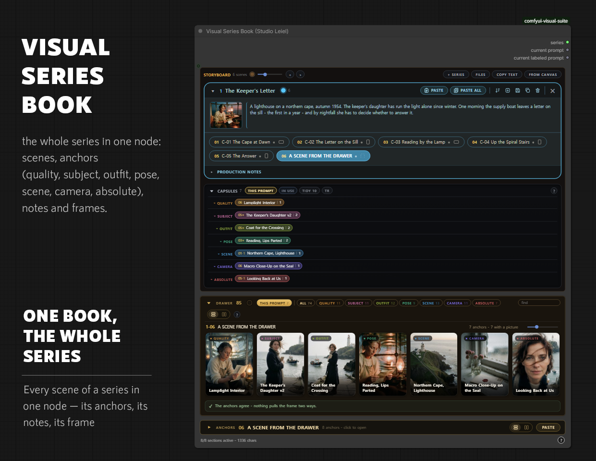
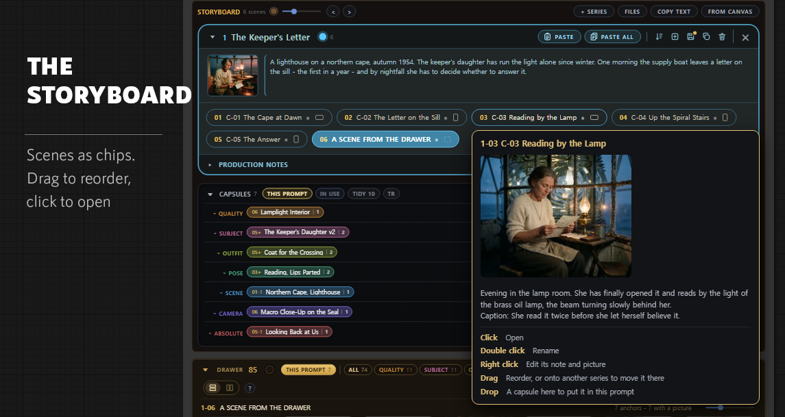
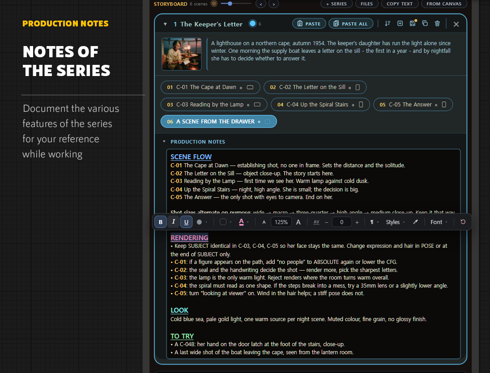
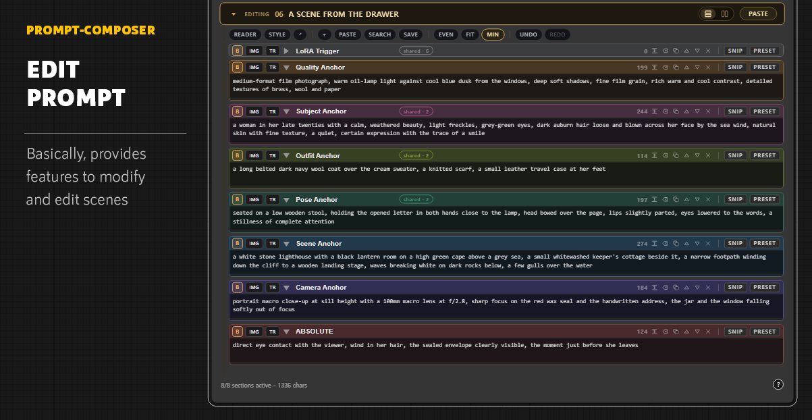
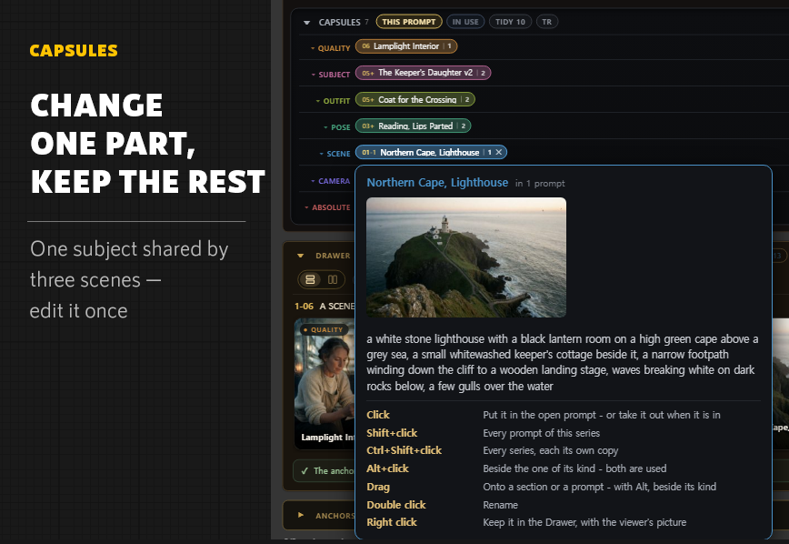
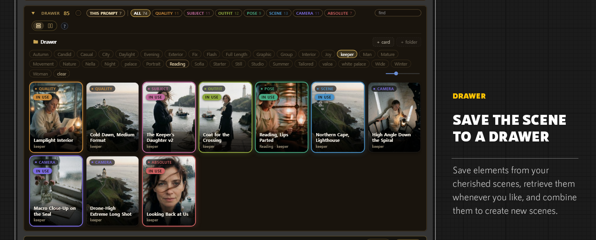
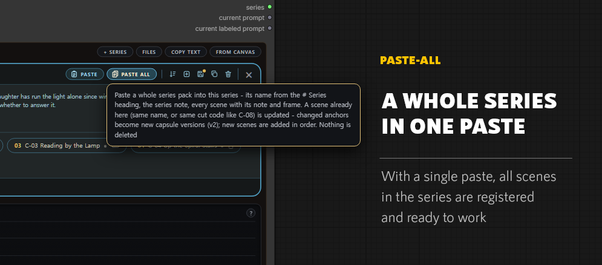
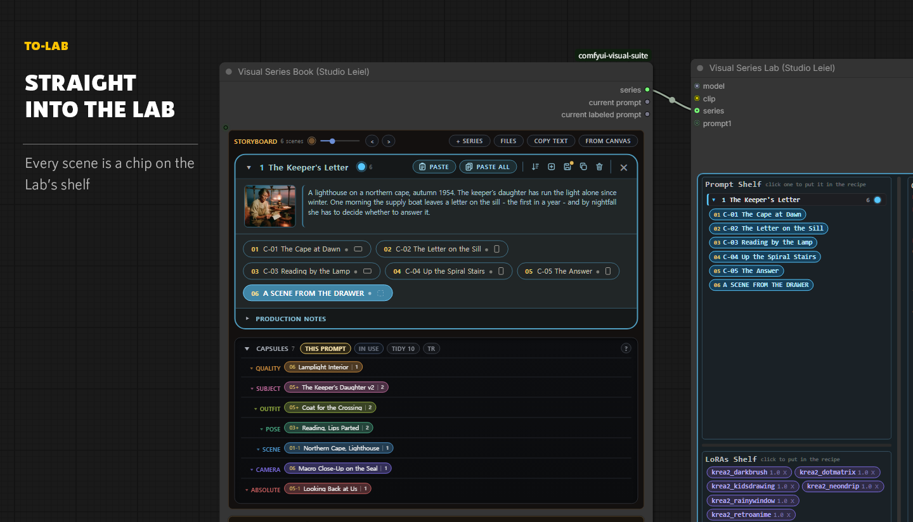

# Visual Series Book

A whole series of prompts in one node. Every anchor is kept once, as a
**capsule**, and a **prompt** is a list of capsules. Below the book sits the
full Prompt Composer, working on whichever prompt is open.



---

## Why this exists

A series is mostly the same words. The quality line and the person - who she
is, what she wears - are written once and carried through every scene; the
pose, the place and the camera are what change. Built from Prompt Composers,
a ten-scene series is ten nodes holding ten copies of the shared parts. Taking
a hat off means opening ten nodes, and missing one puts two different coats in
the same series.

The Book keeps each piece of writing once. Prompts that share a capsule share
the text itself rather than a copy of it: edit the Subject in one prompt and
every prompt using it has changed. Each section names, beside its title, the
capsule it holds - its number and name as on the shelf, `03-4 Imperial Cold
Light` - and one whose capsule is shared says so too - `shared · 6` - so the
reach of an edit is never a surprise. A capsule renamed on the shelf is
renamed there at once.

---

## Series

One book can hold several series - a few in progress at once, borrowing from
each other. Each series has its own box, its own number and its own capsules,
and its prompts are numbered within it: `2-03` is the third scene of series 2.
Numbers are given once and never reused, so a deleted scene leaves a gap
rather than renumbering the rest.

- **+ Series** starts a new one with an empty first prompt, ready for a paste.
- Double click a series name to rename it; the caret folds it.
- Drag a prompt onto another series' box to move it there. It takes the next
  number in that series.

**A capsule belongs to one series.** Prompts of the same series share
capsules, exactly as before. A capsule taken into another series - clicked,
dragged, or put in every series at once - arrives there as a copy. Work on a
new series can therefore never change a finished one.

**Every series is written to its own file**, in
`user/visual_series_book/series/`, a few seconds after it changes. The `✕`
on a series box closes the whole series - the file stays - and **Files**
lists the saved series and brings one back as it was. Closing the last series
leaves an empty one to start on. A series can be in a book only once. A
series with nothing written in it yet - every anchor empty but the trigger -
gets no file, and older files like that are left out of the list. (Series
files from before 1.5, in `user/visual_prompt_composer/series/`, are copied
across on first use.)

**The whole book as one file.** In **Files**, **Save book** writes every
series, prompt and capsule - the open prompt and the book's colour included -
to `user/visual_series_book/books/` under the name typed; saving under the
same name again updates it. **Open** beside a saved book brings it into any
Series Book. One workflow can then serve every series: keep the workflow as it
is, keep a book per project, and open the one you need. Opening takes the
place of the book on the node, after asking. A book file kept somewhere else
opens with **Open a file from the computer**. Saving keeps the panel open:
the list is read again, with the book just saved marked in it.

With several series open, the menu before the name chooses what is saved:
**All series**, or one series on its own - its prompts and capsules and
nothing of the others, named after it. One book file per series can then be
kept while working on several side by side.

### Keeping Files in order

A few months of work leaves a long list. **Files** keeps it short:

- **Folders.** **+ Folder** makes one and asks for its name; drag a book or
  series file onto a folder - its bar or anywhere in its open list, which
  lights up - to put it in, or back onto the **Book files** /
  **Series files** heading to take it out. Held near the top or bottom of the
  list while dragging, the list scrolls. Ctrl+click and Shift+click pick
  several files to drag together, and with files picked, **+ Folder** puts
  them straight into the new folder. A click on a folder opens or closes it,
  **+ Folder**, **Rename** and `✕` appear on its bar under the pointer.
- **Folders inside folders.** **+ Folder** on a folder's bar makes one inside
  it, and a folder dragged onto the middle of another goes inside it - onto
  the **Book files** / **Series files** heading, back to the top. Dragged
  onto the top or bottom edge of another folder's bar, it goes just before or
  after that folder instead - a gold line shows where - which is how folders
  are put in order.
- **Archive.** The first folder is always **Archive**, marked *kept for
  good*. Drag finished work into it and it stays in the list however old it
  gets - the same holds for any folder; only files left loose are ever hidden
  as they age. Archive wears its own fixed silver, unlike any folder colour,
  and cannot be renamed, recoloured or removed.
- **Folder colours.** The small dot on a folder's bar, under the pointer,
  changes its colour - five quiet ones: gold, slate, sage, wine and plum
  (Shift+click goes back one). A folder inside another wears its parent's
  colour until it is given its own, so a whole story can be one colour.
- **Files in order inside a folder.** Inside a folder, files stand in name
  order, numbers read as numbers - `S1E1` before `S1E3` before `S1E10`. The
  `▲` `▼` arrows that appear on a file's row under the pointer move it up or
  down among the files of its folder, and that order is kept. Files outside
  any folder stay newest first. A story can be
  kept as `The Valois-Leiel Chronicles > S1 The Absolute Queen > S1E3 The
  Portrait`. A folder's count is every file under it. Removing a folder takes
  two clicks and moves what was in it - files and folders - up a level;
  nothing is deleted.
- **Rename.** Double click a folder's name, a book file's name or a closed
  series' name to rename it; `Enter` keeps it, `Esc` leaves it. A book file is
  renamed on disk and stays in its folder; a book file that holds a single
  series gives that series the new name too, so opening it shows the name
  given here. A closed series has the new name written into its own file. A series open in this book is renamed on its own
  bar, as before.
- **Open with a double click.** Double click a file's row anywhere but its
  name - the picture, the date, the empty space - and it opens, the same as
  its **Open** or **Bring back** button. The name keeps its double click for
  renaming. A series already open in this book stays as it is.
  One set of folders serves both lists, so a story's book file and its series
  files can share one. Folders are an index only, kept in
  `user/visual_series_book/file_folders.json`: the files never move, and a
  series keeps writing to its own file.
- **Save current book as.** **Save book** on the **Book files** title line
  opens a framed row with the name: `Enter` or its **Save book** saves the
  book open in this node under that name, and the row folds away again.
  `Esc` folds it without saving.
- **Find.** The box beside **Files** narrows both lists as you type - book
  names, the series a book holds, and folder names. `Esc` clears it.
- **Fold a list.** Click **Book files** or **Series files** to fold it away.
  An open list scrolls inside itself rather than stretching the node.
- **Old files leave the list - only the list.** When a list holds more than
  20 files, the ones not saved or changed for 30 days are left out of it. The
  files stay on disk, a search still finds them, and **Show them** at the foot
  of the list brings them back for now. Files in a folder and anything open in
  this book are always shown. **hide old after** at the top of the panel sets
  the age, or **never**.
- **Hide a file, or delete it.** Under the pointer, every book row and every
  series row not open in this book has two buttons:
  - **Hide** takes it off the list only. The `.json` stays on disk, untouched.
    A line under the list counts what is hidden - **Show them** brings the
    hidden rows back, dimmed, each with **Unhide** to put it back for good. A
    search finds hidden files too.
  - **`✕`** deletes the file itself: the first click asks `Delete file?`, the
    second removes the `.json` from `books/` or `series/` and takes it out of
    its folder. A deleted book does not touch the book open on the canvas, and
    the series files it was made from stay in **Series files**.
- **Copy text without opening.** Each file row has a copy button (two sheets)
  beside **Open** / **Bring back**: it copies that file's series as text, in
  the form Copy Text writes and Paste reads, without opening anything. Each
  folder's bar has **Copy text**, which copies every file in the folder - and
  in the folders inside it - in the order shown, one series after another,
  numbered in turn. Hidden files are left out unless they are shown.
- **Two rooms.** Book files and Series files each sit in a box of their own.
  Their actions wait folded as buttons on the room's title line - **Save
  book** and **Make all series** for books, **Make all series** for series -
  and a click opens the gold box under the title; a second click, or Cancel,
  folds it again. The arrow on a room's title folds the whole room away; a
  button on a folded room opens the room too.
- **Make all series.** The gold box in each room makes many files at once
  from their packs, without opening them in the book - in Book files a book
  file for each series, in Series files a series file for each - see
  [Make all series](#make-all-series) under Paste.
- **Notes on hover.** Rest the pointer on a row and the series' note shows -
  the note written under the series name. A book file shows the note of each
  series it holds, so a book can be told apart before it is opened.

### A series from the Idea Box

**Start a series with this** in the [Visual Idea Box](idea-box.md) opens a new
series here: the idea's line as its name and its picture as the series picture.
The line, the notes, the folders and the address go into the **Production
notes**; the series note is left empty for the series' own words, since the
Series Layout prints it. It starts on an empty first scene, so its pack can be
pasted in straight away.

A picture in the Idea Box can also be read straight into the anchors: drag it
from the box onto the picture square of the **Reader** - the panel between the
*Editing* line and the toolbar - tick the anchors and press **Read**. The whole
picture comes, not the copy on screen. **Read in Book** in the box does it in
one press: the picture lands in the Reader of the open prompt, ready to read.

### The Reader

Pictures are read in one place, the **Reader** under the *Editing* line. The
picture is on the left; on the right every anchor of the open prompt is listed,
under *Anchor*, with what it reads beside it under *Reads* - Quality, Subject, Pose,
Scene, Camera, the whole picture, or a question of your own. Click that word
to change it. Tick the anchors the picture should fill and press
**Read**; each is asked its own question and its capsule's words are replaced.
At first only the anchors whose names say a layer are ticked. Each scene keeps
its own picture and its own ticks, so going back to a scene shows what it was
read from. Fold the panel with its head, make it taller with its lower edge,
and choose the model with **Model**.

The Reader's picture stays in the Reader; a reading puts only words in the
anchors. **IMG** in an anchor's header opens a place for a picture beside its
words, only to look at - the anchor has no reading controls of its own - and
**To Reader** sends that picture up to be read.

### Opening a series opens its pictures

Bringing a series back from **Files**, or opening a book file, tells every
[Visual Image Viewer](image-viewer.md) on the canvas, and each one goes to that
series' pictures - see *Following a Series Book* there.

## Storyboard



The top of the book, headed **Storyboard** with the number of scenes in it:
every series, each with its picture, note, scenes and production notes. Click a prompt to open it in the sections below,
double click to rename it, drag to reorder. The arrows step through them.

The icons at the top right of a series box act on its prompts; the `✕` after
them closes the series itself.

| | |
| --- | --- |
| **new** (icon) | A new empty scene; only the LoRA trigger is carried over. On another series' box, it starts from that series' last prompt. |
| **save** (icon) | Saves the series as a book file under its own name - the same name again is updated. When anything in the series has changed since it was last saved - a prompt, an anchor, a name, a note, a picture, a frame - the icon turns gold with a dot; saved, it is grey again. A series never saved this way shows the dot until its first save. |
| **auto save** (icon, a disk in turning arrows) | Auto save for this series. On (gold), the series saves its book file by itself about three seconds after each change - the save icon's dot shows only for that moment - so the book file is never left behind the work. It saves quietly, with no message and no step in Undo. The choice is kept with the series, in the workflow and in its files; off, the save icon works by hand as before. |
| **duplicate** (icon) | A copy of the open prompt sharing every capsule - replace only what changes. |
| **delete** (icon) | Removes the open prompt. Its capsules stay on the shelf, and Undo brings it back. |
| **Copy Text** | Copies every prompt of the open series as text, in the form Paste reads - the series heading and note, each scene's name and note, then each anchor under a label carrying its capsule's name. Shift+click copies every series. |
| **From Canvas** | Brings in every Prompt Composer on the canvas as a prompt, in Series Lab order when they are wired to one, top to bottom otherwise. Identical anchors become one capsule. |

---

**Notes.** Under a series' name there is room for a note - the story, the look,
what was tried. Click it to write; it is kept with the series and its file.

**A note and a picture on each prompt.** Right click a prompt chip to write
what the scene is about - who, where, why it matters - and give it a picture:
**From viewer** takes the one open in a Visual Image Viewer, **File...** picks
one from the computer, or paste or drop one onto the box. Hover the chip and
the picture and note show on its card, above the actions; a chip with either
carries a small dot after its name. A Series Lab shows the note on that
prompt's chips as well.



**Production notes for each series.** At the foot of an open series, below
its prompts and ruled off from them, sits **Production Notes** - a place for
working notes: the scene flow, what to watch for when rendering, ideas, what
to fix. Click its text to write (Esc cancels, Ctrl+Enter or a click elsewhere
keeps it). While writing, select text and the same style bar as in the
anchors comes up over it - bold, italic, underline, the paragraph dots, the
Highlight and Text colour dropdowns (with favourites, RGB sliders and numbers,
a colour code box and an eyedropper), the size and letter spacing (each with
− and + and a box to type a number), **¶ Paragraph**, Font (every font on this
computer, by face, with favourites), and the round arrow that clears the
marks. The paragraph dots are grey.

Every line of the notes is its own paragraph, so **¶ Paragraph** works on the
lines the selection touches: alignment (left, centre, right, justify), line
spacing (80 to 300 percent), space before and after, left indent, first-line
indent (negative for a hanging first line) and tab width - each with − and +
and a box to type into - and **Lines**: a line above and a line below the
paragraph in five weights (0.5 to 3 px), four styles (solid, dashed, dotted,
double - one style for both lines) and four colours (grey, white, gold,
blue), as InDesign's paragraph rules. The lines are drawn so that weights
under a screen pixel still differ: 0.5 is a lighter hairline than 1, and 1.5
sits between 1 and 2. They sit at the edge of the space before
and after, so those two set how far the line is from the text. **Tab** types a tab. A line with a dot hangs: its
second line starts under the text, not under the dot. Enter starts a new line
that carries on the paragraph it came from, dot and all.

**Styles** keeps looks under a name. Select text, type a name - and, if you
like, a shortcut number from 1 to 9 - and press **¶ Paragraph** or **A
Character**. A paragraph style takes the line's paragraph settings and its
first character's marks (font, size, colour, letter spacing...); a character
style takes the first selected character's marks only. Click a style to put
it on: a paragraph style on every line the selection touches, a character
style on the selected text. **Ctrl+Alt+number** puts the paragraph style with
that number on, **Alt+number** the character style (Ctrl+Shift and Alt+Shift
switch the input language on Windows, so they are left alone). Hover a style
and press its cross to delete it. Styles, favourite fonts and colours are
kept in a file beside the books (`ui_prefs.json`), so they survive restarting
ComfyUI or opening it in another browser.

The **eyedropper** on the bar works as in InDesign: press it, click any text in
the notes to pick up its formatting (marks and paragraph), then select text to
stamp it on - as many times as you like. While it is loaded the pointer is
an eyedropper - white while picking up, gold while stamping - and the notes
wear a thin gold frame. A plain click in the text (not a drag), Esc, or the button again puts it down.

**Reset paragraph** clears a
line's paragraph settings and keeps its dot. Notes written before paragraphs
open as they were, a line each. It stays up for one effect after another, and while a number is
being typed the selection stays painted; it goes when the selection does. Selecting text while the
notes are only being read starts the writing with that selection kept, so it
can be styled straight away. The styling is kept with the notes; a click anywhere
outside the notes ends the writing. Click the **Production Notes** bar to fold it; folded, only the bar shows. The notes are kept with the series in its own file and in book
files, apart from the note above, which stays the description of the series.

**A workflow saved part way through.** Every series keeps the time of its
last change, in the workflow and in its own series file, which is written a
moment after every change. A workflow saved in the middle of a series and
closed later without saving again would open with the older state; instead,
when it opens, each series whose file holds later work is brought up to date
from that file, in its place and with its number, and the book says so.
Undo goes back to the state the workflow held. Series saved before this was
added carry no time yet and are left as they are until their next change.

**A note in two languages.** A series note that holds lines in English and
lines in another script shows three buttons at its top right: **EN**, the
English lines; the second language, named after its script (**KO** for
Korean, **JA** Japanese, **ZH** Chinese, **RU** Cyrillic and so on); and
**ALL**, the whole note. Only the view
changes: the note keeps every line, clicking it to write shows the whole of
it, and the Series Layout still reads the lines it is set to. The choice is
kept for every series and every Series Book, and shared with the story box
of the Series Report; a note in one language only always shows whole.

**A picture for each series.** Beside a series' note sits its picture. Click
it to see it larger (click anywhere or press Esc to close); double click it to
replace it with the picture open in a Visual Image Viewer (or choose a file
when none is open). Drop a picture onto it to set it, right click it to take
it off. An empty box shows only under the pointer, and a single click on it
sets a picture.

From a Visual Image Viewer, right click any picture to make it a thumbnail
here, under **Series Book · set as thumbnail**: **Thumbnail of its scene** and
**Thumbnail of its series** set it on the scene and series it was rendered
from (by their names, as the Series Lab recorded them in the picture);
**Thumbnail of the open scene** and **Thumbnail of the open series** set it on
what is open here. Pictures and
notes are kept small inside the book, its series files and its book files.

In **Files**, a book or series file with a picture shows it small before its
name, and larger on the card that opens when the pointer rests on the row. `Ctrl+Enter` or **Keep** keeps it, `Esc` or **Cancel** leaves it,
and emptying the box clears it. The note is kept with the prompt, in the
series file and in every book file.

**New prompts start empty.** `+` on a series makes an empty prompt to paste or
write into; only the LoRA trigger is carried over.

**The frame a prompt wants.** After each prompt's name sits a small outline
of its frame: tall for portrait, wide for landscape, square, or dashed for any
(shown only on hover and on the open prompt). Click it for the next, shift+click
for the one before. A [Series Lab](series-lab.md) rendering the prompt hands
that shape to every [Visual Latent Size Picker](latent-size-picker.md) on the
canvas for the render, so a random pick stays among sizes that suit the scene -
a leap stays wide, a standing figure stays tall - and the picker goes back to
how it was afterwards.

**Anchors wear their kind's colour.** In the Book every anchor below is drawn
in the colour of its kind, the same as its capsule on the shelf.

**Opening a file.** Open on a book file - or a file from the computer - asks
whether to add its series beside the ones already in the book, each as a new
series, or to replace this book with it. A series file opened from the computer
comes in as a new series.



## Capsules



One row per kind of anchor - trigger, quality, subject, outfit, pose, scene,
camera, absolute - and one colour per row, matched to the section colours. The
number on a capsule is how many prompts use it; `0` means it is in none.

Click a row's label to fold that kind: only the capsules the open prompt uses
(and any a search found) stay in view, with a `+N` for the rest - click it, or
the label again, to open the row. Shift+click a label folds or opens every
row. With a long series the shelf stays short this way.

**Outfit** is optional, and sits between Subject and Pose. Keep the person in
Subject - face, build, age - and the clothes in Outfit, and a change of clothes
becomes one click while the same face carries from one series to the next. A
reply labelled `OUTFIT` (or `WARDROBE`) fills it; a prompt without one works as
it always has.

The figure at the front of a capsule is where it was first written: the
prompt it was made for, and - when that prompt has had more than one try at
that layer - which try, so `03-2` is the second camera written for prompt 03.
With several series the series comes first, in its colour: `2 | 03-2`. The
number is given once and kept for good. Put the capsule into another prompt,
copy it into another series, or leave it unused, and it still says where it
came from. When that prompt is renumbered or moved to another series, the
capsules written for it follow its new number. This is what a render read in
the Image Viewer needs: the number
there is the capsule on the shelf, whichever prompt now uses it. `+` means
more than one prompt uses it; a dim number, none does.
A row keeps that order: putting a capsule in lights it where it stands rather
than moving it to the front.

The **?** at the right end of the CAPSULES bar opens a one-page key to all of
this - each figure on a capsule drawn as the shelf draws it, what every click
does, and how a pasted reply becomes capsules. Close it with **Close**, **Esc**
or the **?** again.

- **Click** puts the capsule in the open prompt, in place of the one of its kind. Clicking one that is already in it takes it out again; it stays on the shelf.
- **Shift+click** puts it in every prompt of the open series - the hatless Subject, everywhere, in one press.
- **Ctrl+Shift+click** puts it in every prompt of every series, each series getting its own copy.
- **Alt+click** adds it **beside** the capsule of its kind instead of in its place: the prompt keeps both, one after the other, and both are used - the palace's front in one Scene capsule and the day's own forecourt in another, say. Alt works with Shift and Ctrl+Shift as well. Hold **Alt** while dropping a capsule into the anchors for the same. A capsule already in the prompt is not added twice.
- With several series in the book, the series are named beside CAPSULES: click one to see only its capsules, or **All** for every series. The open series is shown by default. Another series' capsules carry its number.
- **Drag** it onto a section to take that section's place, or onto a prompt chip to put it in that prompt.
- **Double click** renames it. The layers a series shares are named for what they are (`Subject`, `Subject 2`); the layers that make a scene are named for the scene they came from, unless the pasted label named them (see Paste).
- With **TR** on, hovering a capsule shows its text translated as well, into the language chosen beside it. The translation runs in the browser, on this machine.
- **✕** deletes it - twice when a prompt is still using it.
- An orange **!** on a capsule says putting it in would clash with the open
  prompt - a walking pose against a close portrait, say. Hover it for why.

**Keeping the shelf tidy.** A long series leaves capsules behind - earlier
takes of a pose, the layers of a scene that was deleted. They read `0`, and
two controls beside CAPSULES deal with them:

- **This prompt** shows only the capsules of the prompt open now: every one
  written for it - `03`, `03-1`, `03-2`, used or not - and whatever it wears
  from elsewhere, so the shelf reads as that scene's alone. Click it again to
  see the rest.
- **In use** hides every capsule no prompt uses. Nothing is deleted; the count
  beside CAPSULES shows how many are out of sight (`48 +23`). Click again to
  see them.
- **Tidy 23** deletes every capsule no prompt uses in the series shown (in
  every series when **All** is picked). It asks for a second click -
  `Delete 23?` - and Undo brings them back. It shows only when there is
  something to tidy. If the second click does not come, the button lets go
  by itself after four seconds; a click anywhere else in the node or Escape
  lets go at once. The same holds for every delete that asks twice - a
  capsule's x and closing a series.

Deleting the scenes you will not use first, then pressing Tidy, clears out a
series in two steps.

To change one prompt only, give it a capsule of its own: paste the new text,
or duplicate the section and edit the copy.

An empty capsule nobody uses simply disappears. One with writing in it stays
on the shelf until it is deleted, so taking a capsule out of a prompt never
throws writing away.

Emptying a section works the same way. Clear the Pose to read a new picture
into it, or to write another one, and the pose that was there stays on the
shelf as it was; the section carries on with a new capsule of its own, shown
on the shelf as `empty - fill the box` until something is in it. Click the
old capsule to put it back.

To start from what is there rather than from nothing, press **+ variant** on
the section's header (it shows when the pointer is over the section): the
capsule stays as it is, and the section goes on with a copy of it to edit -
a second pose from the first, a closer camera from the wide one.

Either way is how a scene gathers several poses - or cameras, or lights - to
sweep through in the Series Lab, without a prompt for each. Other prompts
that shared the old capsule keep it. On the shelf, a capsule in no prompt
reads `0` and is as ready to use as any other.

---


## Help on hover

Rest the pointer on any button, mark or chip of the book and a card explains
it, drawn like a capsule's card: what it is on top, then each action - Click,
Shift+click, Double click, Drag, Right click - on its own row under a gold
label. The cards come from the same words the browser used to show as plain
tooltips, so every control explains itself the same way.

## The Drawer



Under the capsules sits the **Drawer**: anchors kept for good, outside any
series. An outfit that came out right, a pose, a camera, a light, a line in
ABSOLUTE that finally fixed something - put away once, taken out again in any
series later. There is one drawer for the whole computer, kept at
`user/visual_series_book/drawer.json`, so every Series Book in every workflow
opens the same one. The first time it is opened it holds a starting set of
about forty ready-made anchors - lights, outfits, poses, places, cameras -
so the node can be used without writing a prompt at all.

Every card names the anchor it belongs to: a card with a picture carries the
kind - `QUALITY`, `POSE`, `CAMERA` - in its own colour at the top left, and a
card of words says it in its first line.

- **Keep** - right click a capsule, or drag it onto the Drawer. A capsule
  whose name starts with a name and a comma - `Amara, Denim Shirt` - is
  tagged with that name on its own. The picture a Visual Image Viewer is
  showing - open large, or framed in its grid - comes along as the card's
  picture, so the render that made the capsule worth keeping is kept with it.
  A card already in the drawer without a picture is given that one.
- **+ card** - for an anchor no scene has used yet, write the card by hand.
  **+ card** on the folder bar opens a blank card: name, kind, tags, words
  and a picture, the same window a double click opens on a kept card. Its
  kind starts as the tab that is open (or the open folder's, or Subject), its
  tags as the ones picked under the bar, and it goes into the folder that is
  open when that folder is of its kind. **Add to drawer** keeps it; the same
  words already kept under that kind are named instead of kept twice.
- **Use** - click a card and it asks first, naming the capsule it would
  replace; **Put it in** (or Enter) puts it in the open prompt in place of the
  capsule of its kind, and the words become a capsule of the series like any
  pasted anchor. To use it beside the capsule already there, put it in, then
  Alt+click the other capsule on the shelf. **Double click** a card, or drag it onto a section, and it
  goes in at once, without asking.
- **Find** - the kinds along the Drawer's bar, the tags under it, and the find
  box, which narrows by name, tag and words as you type. Several tags can be
  picked at once; only cards with every one of them are shown, and a tag that
  would leave nothing is dimmed. **clear** drops them all. A folder stays in
  view only while something in it matches: with tags picked it shows how many
  of its cards carry them - `3 of 11 cards` - and a folder with none of them,
  or none of the words typed in the find box, steps out of the way.
- **Folders** - the drawer reads like a file window. Each kind keeps its own
  folders: a "Ballet" among the poses is not one among the outfits. Pick a
  kind, and `+ folder` makes one for it; **All** shows every kind's folders.
  At the top sit the folders, as tiles among the cards, and the cards in no
  folder; click a folder to go in, and the path above - `Drawer > Ballet` -
  brings you back out. Every card kept while you are inside a folder - from a
  capsule or from a Visual Image Viewer - goes into it. Pick cards with the box
  at a card's corner, Ctrl+click, Shift+click for a run, or a box dragged
  across the empty part of the grid (Ctrl held takes cards out of the pick);
  drag one of them onto a folder and all of that kind go in, or onto **Drawer**
  in the path to take them out. Right click a folder to rename it, tag every
  card in it at once, or delete it - its cards stay, at the top of the drawer.
- **Add to the capsules** - Alt+double click a card to put it on the open series'
  capsule shelf without putting it in the prompt. Gather several cameras this
  way and sweep them in the Series Lab.
- **Clashes** - with a prompt open, a card that would clash with it wears an
  orange label - `! vs Camera` on a walking pose when the camera is a close
  portrait - and the ask says why before it is put in. Choosing a camera first
  and the rest after it is the natural order.
- **Edit** - right click a card, or press **Edit card** when it asks, for its
  name, kind, tags, words and picture. The window opens in the middle of the
  screen and moves by its top bar; Esc or a press outside it closes it without
  saving. While it is open, clicking a picture in a Visual Image Viewer puts
  that picture on the card; **Select from Visual Image Viewer** takes the one
  it is showing, and a picture can also be pasted, dropped or chosen from a
  file. It is kept small, inside the drawer file.
- **Pictures on capsules** - hovering a capsule shows the picture of the
  drawer card with the same words. Change the capsule's words and it no
  longer claims that picture.
- **This Prompt** - the first tab on the Drawer's bar lays the open prompt
  out as a set of cards, one per anchor from the light to the rules, each with
  the picture of its drawer card: the whole look of a scene at a glance. A
  dashed card is not in the drawer yet - right click it to keep it; double
  click a card to open its drawer card.
- **The anchor check** - above those cards, This Prompt says where the
  anchors pull against each other. A scene written in one go has every anchor
  in view; cards from the drawer were each written alone, and the commonest
  way they disagree is over how much of the body the frame holds. A close
  portrait with a walking pose and loafers is drawn as both - a large face and
  a small full figure beside it. The check reads each anchor for what it asks
  of the frame - a Subject that describes the face closely in a picture
  where the face is small (the commonest cause of a doubled figure: keep the
  Subject to age, build, skin and hair and let the LoRA carry the face), the
  Camera's crop, a whole-body action in the Pose, shoes in
  the Outfit, a Camera that fixes the stance (both feet on the ground) under a
  Pose that moves, a camera close behind her while the Pose walks off or faces
  the lens, a shape passing in the foreground, a standing figure where some
  latent sizes are wide, lens or shape words outside the Camera, someone else where only
  one person is allowed - and the latent size on the canvas, and names the
  clash with what to change. Orange is likely to show in the picture; grey is
  worth knowing. It only warns and never rewrites, since the same words in
  every scene is what keeps a series together. When there is something to
  check, an orange **! to check** sits on the Capsules bar.
- **Take out** - the x on a card, twice.
- **Beside the book** - the two small layout pictures on the Drawer's bar
  move it under the book or beside it, above the anchors. With many series
  and a long shelf the book alone makes the node tall; moving the drawer to
  the anchors' column shares the height between the two. Choosing beside
  also puts the anchors beside the book. Kept with the book.
- **Height** - drag the strip under the open Drawer down to show more rows
  of cards, up to show fewer; double click it for the default. Kept with the
  book.

With **Outfit** kept apart from **Subject**, the Drawer becomes a wardrobe:
one face, any clothes.

## Paste



Copy a whole reply - a scene name, then each anchor under its own label
(`QUALITY`, `SUBJECT`, `POSE`, `SCENE`, `CAMERA`, `ABSOLUTE`) with its text in
a code box or on the lines below - and press **Paste**, or hover the node and
press `Ctrl+V`.

A reply looks like this:

```
**Princess House, Looking In**

POSE · Lying in the Grass, Looking In
She lies on her stomach in the meadow grass right in front of the open toy
house, her chin resting on her folded forearms...

CAMERA · From Behind the Doll
The camera is inside the toy house, low at the back of the room...
```

One paste does all of it:

- **The prompt.** The bold first line is the scene's name. A new name adds a prompt chip to the open series under that name; a name already there updates that prompt.
- **The anchors.** Each label - `POSE`, `CAMERA` and the rest - says which anchor its text goes into, and the text lands there.
- **The capsules.** Each block becomes a capsule on the shelf, named after the dot in its label (`Lying in the Grass, Looking In`). A block whose text the shelf already has reuses that capsule instead of making a twin.
- **The rest.** A new scene starts from nothing: anchors the reply leaves out stay empty, rather than being borrowed from the prompt that happened to be open. Only the LoRA trigger comes along. To change only part of a scene, paste under a name the series already has - that prompt keeps what the reply does not mention.

**Paste** sits on the bar below the book as well, the one with the open
prompt's name, so it is there with the anchors folded away. That is the
usual way to work: paste a reply, render, paste the next. The anchors - the
toolbar and the open prompt's sections - fold into that bar with a click on
it, and only need opening to change a prompt's text by hand.

- A scene name the book does not have becomes a new prompt holding only the anchors the reply brings (and the LoRA trigger). An anchor it leaves out is left out.
- A name the book already has updates that prompt.
- Right after **new** or **duplicate**, the paste fills the fresh prompt instead of adding another.
- Text that matches a capsule already on the shelf reuses that capsule.
- A label may name its capsule after a dot or a dash - `CAMERA · High Overhead, Long Lens`. Without one, a scene's pose, camera and absolute are named after the scene. A named label on text the shelf already has renames that capsule, so pasting the same reply again with names on its labels is how capsules get better names. The name reads like a title - a capital first, no full stop, up to about a dozen words. A label that starts like one but is not (a sentence after the dot, say) is skipped, and Paste says which anchor it left as it was.
- Commentary around the blocks is ignored. A label is a line holding nothing but the anchor word (with "Anchor", a remark in brackets or a colon allowed), so a sentence that happens to begin with SCENE is never taken for one.

**Save a series.** The save mark on a series' header writes that series as a
book file named after it - the series alone, its prompts and capsules. A book
file of that name already there is updated in place, folder and all.

**Paste on a series.** Each series' header has its own **Paste** button, first
among its icons and set apart by a line. It always pastes into that series, whichever series is open - its last
prompt is opened first - and scenes under a `# Series` heading go there too.

Several scenes can come in one paste - what **Copy Text** writes, or a reply
covering a whole series. Each scene starts at its name set apart as a heading
(bold or `#`), and scenes under a `# Series 2 - Name` heading go back to that
series. Copy the series, rename or rewrite in it, paste it back: only what
changed is applied.

**Paste All - a whole series in one go.** Each series' header has **Paste
All** right after its **Paste**. It takes a whole series pack into that
series - and the series takes the name the pack's `# Series` heading gives
it. To make a new series from a pack, press **+ Series**, then **Paste All**
on it: the empty first prompt is filled by the first scene. `Ctrl+V` over the
node reads a pack too, sending it to the series of that name, or making it.

### The series pack - full template

A pack is plain text. Copy the template below, fill it in, and paste it with
**Paste All**. Everything in `<angle brackets>` is yours to write; the words
outside them are the markers the Book reads.

```
# Series - <series name>
NOTE:
<the series note - one or more lines>

**<C-01 Scene Name>**
FRAME: <landscape | portrait | square | all>
NOTE:
<the scene's note - description, caption, anything>

LORA TRIGGER · <Trigger Name>
<trigger words>

QUALITY · <Capsule Name>
<quality text>

SUBJECT · <Capsule Name>
<subject text>

OUTFIT · <Capsule Name>
<outfit text>

POSE · <Capsule Name>
<pose text>

SCENE · <Capsule Name>
<scene text>

CAMERA · <Capsule Name>
<camera text>

ABSOLUTE · <Capsule Name>
<absolute text>

**<C-02 Next Scene Name>**
FRAME: portrait
NOTE:
<...>

QUALITY · <Capsule Name>
<...>
```

A short example:

```
# Series - The Night Garden
NOTE:
A queen walks her silver garden alone, the night before the war.

**C-01 Silver Roses at Midnight**
FRAME: landscape
NOTE:
She stops at the only rose that is not silver.
Caption: Everything here obeys her, except one flower.

QUALITY · Low-Key Candle Night
cinematic editorial photograph, a single lantern as the only light, deep shadows

POSE · Bending to the Rose
standing still, bending slightly toward a single red rose, one gloved hand raised

CAMERA · Low Side Medium
landscape medium shot from the side at waist height
```

**How each part is read**

- **`# Series - <name>`** - the series. It is found by its name (a number in
  the heading, `# Series 2 - Name`, as Copy Text writes it, is checked too). A
  series not in the book is made, with the next number. With **Paste All** on
  a series header, that series is used and takes this name.
- **`**<scene name>**`** - a scene, its name in bold (or as a `#` heading).
  A scene already in the series - by its name, or by its cut code when the
  name changed (`C-08 The Riding Lesson` pasted as `C-08 The Horse Rears`
  updates C-08 and takes the new name) - is updated: an anchor whose words
  changed becomes a new capsule, named after its label, with `v2`, `v3` added
  when the name is taken. A new scene is added after the last one pasted,
  with the LoRA trigger of the open prompt when the pack brings none.
- **`FRAME:`** - directly under a scene name: `landscape`, `portrait`,
  `square` or `all`. It sets the prompt's frame, the icon on its chip. Left
  out, the frame stays as it was.
- **`NOTE:`** - the lines under it, up to the next label, scene name or series
  heading, become the note of the series or the scene it sits under,
  replacing the old note. A note is never read as an anchor, so any language
  and any text - a caption, a description - is safe in it.
- **Labels** - `QUALITY`, `SUBJECT`, `OUTFIT`, `POSE`, `SCENE`, `CAMERA`,
  `ABSOLUTE` and `LORA TRIGGER`, in capitals, then `·` and the capsule's
  name. The text below a label, up to the next label, is the anchor. A scene
  may bring only the anchors it needs; on a new scene the others stay empty,
  on an existing one they stay as they were.
- A scene in the book that the pack leaves out is left alone - nothing is
  deleted.

**Copy Text** writes the same form, notes and frames included, so a series
copied out pastes straight back.

Every box is fitted to its text afterwards. Where the browser will not let a
page read the clipboard - an address that is neither localhost nor https -
Paste opens a box to press `Ctrl+V` into instead.

**Two of one kind.** Paste always puts an anchor in place of the capsule of
its kind. In a prompt that holds two of that kind (one added beside with
Alt), the pasted anchor takes the first one's place and the others are taken out;
they stay on the shelf. A pack's label repeated in one scene is read as a
correction: the later one wins.


### Make all series

Paste All fills one series. **Make all series** in Files takes a whole season
at once: many packs, each written straight to a file of its own and sorted
into a folder, without being opened in the book. It is there in both rooms,
and the room says what is made:

| Where | What each series becomes |
| --- | --- |
| **Book files** | A book file of its own, named after the series - and its series file too, both in the folder. Open it from Book files as any saved book |
| **Series files** | A series file only - Bring back puts it in the book |

1. Press **Make all series** on the room's title line to open the box, then
   **Paste** to read the packs from the clipboard - one text holding
   several `# Series` headings, one pack after another - or **Choose files...**
   to pick the packs' `.txt` files; the files can also be dropped on the box.
   Files are read in the order of their names, numbers read as numbers:
   S1E2 before S1E10.
2. The box lists what it read before anything is written: each series with its
   number of scenes, and in total how many series and scenes.
3. **Folder** - where they go. A line `# Folder: <name>` in the text names it;
   a slash makes a folder inside another (`# Folder: Chronicle/S1`). With no
   such line, the S number every series' name shares - `S1E4`, `S1E5` - gives
   `S1`. The name can be changed in the box, or emptied to leave the files
   loose. A folder not there yet is made.
4. **Make N book files** / **Make N series** writes them. In the folder they
   stand in the order of the pack, and the folder - with the folders above
   it - is opened to show them.

Each series is made exactly as Paste All would make it - its note, every scene
with its note and frame, every anchor as a named capsule - then written to its
file and taken out of the book again. The book open on the canvas is left as
it was, with no step to undo.

A series of the same name already in Files - in Book files, a book file or a
series file of that name - is marked **in Files**, and one choice covers them
all:

| Choice | What happens |
| --- | --- |
| Leave them as they are | Those series are skipped - the files already there stay untouched |
| Add them as copies | A new file beside each, named `<name> copy` (in Book files, a book file and a series file of that name) |
| Replace them with these | The file is written over with the pack, under the same name, and moves to the folder - in Book files, the book file and the series file both |

A series open in this book is marked **open here** and always left alone -
paste into it with its own Paste All, so the book and its file never
disagree.

A pack for several series at once looks like this:

```
# Folder: S1 L'Empire de Valois-Leiel

# Series 1 - S1E5 The Double
NOTE:
<the series note>

**C-01 The Invitation, Sealed**
FRAME: portrait
NOTE:
<...>

QUALITY · <Capsule Name>
<...>

# Series 1 - S1E6 Eye to Eye
NOTE:
<...>
```
---

## Search

**this series** is the first scope and **every series** the next. The open prompt is marked as usual, every
capsule with a hit lights up on the shelf with its count, and REPLACE ALL
changes each capsule once, so every prompt using it follows. The EFFECT row
styles hits across the book the same way.

---

## Outputs



| Output | |
| --- | --- |
| `series` | Every prompt in the book, for the Series Lab. |
| `current prompt` | The prompt open in the book when the run is queued, as plain text - for using the Book without a Series Lab. |
| `current labeled prompt` | The same in the form Paste reads: the prompt's name in bold, then each anchor under its label and capsule name (`CAMERA · Low Angle Flash`). Copied out, it pastes straight back into a Book. |

The series name for a file name comes from the Series Lab's
`this render's series name`, which follows each render. Sections are always
joined by a blank line and empty ones left out, without the Composer's
widgets for it. Find and replace across prompts is the Composer's;
in the Book, Search does it in place.

Wire `series` into the Series Lab's `series` socket and every prompt in the
book appears on its prompt shelf, named as it is here. A recipe remembers its
prompt by an id that survives renaming and reordering, so a recipe queued an
hour ago still renders the scene it was built for.

### Capsule sweep

A recipe on a book prompt can render once per capsule - the same scene
through several cameras, lights or poses - or once per combination of
capsules: a pose from one series with a camera from another. In the Series
Lab, put a book prompt in the recipe and click the `⇄ sweep` chip beside it.

The picker has two halves. Below are the capsules, one kind at a time - pick
the kind from the row of tabs. Each capsule is shown with the start of its
text, so a capsule named after a scene still says what it does. With several
series in the book, a row above the tabs says whose capsules are offered: the
prompt's own series, by name, or `all series`. A capsule from another series
carries that series' number and name, in its colour.

Above are the **takes** - one line per render setting, rendered in that
order. Click a capsule below and it becomes a take of its own; click it again
and the take goes. `All` makes every capsule of the kind on show a take. A
sweep of one kind is just that: four poses ticked, four takes.

To combine, press `+` on a take. It lights up, and until you press it again
(or `done` in the note that appears) a capsule you click goes into that take,
in place of any capsule of its kind already there - the tabs switch to a kind
the take has not got yet. A take can hold one capsule of each kind; whatever
kind it does not hold, the prompt keeps its own. So

    1  pose Venetian Passage  +  camera Low Angle Flash   ×2
    2  pose Stair Lean                                     ×4

renders the first pose with that camera twice, then the second pose with the
prompt's own camera four times - six renders, no more. The `x` on a capsule
takes it out of its take, the `x` at the end of the line removes the take,
`Clear` removes them all.

Each take has its own count: it renders as many times as the recipe asks until
you change it with `−` and `+`. Click the count to hand it back to the recipe.
The chip says which kinds the sweep touches (`⇄ pose + camera`), how many
takes and how many renders, and wears the prompt's series colour, a shade
darker.

The same chip sits on the recipe once it is queued, and the picker works there
too: add, change or drop takes while the queue runs. On a queued recipe the
picker also marks which takes are done and which one is rendering now. The
`x` on the chip turns the sweep off. Each render carries its capsules' names
in its label and file name - `pose(Venetian_Passage)_camera(Low_Angle_Flash)`.
