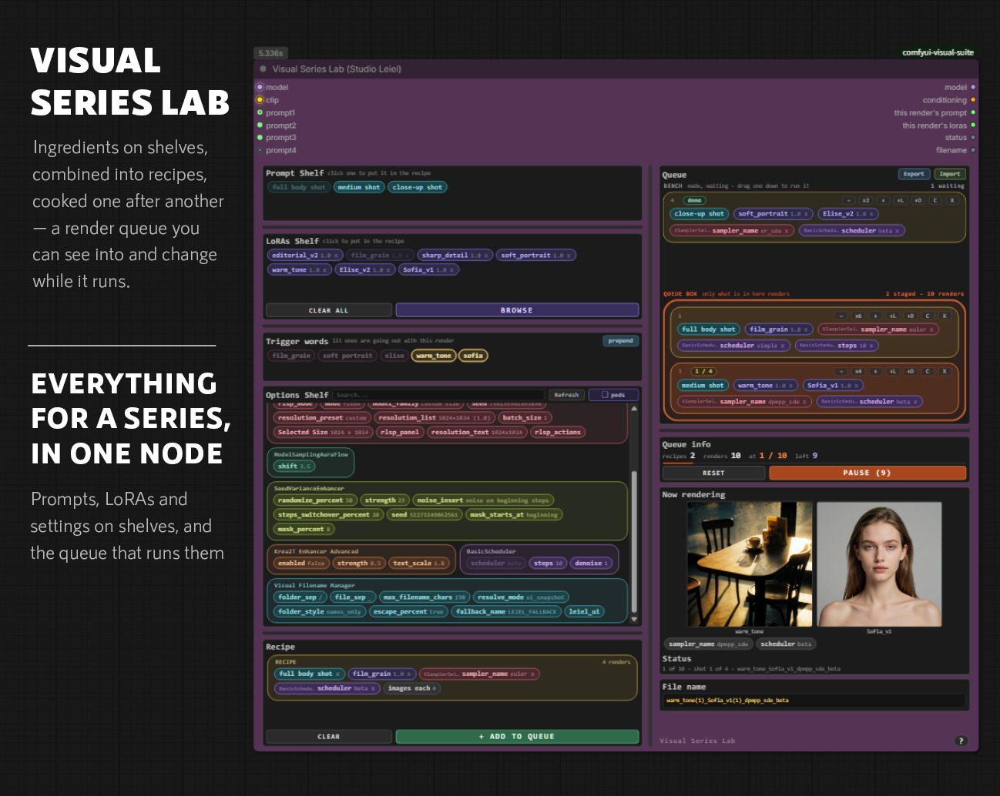
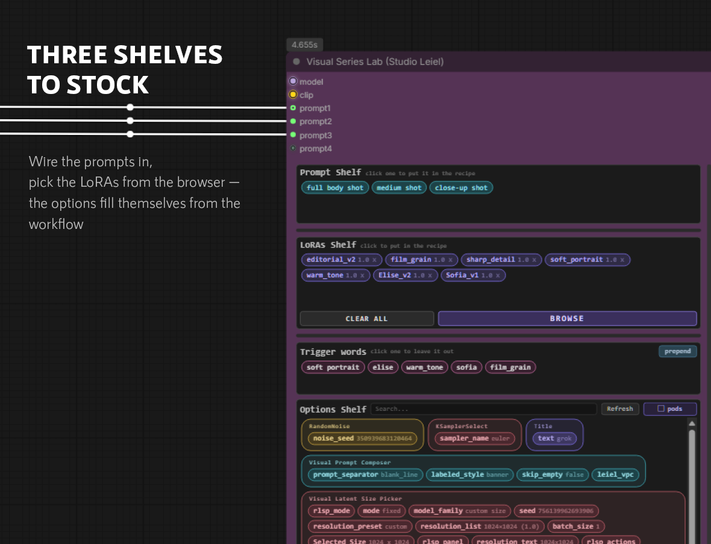
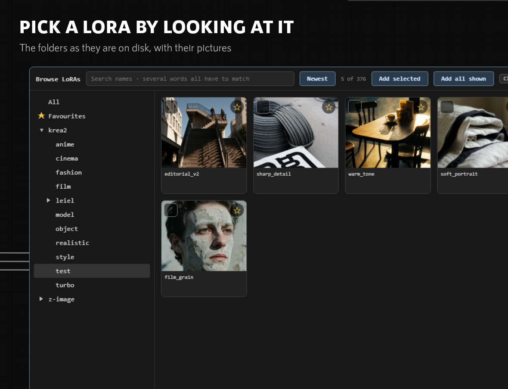
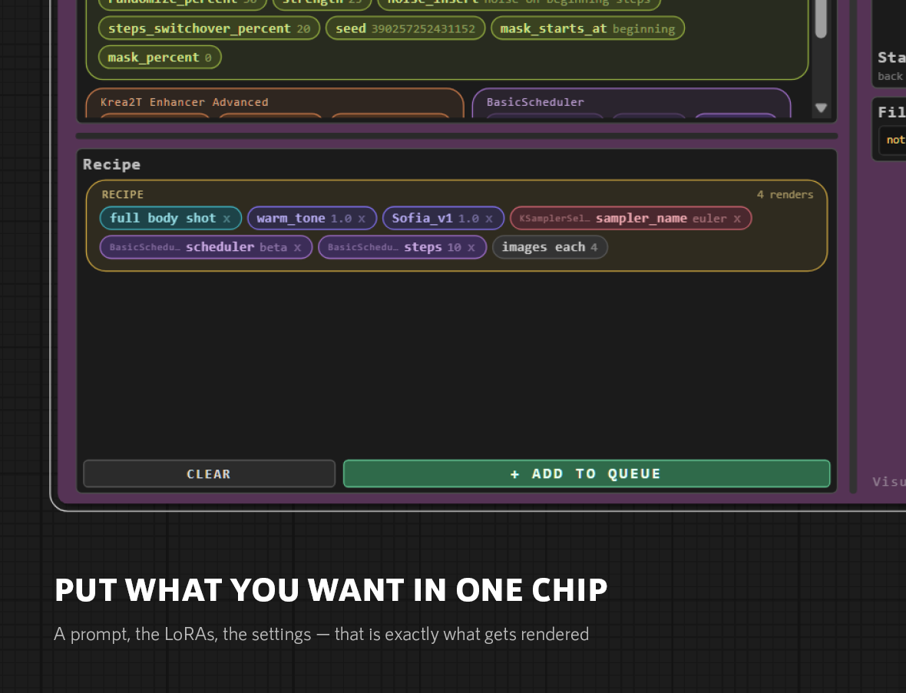
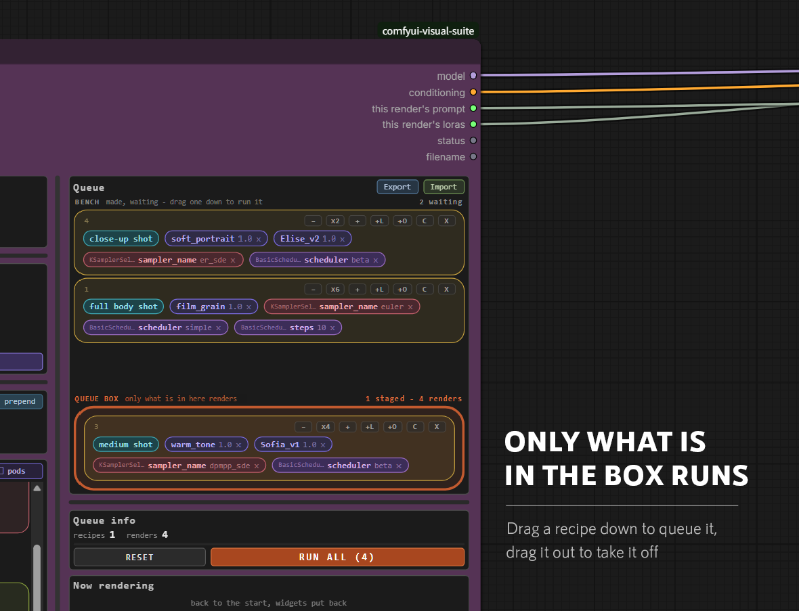
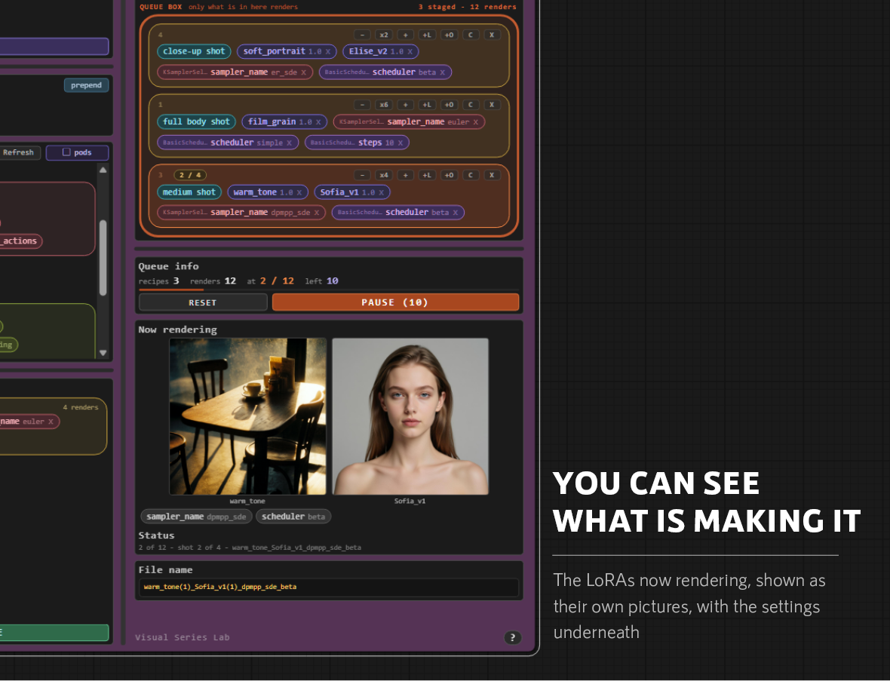
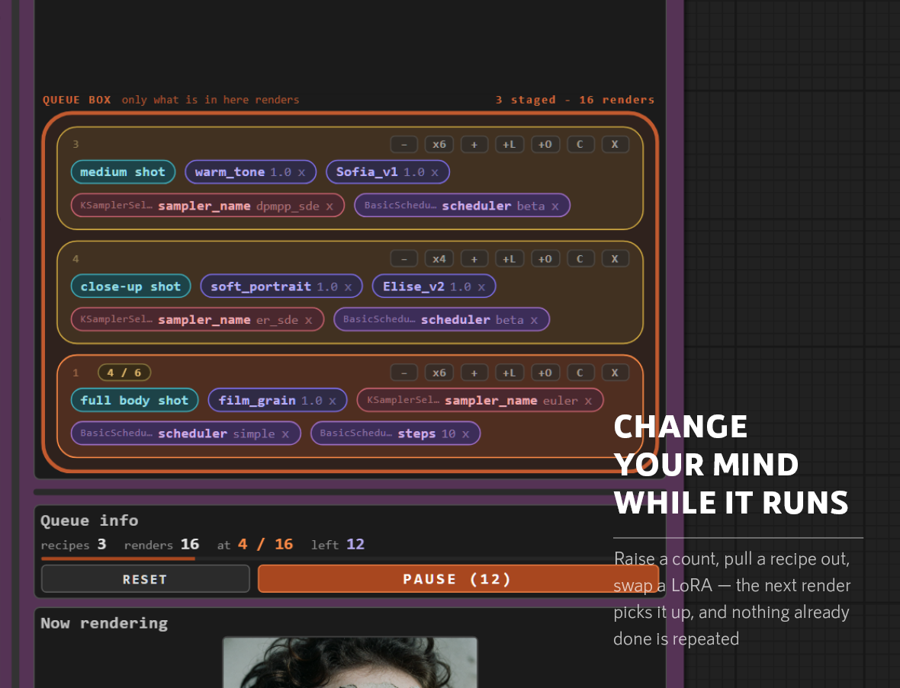
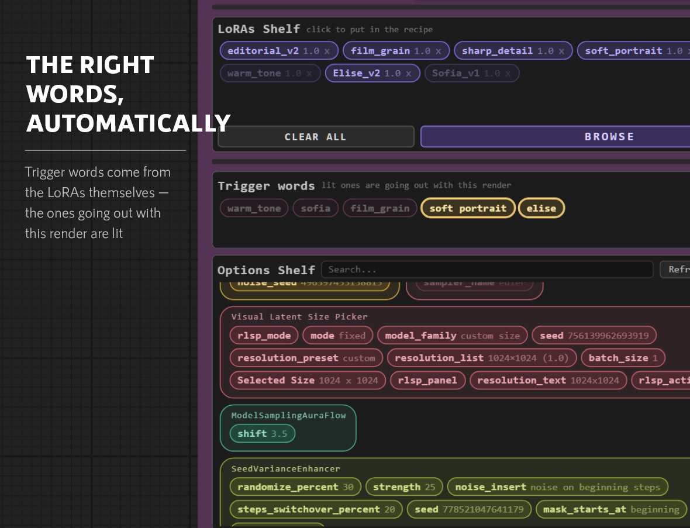

# Visual Series Lab

Ingredients on shelves, combined into recipes, cooked one after another — a
render queue you can see into and change while it runs.

---

## Your first run

There is a lot on this node. You need three things of it to start.

1. **Make a recipe.** Wire a prompt into `prompt1` — any text node, or a
   [Prompt Composer](prompt-composer.md). A chip appears on the **Prompt
   Shelf**; click it. If you want a LoRA, press `BROWSE`, pick one, and click
   its chip on the **LoRAs Shelf** too. Both land in the **Recipe** below.
2. **Queue it.** Press `+ ADD TO QUEUE`. The recipe appears on the **bench**
   at the top of the queue column. Drag it down into the orange **QUEUE BOX**.
3. **Run it.** Press `RUN ALL`.

That is the whole of it. Every picture says, while it is being made, which
prompt and which LoRA made it. Everything below is for when you want more —
none of it is needed to get going.

---

## Why this exists

ComfyUI renders one thing at a time. You set the graph up, queue it, and when it
comes back you change something and queue it again. Nobody complains about that;
it is simply how it works, so the work gets shaped around it.

Testing a new series means finding which style suits it. Five or six candidate
LoRAs, four or eight variations each, and the queue is already forty deep. Add
one more LoRA, or an enhancer, and it is sixty.

ComfyUI will render all sixty. What it will not do is tell you which one you are
looking at, or let you change your mind. A queued run is a sealed box: you watch
a LoRA you already dislike render its remaining twelve images, or you work out
where they sit in the order and cancel them one at a time, counting in your
head.

This node keeps the queue open. Every render says which prompt, which LoRAs and
which settings made it, while it is happening. A recipe that turns out badly can
be pulled out mid-run; one that turns out well can have its count raised on the
spot. Nothing already rendered is repeated.

What changes is not the time spent rendering. It is that the size of an
experiment stops being limited by how long you are willing to sit in front of
the machine.

---

# The basics

## Colour

The node is framed in the colour of the series open in the
[Series Book](series-book.md), and its panels are tinted with it, as the
Series Layout and the Series Report are - the suite reads as one. It follows
the book as you open another series or change its colour; with no book on
the canvas the node keeps its plain dark look.

## Shelves

**Prompt Shelf** — one chip per prompt wired into the node, named after
whatever it is connected to: rename the node at the other end of the wire and
the chip follows it, here and in every recipe already queued. Connect a text
node to `prompt1` and a chip appears; the next socket opens as soon as that one
is used, up to ten.

**LoRAs Shelf** — whatever was picked in `BROWSE`. Hover a chip to see its
picture; click to reserve it for the recipe, `x` to take it off the shelf.

The shelf does not belong to the workflow. It is kept in
`user/visual_series_lab/lora_shelf.json` and is the same shelf in every
workflow and every Series Lab on the canvas, so opening a series from the
Series Book, or starting a new workflow, finds it as it was left - there is no
need to save a workflow only to keep the LoRAs. The first time after the
update, the shelf the open workflow carried becomes the shared one.

**Groups.** `+ GROUP` adds a group to sort the shelf into - Film looks,
Models, Lenses, whatever helps. Drag a LoRA onto a group to put it there - onto the band of a folded group,
which stays folded and counts one more - and
back onto the shelf outside the groups to take it out; a LoRA sits in one
group at most. LoRAs in no group come first, where new picks from `BROWSE`
land. Click a group's band to fold it, double click its name (or right click
the band) to rename it, and its `x` - pressed twice - removes the group while
its LoRAs stay on the shelf. The groups are kept in the same file. The LoRA list
that opens from a queued recipe - to add a LoRA or swap one, and in a sweep -
is sorted into the same groups: the LoRAs in no group first, then each group
under a band that folds. A group folded on the shelf opens folded there too
(click its band to open it), except the one holding the LoRA being swapped. The shelf
scrolls once it is taller than its panel; drag the panel's edge to give it
more room.

`CLEAR ALL` asks first: the first press turns the button red and asks `CLEAR 33?`
- how many LoRAs it will take off - and only a second press within a few seconds clears the
shelf. The groups stay, empty.

**Sample pictures on hover.** The card that opens over a LoRA chip - on the
shelf, in a recipe or in the queue - also shows the model page's sample
pictures as a strip under the preview. Move the pointer onto the card and
point at a small one to see it large; the card stays open while the pointer
is on the chip or the card. The chip's `x` is left free for deleting: pointing at it
never opens the card, and moving onto it puts an open card away. Click the large picture, or any small one, to
open it over the whole window - the buttons on either side, the arrow keys or
the wheel go through the others, and a click or `Esc` goes back to the card,
which stays open until the pointer leaves it or a click lands elsewhere. The pictures come from the metadata file beside
the LoRA (`.metadata.json` from LoRA Manager, or `.civitai.info`): when LoRA
Manager has downloaded the example images to disk, those copies are shown;
otherwise the web addresses in the metadata are loaded from the internet.
Videos are left out. A LoRA with no metadata shows its preview alone, as
before.

### Browsing LoRAs

Every LoRA on disk, in the folders it actually sits in, with its preview
picture. The tree folds — the arrow opens a branch, the name selects it — and a
folder shows everything underneath it, not only what sits directly in it.

Search looks at file names first and falls back to folder names when nothing is
named that. Several words all have to match, and spaces, underscores and dashes
count as the same thing. Favourites have a shelf of their own.

## Recipes

A recipe is one prompt, the LoRAs you want with it, and the settings you want
changed. Click the chips on the shelves to bring them down. One prompt per
recipe, and it is required — a recipe without one cannot render.

`+ ADD TO QUEUE` leaves the recipe standing, so changing one thing and adding it
again builds a series in a few clicks.

A recipe carries only what you put in it. Anything you leave out keeps whatever
the node already has, and the values written for a render are put back
afterwards — a recipe changes the graph for one picture and leaves it as it was.

## Bench and queue box

A queued recipe lands on the **bench**, where it waits. Drag it down into the
**queue box** to have it rendered — only what is in the box runs, from the top
down. Drag to reorder, or drag one back out to take it off the run.

Each recipe keeps the number it was given when it was made. Not its position:
its own number, which never changes wherever it moves and whatever is deleted
around it. That is what makes the rest of this safe. Renumbering on every change
would mean that pulling one recipe out leaves you unsure which of the others you
are looking at, and an editable queue nobody dares edit is no better than a
sealed one.

A recipe that finishes leaves the box and goes back to the bench marked `done`,
so the box always holds only what is left. Put it in the box again and it starts
over.

A recipe dragged out of the box part way keeps its count - `6 / 24` - and its
chips keep their own, so put back in the box it carries on from there; only a
render that was sent but never came back is made again. The round arrow in
its header, beside copy, starts that one recipe over: its count goes back to 0
and every other recipe keeps its own. It shows once a recipe has rendered
something, and not on the recipe being rendered right now. **Reset** below
still starts the whole queue over.

## While it runs

**Now rendering** shows the LoRAs going into the picture that is being made — as
their own pictures, not as file names in a list — with the settings underneath.
The status line and the file name say the same thing in words.

All of the editing works during a run. Raise or lower a recipe's count with the
buttons either side of `x4`, add a LoRA with the purple layer mark or an option
with the orange sliders, copy one with the two sheets, remove it with the bin,
drag a new recipe in or an old one out. Click
a LoRA chip in a queued recipe to swap it for another - the strength it had stays,
so a LoRA tuned to `0.8` is replaced by another at `0.8` - and right click it to
change the strength. Each
render is set up fresh, so a change is picked up by the next picture rather than
the next run.

The counts follow every change at once. `recipes 3 · renders 16 · at 2 / 16 ·
left 14` is the whole state of the run in one line, and `PAUSE` stops it where
it is.

## Outputs

`model` and `conditioning` carry the render.

`this render's prompt name` and `this render's lora names` name what went into
the picture on its way out, and `filename` is a name describing the combination
— `warm_tone(1)_Sofia_v1(1)_dpmpp_sde_beta`. They are meant for a file manager
node downstream, so that what the screen tells you during a run, the file name
tells you afterwards. A prompt from a Series Book goes out with its number in
its series in front - `03 Watching It Burn` - so folders made from it sort in
the order of the book.

A prompt from a Series Book that asks for a frame - portrait, landscape or
square - passes it to any Visual Latent Size Picker on the canvas for that
render; **Now rendering** shows it as a `frame` chip. The same frame sits as a
small outline beside the prompt in the recipe and in every queued recipe: click
it for the next shape, shift+click for the one before. It is the book's setting,
so a change here shows in the book at once, and a change in the book shows here.

`this render's series name` is the name of the series the prompt belongs to
when it comes from a [Series Book](series-book.md) - for filing each series in
its own folder or under its own name. It is empty for a prompt on a socket.

`status` says where the run has got to.

---

# Going further

Each of these is there when you need it, and stays out of the way until then.

## Trigger words

Read from the LoRAs themselves, so the words that belong with a LoRA arrive
with it. Click one to leave it out. While a render is on its way, the words
actually going with it are lit and the rest are dimmed. `prepend` decides
whether they go before or after the prompt.

**Each recipe.** Some words change from one scene to the next - `looking at
viewer` belongs with a portrait but not with a scene where her eyes are
closed. Right click such a word, or drag it, and it moves to the **each
recipe** row under the others (right click or drag it again to move it
back). Every recipe - the one being
built and each one in the queue - then wears that word on its header as a
small switch: gold when it goes out with that recipe, struck through when it
is left out. Click it to change that recipe alone. The word's own state in
the each recipe row is the default: the recipe being built follows it, and a
recipe takes it as it stands when it is queued and keeps it - turning the
default on or off later changes only the recipes still to come. A duplicate
keeps its switches. The words lit during
a render are the ones that recipe actually sent.

This matters more than it sounds. Comparing five LoRAs by hand, it is easy to
leave the last one's trigger word in the prompt, or forget the new one's — and
then you cannot tell whether the LoRA was bad or the words were wrong.

## Options and sweeping a setting

The **Options Shelf** lists the widgets of every other node in the workflow,
without wiring anything. Search to narrow it, `Refresh` to rescan, and three
layouts to read it by: `pods` groups by node, `lines` puts one node per row, and
`flat` runs everything together. Click one to put it in the recipe.

Give a setting more than one value and every one is rendered. Values multiply:
two samplers, two strengths and four images each is 2 × 2 × 4 = 16 renders. Pick
several from the list for a setting that has one, or separate numbers with
commas. The count on the recipe updates as you build it.

## Help on hover

Rest the pointer on a button or chip and a card explains it, drawn the way the
Series Book draws its own: what it is on top, then each action - Click, Right
click, Drag - on its own row under a gold label. LoRA chips show their picture
card instead.

## A Series Book on the shelf

A [Series Book](series-book.md) wired into `series` puts every one of its
prompts on the shelf at once, named as they are in the book - rename one there
and the chip follows. They take no sockets, so the limit of ten does not apply.

Each series of the book is a group on the shelf under a heading with its
number, name and count - renamed in the book, renamed here at once. Click the
heading to fold the series away; click its dot to give it a colour, which its
prompts then wear on the shelf, in the recipe and in the queue. Every chip
carries the prompt's number (`2-03`) beside its name - the name itself, which is
what reaches file names, is unchanged.

A note written on a prompt in the book - right click its chip there - shows
when the pointer rests on that prompt's chip here: on the shelf, in the
recipe, in the queue and in the prompt picker.

## Capsule sweep

A recipe on a book prompt can render once per capsule — the same scene
through each of its poses, cameras or lights — or once per combination you
put together: a pose from one series with a camera from another. The `⇄ sweep`
chip beside the prompt opens the picker: click capsules to make them takes,
press `+` on a take to add a capsule of another kind to it, and give each take
its own count if it should have more or fewer renders than the recipe. Hover
the chip to read the sweep: every take in order with the picture of its
capsules' drawer cards, how many renders each gets and, while it runs, how far
it has got. Each take is also read by the Series Book's anchor check, with its
capsules in place of the prompt's own: a take whose anchors pull apart - a
close portrait swept over a walking pose - is marked, and the chip wears an
orange `!`, before a single picture is rendered. See the [Series Book](series-book.md#capsule-sweep) for the details.

## Queue sweep

Testing many prompts or LoRAs used to mean one queued recipe per try, and a
queue box full of near-identical recipes. A queued recipe can carry its own
**sweep** instead: three rows under it — **prompt**, **lora** and
**options** — each a list run one after another.

- **Prompts** render in turn. The prompt button in the recipe's header adds
  another prompt beside its own; prompts cannot be laid over each other, so
  every prompt on a recipe renders in turn, sweep or not.
- **LoRAs** in the sweep each get a pass of their own, put **first**, with the
  recipe's own LoRAs following. Sweep C and D over a recipe holding A and B and
  you get `C A B`, then `D A B`.
- **Options** in the sweep go on top of the recipe's options. Options on the
  **same setting take turns**: `sampler euler`, `er_sde` and `dpmpp_2m_sde`
  are three passes. Options on **different settings combine**, every one with
  every other: add `enabled false` and `enabled true` as well and each sampler
  runs once with the enhancer off and once with it on — 3 × 2 = 6 passes,
  and the heading reads *(3 × 2) options*. In the row each setting is its own
  group - numbered *1*, *2* on the left, a dashed rule between them, its
  chips numbered within it - in the order the sweep runs them. The setting that came into the
  sweep first changes slowest. A swept option the recipe also sets replaces
  it for that pass; one with several values still sweeps its values. Only an
  exact copy, the same widget at the same values, counts once: it can be
  added - usually to be changed next - and shows dimmed with a dashed edge
  while it matches, and the copies are taken out when Run starts.

The option picker on a queued recipe lists every option, the ones already in
the recipe too (marked ✓): add the same option twice, set each copy its own
way, then drag both into the sweep. A LoRA in the sweep keeps its trigger
words — they stay in the Trigger words panel and on the recipe's switches.

**Favourite options.** Each option in the picker ends in a star. Click it and
the option is kept under **★ Favourites** at the top of the picker, with its
node's name beside it, so the sampler or the Enhancer is one click away every
time. Click the star again to take it out. A favourite is named by the node's
title and the widget, not by the node's id, so it holds in every workflow with
a node of that name; it is kept in this browser and with the workflow.

The rows multiply: 3 prompts × 2 LoRAs × 2 options × 2 images each is 24
renders, and the sweep's heading says so. They run prompt by prompt, so one
prompt's pictures come out together. A capsule sweep on the recipe applies to
every book prompt in it.

**Opening it.** Drag any chip — the prompt, a LoRA, an option — down from the
recipe's body: the sweep opens under it while you drag, and dropping moves the
chip in. Or press the sweep button (three arrows) in the header and add with
the `+` at the end of each row. Drag a chip from the sweep back onto the
recipe's body to take it out again, drag within a row to change the order,
`✕` removes it.
A prompt chip in the sweep works as it does on the recipe: hover it to read
the prompt's note, click it to swap it for another prompt. The new one takes
its place in the order and keeps its count; a prompt already in the sweep is
not added twice.
The recipe's own prompt, once dragged into the sweep, is a sweep prompt like
the others: `✕` takes it out of the recipe altogether and swapping it replaces
it there too - it does not come back onto the recipe's body. The recipe then
takes the prompt swapped in, or another prompt on its body, or else the first
one left in the sweep, as its own. Only the very last prompt of a recipe
stays, since a recipe with none could not render.

A recipe whose own prompt is gone — never picked, or from a book that is no
longer loaded — takes the first live prompt you add to its sweep as its own.
That prompt stays in the sweep, so it renders once, in turn, and the red
**no prompt** chip clears. Building a sweep straight from its `+` buttons,
without dragging the prompt in first, renders just the same.

**Counts per chip.** Every chip in the sweep carries its own `− ×6 +`; it
starts at the recipe's count, dim. The rows are levels, one above the other:

- a **prompt**'s count covers every pass of that prompt — all its LoRAs,
  all its options;
- a **LoRA**'s count lifts its own passes above that;
- an **option**'s count lifts only the passes it is in — Enhance on at ×6
  is six of every Enhance-on pass, Enhance off stays as it was.
  Where options combine, a pass takes the highest of its options' counts —
  `euler ×4` with `enabled true ×6` makes six.

A count lower down never pulls one above it down: on any one pass the
highest count wins. Bring a LoRA or an option down to the prompt's count and
it follows the prompt again.

A count brought back to the recipe's own number follows the recipe again. A
chip lifted by another shows what it really gets, in italic: with BSS at ×6
the options under it read *×6*, or *×4–6* when only some of their passes meet
BSS. The counter never opens a LoRA's picture card — only its name does.
While it runs, the sweep chips of the picture being made show a small slowly breathing dot in place of their number; every started chip fills from the left with a darker shade as far as its renders have got,
and every chip shows how far it has got — `3/6`, its own renders sent of its
own total, then `done` — so what is left of each one reads at a glance. A chip
that is done fades back on a dashed edge.

Progress is kept per pass, not as one running number, so changing a count in
the middle of a run adds or drops exactly those images — nothing already
rendered is made again. A pass is named by what the sweep put into it: change
a swept option's value and that pass counts as new. Adding an option on a new
setting does the same: the passes become combinations, and each combination
is new.

**Running one again.** Drag a chip that says `done` to another place in its
row and it is asked for again: its renders are cleared and it runs once more
from where it now sits, in the same run, without stopping. A chip still under
way keeps its count when it is moved. After reworking a prompt this is the
clean way to see it again — raising its count instead keeps the old pictures
and adds new ones beside them.

**Only what it sweeps.** A row with nothing in it is hidden, so a sweep of
LoRAs alone is one row. The hidden rows' `+` buttons sit at the end of the
sweep's heading, and every row comes back while a chip is being dragged, so
there is always somewhere to drop it. A sweep with nothing in it yet shows
all three.

**Pausing it.** The sweep button switches it off and on. Off, the sweep is
hidden and left out of the run but nothing in it is lost — the button keeps a
small dot while it holds anything. Empty it and it closes by itself.

## Renaming a prompt chip

Right click to rename a chip. A name you type wins over the one upstream from
then on, and the chip carries a dot to say so - following the node is the
ordinary state and wears no mark, since a shelf where every chip carried the
same badge would say nothing. The dot is also the way back: press it and the
typed name is dropped and the node's own name takes over again. Renaming and
leaving the box empty does the same, and the box shows the upstream name greyed
out behind it. A name you type is dropped anyway if you rewire that socket to
something else, so a chip never keeps the old thing's name.

## Keeping a plan

Everything — the shelves, the recipe, the queue and how far it has got — is
saved with the workflow, except the LoRAs Shelf and its groups, which are kept
apart for every workflow (see above).

`Export` writes the queue to a JSON file, anywhere you like. `Import` adds a
file to what is already there rather than replacing it, so two plans can be
merged.

A single render can come back too. **→ Lab** in the [Visual Image
Viewer](image-viewer.md) puts the recipe that made a picture on the bench:
its prompt, LoRAs, option chips, swapped capsules and per-recipe words, with
the count of the recipe being built. The prompt is found by its scene in the
Book, and by name when the number has changed.

That makes a queue a template rather than a backup. A setup that compares five
LoRAs at four images each can be exported once, and the next series only needs
its prompts swapped.
