# Visual Series Layout

A series laid out for print, for the web and as a short film — the cuts you
picked, with the numbers, titles, captions and notes of the Series Book, in
the order of the book.

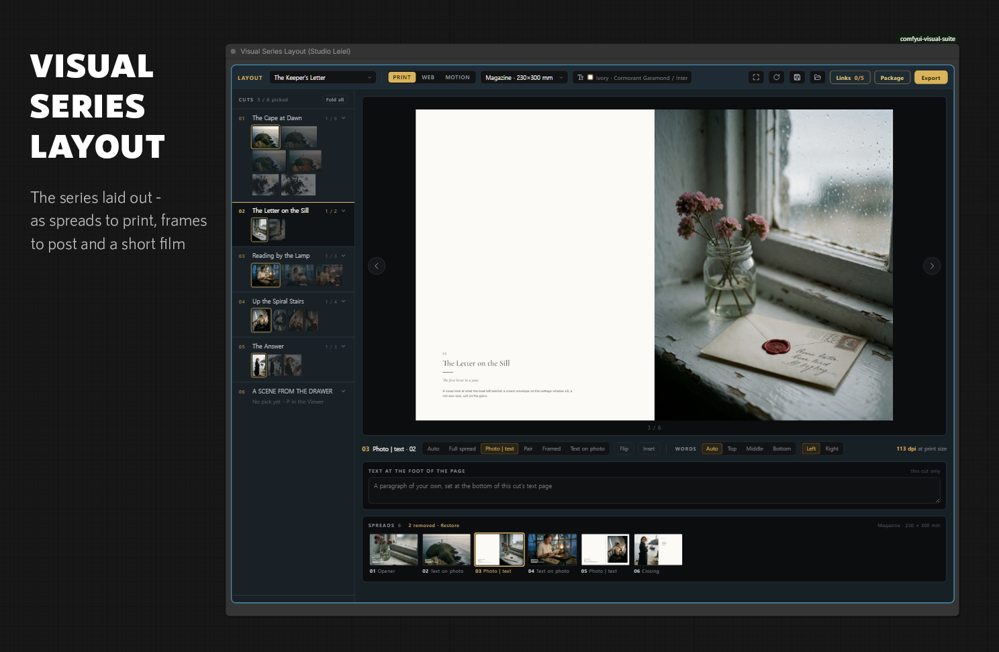

---

## Why this exists

A series is written in the [Series Book](series-book.md), rendered, and judged
in the [Image Viewer](image-viewer.md), where the good renders are picked with
P. At that point it is still a folder of files. Whether it works as a story -
whether the rhythm of wide and close holds, whether a cut is missing, whether
two cuts belong side by side - only shows when it is seen the way it will be
read: in order, at size, with its words.

Everything a layout needs is already there. The book has the title, the note
and, for every cut, a number, a name, a caption and a note. The viewer has the
picks. This node puts them on the page. Nothing is typed twice, and no model is
involved: the words are the book's, the pictures are yours.

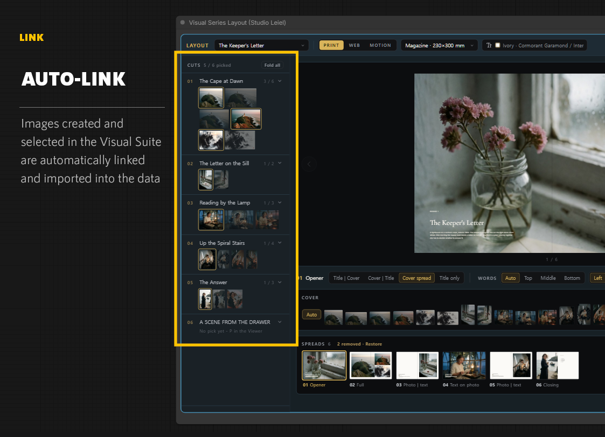

## Print and web

The switch at the top chooses what the series is laid out for.

**PRINT** lays it out as spreads of two pages:

| Size | Page |
| --- | --- |
| Magazine | 230 × 300 mm |
| A4 | 210 × 297 mm |
| Square | 250 × 250 mm |
| Landscape | 300 × 240 mm |

**WEB** lays it out as single frames, one after another as in a feed:

| Size | Frame |
| --- | --- |
| Portrait 4:5 | 1080 × 1350 px |
| Square 1:1 | 1080 × 1080 px |
| Vertical 9:16 | 1080 × 1920 px |
| Wide 16:9 | 1920 × 1080 px |

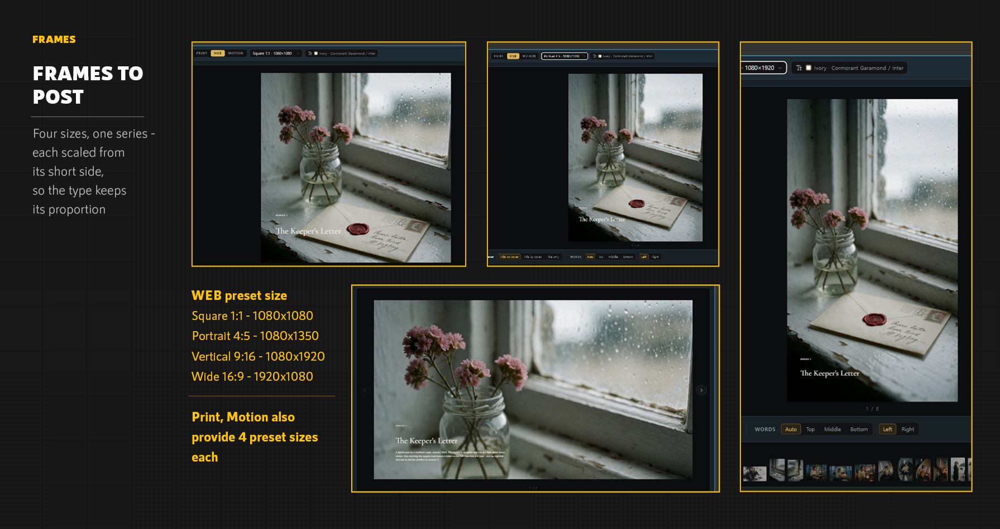

Every size is scaled from its short side, so the type keeps the same proportion
to the page in all of them. Margins are 7.8 % of the short side outside, 7 % at
the gutter, 8.7 % at the top and 10.4 % at the bottom - 18, 16, 20 and 24 mm on
the magazine page.

## The layouts

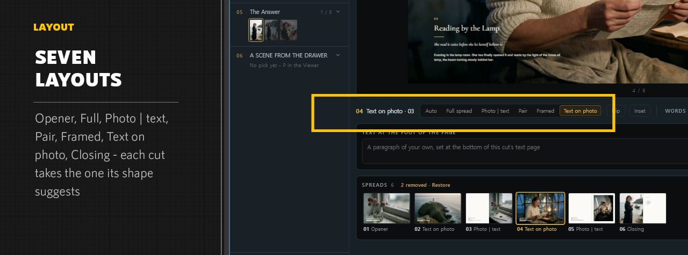

| | Layout | In print | On the web |
| --- | --- | --- | --- |
| A | Opener | Title \| Cover, Cover \| Title, Cover spread (the title on the picture) or Title only | Title on cover, Title by cover (beside it in a wide frame, under it otherwise) or Title only |
| B | Full | The cut across both pages; its number and caption small in the corner | The cut filling the frame; its number and caption small in the corner |
| C | Photo \| text | The cut on one page to the edge, its words on the other | Wide: pictures and words side by side. Tall: pictures above, words below. 4:5 and square: a frame of the pictures, then a frame of their words |
| D | Pair | Two cuts side by side, both to the edge | Two cuts in one frame - side by side, or one above the other in a tall frame |
| E | Framed | Two cuts inside the margins, words below each | One cut, or two, inside the margins, words below - or beside, in a wide frame |
| O | Text on photo | The cut across both pages, its words set on the picture | The cut filling the frame, its words set on the picture |
| F | Closing | The last cut, then the list of every cut | The list of every cut - in two columns in a wide frame |

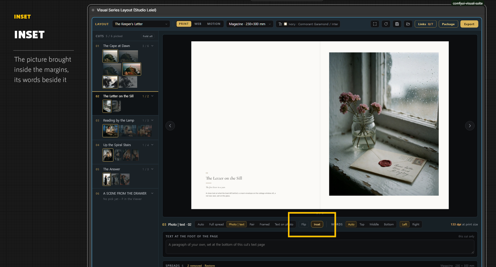

## Moving a picture in its frame

Where a frame crops a picture - a cut across a spread, a photo page to the
edge, a cover, the cells of several picks - drag the picture on the page to
choose the part that shows: up and down for a picture taller than its frame,
left and right for a wider one. The pointer turns to a hand over a picture
that can move. Double-click puts it back in the middle. A picture that fits
its frame whole has nothing to move.

The place is kept for each picture at each size - the same picture in a
magazine spread and a square post is cut differently, so each is set on its
own - and it goes into everything exported from that size: the pages, the
PDF and the InDesign document, where the picture sits in its frame as it did
on the page. The film is framed on its own in MOTION.

## Several picks in one cut

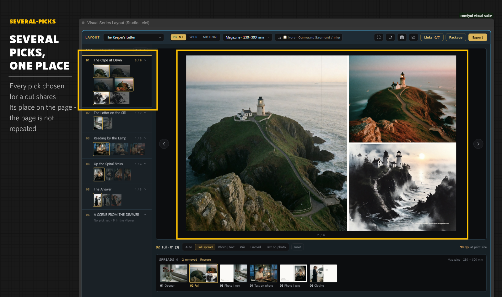

Every pick chosen for a cut goes into the cut's own place on the page - the
page is not repeated. A full spread with three picks holds three pictures; the
photo page of a Photo | text holds them all, its words still facing them.
The pictures share their place with a thin line of paper between them, and
the way they share it is chosen by their shapes: two landscapes one above the
other, two portraits side by side, three as one large picture and two small,
more in a grid - whichever cuts the least off the pictures.

The words of a cut on a **Photo | text** page are its number, its title, a
short rule, its caption, then its note. The block sits where the page's words
are placed - top, middle or bottom - and moves up when the note is long; what
still does not fit ends with an ellipsis. **Text on photo** sets the same words
in light ink on the picture.

The picks of a cut keep the order they were rendered in. A pick added later
goes into its rendered place; one swapped in from MOTION's **Picture** panel
keeps the place of the pick it replaced, on the page as in the film.

## How a series is laid out

The cuts come in the order of the book. A cut lays out every pick chosen for
it, together; landscape or portrait is read from the first. A cut with none is
left out.

In print:

- The series opens with **A**, as Title | Cover unless another is chosen. Its
  cover is the first portrait pick, unless you choose another one.
- A landscape pick becomes a **B**, a portrait pick a **C**. The photo of each
  C sits on the other side from the one before, so the pages alternate.
- When the last cut is a single portrait pick, it is the left page of the
  closing spread **F**; otherwise F starts with a blank page.

On the web the shape of the frame decides:

- **Wide (16:9)** - the title and the note sit on the cover, or beside it. A
  pick that does not fill the frame sits beside its words (**C**).
- **Tall (9:16)** - a pick that does not fill the frame sits above its words
  (**C**).
- **4:5 and square** - a pick that does not fill the frame sits inside the
  margins with its words below (**E**); Photo | text gives the words a frame of
  their own.
- A pick close to the frame's shape fills it (**B**), and so do several picks
  together. The last frame lists every cut.

In both, **D** and **E** of two cuts are never chosen for you: which two cuts
belong together is a matter of the story. Landscape or portrait is read from
the pick itself, not from the book's FRAME.

What is chosen by hand is kept apart for print and for the web - a cut can be a
full spread in print and a framed picture in a feed.

## Using it

1. Pick the series in the list at the top. Every series the Series Book has
   saved is in it, the one saved last first. The node wears the series' colour
   from the Series Book, and follows it when it is changed there.
2. Choose **PRINT** or **WEB**, and the size beside it.
3. **CUTS**, on the left, has every cut of the book with its picks - never
   taller than the page beside it; a long series scrolls - all at one
   height like a contact sheet, so their width shows their shape. Chosen picks
   are bright with a gold line round them; the rest are dimmed. Click a pick to add it to the cut, click it again
   to take it out - every chosen pick is laid out, in the order they were
   rendered, and the last one of a cut stays. `2 / 3` beside a cut counts its
   chosen picks. Click a cut to go to its page.
4. The large page is the one chosen in **SPREADS** (or **FRAMES**) below it.
   Step with the arrows on either side of it, or with the keys.
5. Under the page, change how its cut is laid out:
   - **Auto** - by the shape of the pick and the frame
   - **Full**, **Photo | text** - for this cut alone
   - **Pair**, **Framed** - this cut and the next one share the page
   - **Text on photo** - the words set on the pictures
   - **Flip** - the photo and the words change places
   - **Inset** (print, on **Full spread**, **Photo | text** and **Text on
     photo**) - the pictures come in from the edge and sit inside the margins
     of the page or the spread, the paper round them; press again for the edge.
     Mixing pages to the edge with inset ones gives a series its rhythm
   - **WORDS** - on a page with words of its own: **Auto** follows the Style,
     **Top**, **Middle** and **Bottom** set this page alone; **Bottom** sets the
     last line on the foot of the page
   - **Left**, **Right** - the words of this page set flush left, or flush right
     against the page's outer margin - on a cover spread, or words set on a
     picture across the spread, against the right edge of the spread
6. On the opener, choose how it is laid out, and under it the **COVER** - any
   pick of the series, or **Auto** for the first portrait pick. Alt+click on a
   pick in CUTS chooses the cover too.
7. On a **Photo | text** or **Text on photo** page, **TEXT AT THE FOOT OF THE
   PAGE** adds a paragraph
   of your own at the bottom of the page of words - a credit, a line of
   context. It belongs to that cut, and is kept for print and web alike.
8. **×** on a page in SPREADS takes it out of the layout: a cut's own page
   takes the cut out; the opener, the introduction
   or the closing goes alone. **Restore** beside the count brings
   every page back; choosing a pick of a cut taken out brings the cut back.
9. **Export** opens the export window - see [Export](#export).

Picks made in the viewer appear within a few seconds; the refresh button reads
the book and the picks at once.

## Motion

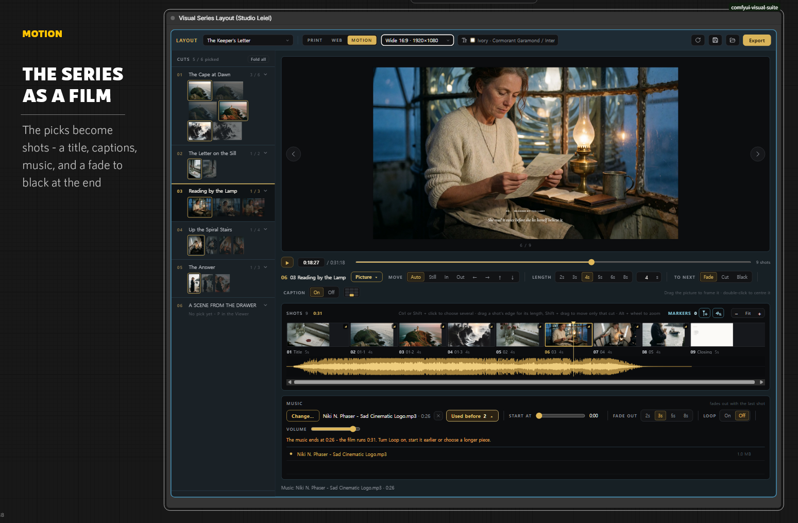

**MOTION**, beside PRINT and WEB, makes a short film of the series: the cover
with the title, every chosen pick of every cut one after another, moving
slowly, with its caption on it, and the list of the cuts to close - set to
music that fades out with the last shot. Nothing is drawn by hand; each shot
is chosen, as a page is.

The size beside it is the frame of the film - **Vertical 9:16** for Reels,
Stories and Shorts, **Wide 16:9** for YouTube, **Portrait 4:5**, **Square 1:1**.
The Style (colour, typefaces, sizes) is the one of the layout.

- **▶** plays the film here with its music (Space); the bar under the picture
  goes to any moment of it. The time is in minutes, seconds and frames -
  `0:12:15` is twelve seconds and fifteen frames; type a moment in it -
  `0:12:15`, `0:12` or `12.5` - and Enter to go there.
- **SHOTS** is the film's timeline: every shot in order, as wide as the time
  it is on screen, with the music's waveform under them on the same scale -
  where the music loops, and where it fades - and a line across both for the
  moment on show. The waveform is read every 2.5 ms: its outline is the peak
  of the sound, its bright core the body (RMS), on a curve that keeps the hits
  tall and lets the steady part sit lower, so the accents to cut on stand out. Click a shot to work on it; **Ctrl**+click adds or takes a
  shot from the ones chosen, **Shift**+click chooses every shot between; what
  is set then goes to all of them. Drag a shot's right edge for its length,
  in half seconds - a tenth with Ctrl held: every shot after it moves with
  it, and the film grows or shrinks. With **Shift** held, only that cut
  moves - the next shot gives or takes the time, the rest of the film stays
  where it is; near the playhead it snaps to
  it, and the next shot then starts there. Drag the playhead - or along the
  waveform - and the screen above follows, the time shown on the playhead. **+** and **−** zoom the timeline
  in and out, as does Alt with the mouse wheel; a shot shows one frame at its
  head and the rest of its length is left empty, as clips on a timeline. **×** takes a shot out of the film, **Restore** brings every shot
  back. Picks chosen or taken out in CUTS come and go in the film too.
- For the shot chosen:
  - **MOVE** - **Auto** pans where the frame cuts the picture and zooms slowly
    where it fits, in turn; **Still**, **In**, **Out**, or a pan **←** **→**
    **↑** **↓**
  - **LENGTH** - 2 to 8 seconds, or any length from 1 to 20 typed beside them
  - **TO NEXT** - **Fade** into the next shot, a straight **Cut**, or down to
    **Black** and up again - a pause between two parts. A fade overlaps the
    next shot by 0.8 s; changing it keeps the next shot starting where it
    did, so a cut set on a marker stays on it - the shot's length changes by
    the overlap instead. On the timeline, a small mark at the top right of
    each shot says how it passes: a gold wedge for a fade, a bar for a cut,
    a black square for black
  - **CAPTION** - the cut's number and title, small, and its caption under
    them, on the picture. On by itself for the first pick of a cut. The small
    grid beside it places the caption: top, middle or bottom, by left,
    centre or right - bottom centre to begin with.
  - **Framing** - drag the picture on the screen to where it should sit in
    the frame; the move runs from there. Double-click puts it back in the
    middle. The framing belongs to the size it is dragged in - a wide frame
    and a tall one cut the same picture differently - so frame each size you
    export; a size not framed yet starts from the middle. The moves, lengths,
    passes and captions are the same for every size.
- On the title shot, **Cover** opens and closes the **COVER** panel, which
  chooses the picture of the title -
  any pick of the series, or **Auto** - as on the opener of the spreads; it
  is the same cover for both. Alt+click on a pick in CUTS chooses it too.
- On a picture shot of a cut with more than one pick, **Picture** opens and
  closes the **PICTURE** panel with every pick of that cut. Click one to put
  it in this shot: the shot keeps its place, length, move, pass to the next
  and caption, and only the picture changes. A pick that was not chosen
  takes the old one's place, and the old one is no longer chosen - in print
  and web too. A pick already in the film (marked with a dot) trades places
  with it instead. The framing stays with each picture, so a picture new to
  the shot starts from the middle. The panel stays open while picks are
  tried in it; choosing another shot or cut, or any other change, closes it.
- The film comes up from black and goes down to black at the end.

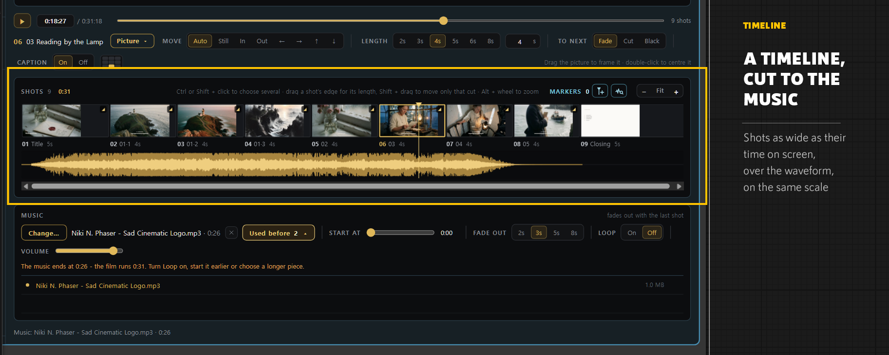

### Logo

**Style** has a **LOGO**: choose a PNG, SVG, JPEG or WebP - one with a clear
background sits best - and its size, **S**, **M** or **L**. The empty margin
round it - transparent, or the plain colour of its corners - is cut away, so
it lines up with the words above it; the size is the height of the logo
itself. It is kept in `user/visual_series_layout/logos/` and set at the foot
of the closing page,
under the list of the cuts - in print, on the web, and on the last shot of the
film. **Remove** takes it away. The InDesign document leaves it out; place it
there as you place any logo.

### Music

**Choose music…** takes a piece from this computer - MP3, WAV, M4A, OGG,
FLAC. It is kept in `user/visual_series_layout/music/`, so the workflow finds
it again. **START AT** is where in the piece the film begins; **FADE OUT** is
how many seconds the music takes to fade away at the end of the film, which
ends when the last shot does - more shots, a longer film, a later fade.
**VOLUME** sets how loud it is. **LOOP** **On** runs a piece shorter than the
film again from START AT each time it ends, until the film's fade; **Off**
plays it once, and the film runs on in silence after it.

**MARKERS** are the moments of the music to cut on, shown on the waveform in
blue; their buttons sit above the timeline, in SHOTS, as icons - each says
what it does when the pointer rests on it: a marker with a plus (Add), a
wave under a lens (Find accents), a magnet (Fit cuts), an arrow back (Undo
fit), a funnel (Keep on cuts) and a bin (Clear). **Add · M** puts one at
the playhead - press **M** while the film plays
to set them by ear, on the beat. **Find accents** puts them, in the part of the music the film uses, where it
rises sharply - an onset, found by plain arithmetic on the sound, no AI -
strong against the passage around it and at least a second apart; keep the
ones that suit. **Fit cuts** moves every cut onto the
marker nearest it, shot by shot from the start - when one is near enough, a
third of the shot's length or a second - and the shots after each move
along; each marker takes one cut. **Undo fit** puts the lengths back.
**Keep on cuts** then takes away the markers no cut sits on - those set
outside the part of the music the film uses stay. Find
accents, then Fit cuts, and the film is cut to the music in two presses.
Click a marker to go to it, **Alt**+click to delete it;
**Clear**, pressed twice, takes them all away. Dragging a shot's end snaps it
to the markers as to the playhead, so each shot can begin on a beat; the
playhead, dragged near a marker, snaps to it too. The count beside
MARKERS is of those in the film; `/ 127` after it says the piece holds more,
outside the part the film uses. The
markers belong to the piece of music, in its own time: they move with START
AT, repeat where it loops, and come back when the piece is chosen again.

**Used before** opens the list of every piece chosen here, in the order it was
first added - click one to set it to the film; the one in use is marked in
gold. **×** beside a piece, pressed twice, deletes it from the list and from
the folder. The list closes again with the same button. Under it, how long the film runs and which
part of the music it uses; it says so when the piece ends before the film.

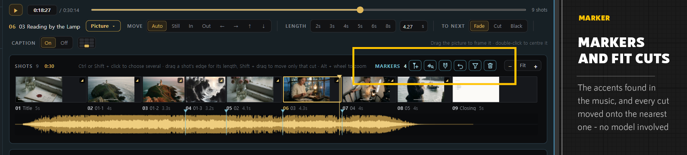

### Recording

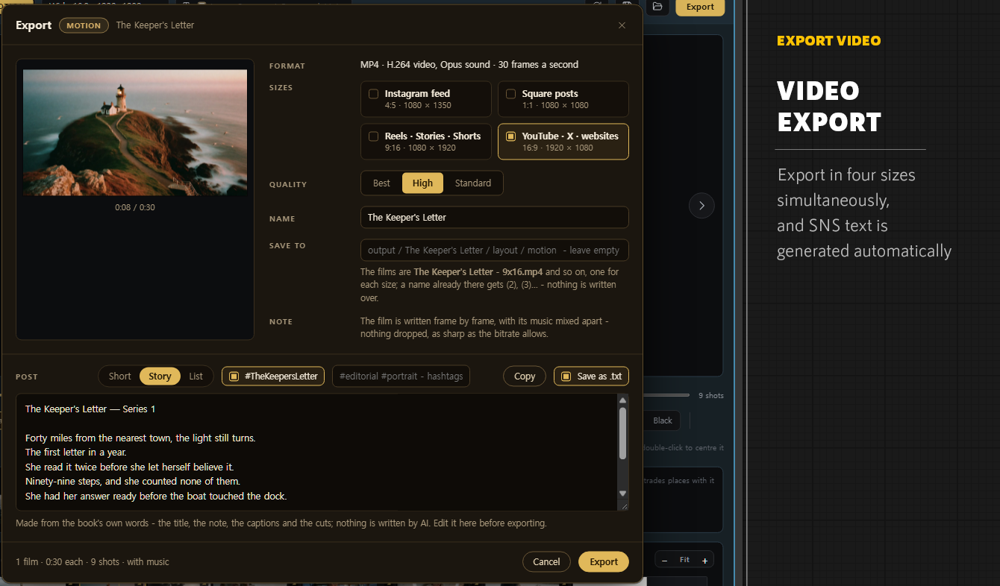

**Export** in MOTION opens the export window: the **SIZES** to record - any of
the four, in one go, each laid out for its frame - **QUALITY**, **NAME** and
**SAVE TO**, as for the other exports. Left empty, the films go into
`output/<series>/layout/motion/`, as `<name> - 9x16.mp4` and so on; a name
already there gets (2), (3)… and nothing is written over.

| Quality | Bitrate | For |
|---|---|---|
| Best | 60 Mbit/s | editing further, keeping |
| High | 40 Mbit/s | posting - the default |
| Standard | 20 Mbit/s | smaller files |

The film is written frame by frame: every frame is drawn at the full size of
the film from the full-size renders (or the upscaled pictures linked to them),
handed to the browser's H.264 encoder at the bitrate chosen, and the music is
mixed apart and encoded as AAC (Opus where the browser has no AAC) - so
nothing is dropped or squeezed, fades included, and it is quicker than the
film runs. **Stop** ends the export without writing anything. The file is MP4, 30
frames a second. A browser without such an encoder records the film as it
plays instead - as long as the film runs, at a quality the browser decides;
the export window says which it will do.

## Post

The export window of a film (MOTION) and of frames (WEB) has a **POST** under
it: the words to put with the upload, made from the book's own words - the
series title and number, the series note, the cuts and their captions.
Nothing is written by AI; the words are the ones in the book.

- **Short** - the title, the first caption and the hashtags, for Reels and
  Shorts
- **Story** - the title, every caption in order, the cuts and the hashtags
- **List** - the title, the series note, and every cut with its caption, for
  a YouTube description

The hashtags: one made from the series title (`#TheKeepersLetter`), which can
be left out, and the ones typed beside it - written once, kept for every
series. The post can be edited in the window before exporting. **Copy** puts
it on the clipboard; **Save as .txt** writes it beside the export, as
`<name> - post.txt` (in `output/<series>/layout/motion/` for a film,
`output/<series>/layout/` for frames, or in the folder chosen) - never over
an earlier one.

## Size of the node

Drag the node's corner to work larger. Taller, and the desk the page sits on
grows by as much - the page or the film grows with it as far as the width
allows; wider, and it grows with the width. A wide frame in a narrow node
needs the node wider to grow. The node keeps the height given, and fits
itself round it.

## Folding the cuts

The arrow at the end of a cut's title in CUTS folds the cut to its title and
opens it again; **Fold all** at the top folds every cut, **Unfold all** opens
them. A long series fits the side this way. The folds are kept with the node.

## Tooltips

Holding the pointer on anything shows a card, as in the Series Book: what it
is first, then each action - Click, Alt+click, Shift+drag... - on a row of its
own under a gold label. A pick - in CUTS, in the COVER panel or in MOTION's
PICTURE panel - shows large on its card, with its cut and whether it is in
the layout, the cover or in the film, so it can be seen before it is chosen.
A pick in CUTS also shows its scene's note from the Series Book under the
picture, as written - the card only; the layout keeps its own words.
The card goes away on a click, the wheel or a key.

## Full screen

The full-screen button, **F** or **↓** opens the page on its own, on the whole
screen. **←** and **→** step through the series; **Esc**, **↑** or **F** comes
back to the node.

## Keys

With the pointer over the node, the node selected, or the full-screen view
open:

| Key | |
| --- | --- |
| ← → | Previous and next page |
| Home End | First and last page |
| F, ↓ | Full screen |
| Esc, ↑, F | Back from full screen |

## Style

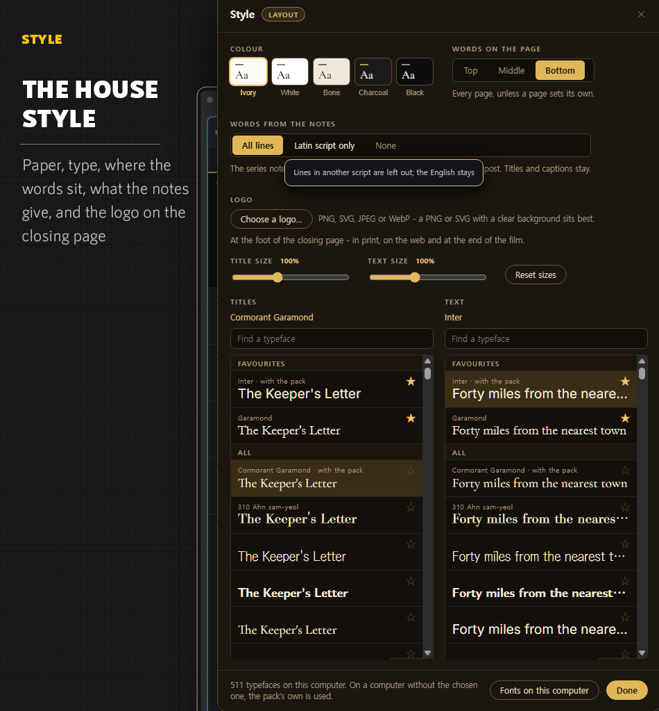

The style button at the top - it shows the colour and the typefaces in use -
opens **Style**. Everything in it is chosen, never drawn: whatever is picked,
the page stays in proportion.

- **Colour** - the paper and its inks: Ivory, White, Bone, Charcoal or Black.
  Each sets the paper, the ink of titles, of text, and of numbers and rules.
- **Words on the page** - where the words sit on a page of their own (the
  opener, the text of Photo | text, the introduction): **Top**, **Middle** or
  **Bottom**. A page can set its own under the page, with WORDS.
- **Words from the notes** - which lines of the series note and of each cut's
  note reach the pages, the frames, the film and the post: **All lines**,
  **Latin script only** - a note written in two languages keeps its English
  and leaves the lines in another script out - or **None**, the
  titles and captions alone. The notes in the Series Book are not changed.
- **Title size** and **Text size** - 70 to 150 %. Titles are the series title,
  cut titles and the closing list; text is everything else. **Reset sizes**
  brings both back to 100 %.
- **Titles** and **Text** - one typeface for each. Cormorant Garamond and Inter
  ship with the pack and look the same on every computer. **Fonts on this
  computer** asks the browser for the typefaces installed on the machine - it
  asks once for permission - and lists them with a sample of the series title.
  **☆** keeps a typeface with the **Favourites**, at the top of both lists, in
  every layout in this browser. A typeface missing on another computer falls
  back to the pack's own there. Text the chosen typeface cannot set - another
  script, for instance - falls back to the system's own typeface for it.

## Print resolution

In print, beside the page is how sharp its smallest picture prints: its pixels
over the millimetres it is given - for a picture to the edge, the side that is
cut decides. A render 1600 px wide across a whole spread prints at about 85 dpi;
on one page, about 110. 300 dpi is print quality, and the figure turns orange
below 200. On the web the frames are exported at their own pixel size, which a
render covers.

A render is not a print file. A layout made of renders is a proof; for print,
package it, upscale its pictures, and link them again.

## Package

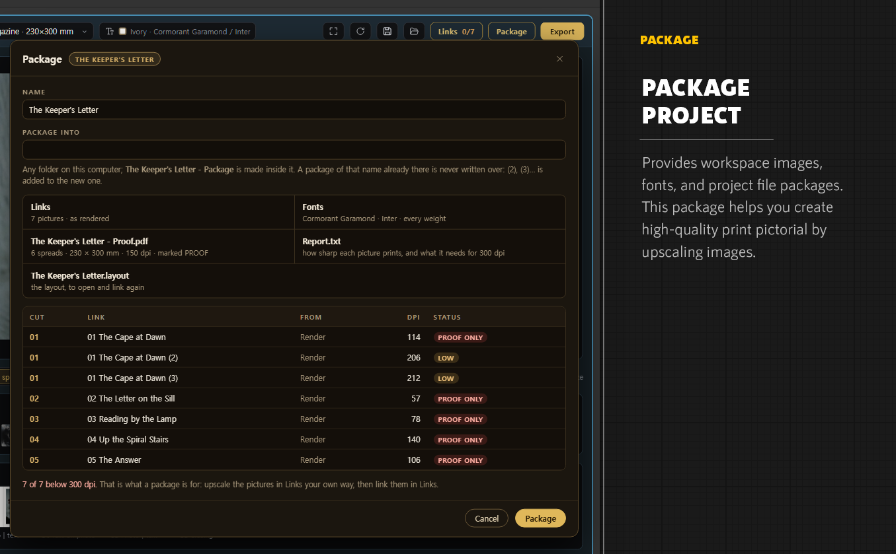

**Package** (in print) first shows what it will write - every link with where
it comes from and how sharp it prints, the typefaces, the proof - and writes it
when **Package** is pressed again. **NAME** is the series' own name unless
changed; the package and the files in it take it. **PACKAGE INTO** is any
folder on this computer, remembered per series; `<name> - Package/` is made
inside it. Left empty, the package goes into `output/<series>/`. A package is
never written over: when `<name> - Package` is there already, the new one is
`<name> (2) - Package`, then `(3)`, and so on. Wherever it is, the Series
Report never reads or counts a ` - Package` folder, so its copies of the picks
stay out of History and Trends:

```
The Keeper's Letter - Package/
├── Links/                          the pictures the layout uses, once each
│   ├── 01 The Cape at Dawn.png
│   └── ...
├── Fonts/                          the typefaces it sets, every weight
├── The Keeper's Letter - Proof.pdf every spread, marked PROOF
├── Report.txt                      how sharp each picture prints
└── The Keeper's Letter.layout      the layout itself
```

- **Links** are the picks as rendered, copied whole with what is written in
  them, named by the cut's number and title so they sort in order. Only the
  pictures on the page are copied - the cover once, even when it is also a cut.
- **Fonts** holds the files of both typefaces: the pack's own as desktop
  fonts with their licences, or the files of a typeface installed on this
  computer. Copying them is for this job only; their licences are the user's
  responsibility.
- **Proof.pdf** holds every spread at its size, at 150 dpi, each page marked
  PROOF in the corner - to look at and to send for approval, not to print.
- **Report.txt** lists every link: its size now, where it is placed, the dpi it
  prints at there, and the size it needs for 300 dpi with the factor to upscale
  by. A picture across a whole spread needs more than one on a page.
- **.layout** is the layout - print or web, size, colour, typefaces, sizes,
  the picks and layout of every cut, the cover, the words of every page, the
  text added, the linked pictures - with the source of every link.

### Saving a .layout

Everything chosen is kept in the node and saved with the workflow. To keep
it apart from the workflow as well, the **save** button at the top (the disk,
as in the Series Book) writes the layout as it stands - the series, print, web or
motion and the size, the style, the logo and hashtags, and every choice made
per cut and per shot - as a `.layout` file into
`output/<series>/layout/saved/`, named for when it was saved
(`<series> - 2026-11-16 1322.layout`). Every save is a file of its own, so
earlier ones stay.

### Opening a .layout

Drop a `.layout` on the Layout node, or press the folder button at the top and
choose one - saved, or from a package. The layout comes back as it was saved - the series, print or
web, the size, the style, and every choice made per cut. Dropped on the
canvas instead, ComfyUI takes it for a workflow and cannot open it.

The series has to be in a Series Book file on this computer, and the picks
are found by the renders' own records - so a .layout opens on the computer it
was packaged on, with the renders where they were.

Upscale the pictures in **Links** in whatever way you upscale; the package does
not ask how. Then link them in **Links**: a package made after that holds the
upscaled pictures instead, and its report says so. Packaging again makes a new
package beside the one before.

## Links

**Links** (in print) lists every picture the layout uses, once each: the cut,
where it is placed, the render's size, the picture linked in its place, the dpi
it prints at, and its status - **300+**, **LOW** (200 to 300) or **PROOF ONLY**
(below 200). The button shows how many are ready, `4/5`.

To link the upscaled pictures, give the folder they are in and press **Find**.
Nothing about the folder is assumed: the pictures may have any names, sit in
folders inside it, and be any of PNG, JPEG, TIFF or WebP. Each is recognised by
what it shows - both pictures are reduced to a small grey grid and compared -
and has to be larger than the render and of the same shape. An upscale changes
the detail, not the picture, so it is found; any other picture is not.

A linked pick carries **HD** in CUTS. The page on screen still shows the render
- it is quicker - but the dpi, the export, the package and its report use the
linked picture. **×** on a row unlinks it, back to the render. The folder is
remembered per series, so Find again picks up pictures upscaled since.

## Export

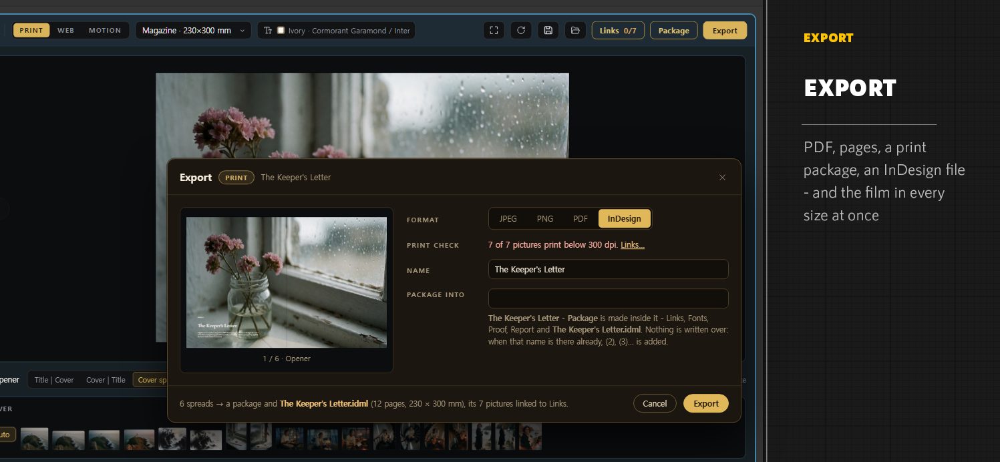

**Export** opens a window: the page on show, small, beside what can be
chosen, and at its foot what will be written.

In print:

- **FORMAT** - **JPEG**, **PNG**, **PDF** - one file of every page, each at its
  size in millimetres - or **InDesign** (below)
- **PAGES** - **Spreads**, two pages side by side as they are seen, or
  **Single pages**, every page on its own, as a printer imposes them
- **RESOLUTION** - **300 dpi** for print, **150 dpi** to look at and send round
- **RANGE** - every spread, or the one on show
- **PRINT CHECK** - how many pictures print below 300 dpi, with **Links…** to
  link the upscaled ones; **Mark as proof** puts PROOF in the corner of every
  page and in the file names. It is on by itself while a picture falls short.

On the web:

- **FORMAT** - **JPEG** or **PNG**
- **SIZES** - any of **Instagram feed** (4:5), **Square posts** (1:1),
  **Stories · Reels · Shorts** (9:16) and **YouTube · X · websites** (16:9), in
  one go: every frame is laid out again for each size, as the WEB size
  list would, and each size goes into a folder of its own
- **RANGE** - every frame, or the one on show

**NAME** is the series' own name unless changed, remembered per series.
**SAVE TO** is any folder on this computer, remembered per series and for
print and web apart. Left empty, the files go into
`output/<series>/layout/<size>/`. The files are `<name> - spread 01.jpg`,
`- page 01`, `- frame 01` or `- proof 01`; a PDF is `<name>.pdf` (or
`<name> - proof.pdf`). Nothing is written over: when files of that name are
there already, the new ones are `<name> (2) - spread 01.jpg` and so on.

### InDesign

**InDesign** packages the layout (see [Package](#package)) and writes
`<series>.idml` into the package - an InDesign document of the layout:

- one spread of two facing pages for every spread, at the size of the layout,
  with its margins and a bleed of 3 mm
- every picture a frame, cropped as it is here, linked to the picture in
  `Links/` - so the upscaled pictures linked there are the ones placed
- every block of words a text frame of live text, set with paragraph styles -
  **Number**, **Title**, **Caption**, **Body**, **Foot**, **Series title**,
  **Note**, **List**, **Label** - so changing a style changes every page
- the colours of the layout as swatches

Open the `.idml` in InDesign (File > Open); it becomes a new document. With the
package's Fonts installed, the type is the same as here; the pages are a start
to be finished in InDesign - bleed the pictures that run to the edge, adjust
the text, export the print PDF from there.

## What is kept

The series on show, print or web, the size of each, the colour, where the
words sit, the sizes, the typefaces, the picks of
each cut, the cover, the layouts chosen by hand, the placing and alignment of the
words of each page, the pages taken out, the pages set inset, the text at the foot of the page, the linked pictures and the folder they came from are kept in the node's properties, per series, so they travel with the
workflow and come back when you switch series.

## Where the words come from

| On the page | In the Series Book |
| --- | --- |
| Series number | The series' number in the book |
| Series title | The series' name |
| Note on the opener | The series note |
| Cut number | The number the scene's name starts with (`C-01 The Cape at Dawn` → `01`), else the scene's own number |
| Cut title | The rest of the scene's name |
| Caption | The line of the scene's note that starts with `Caption:` - or with the same word in the Series Book's other language |
| Text of the cut | The rest of the scene's note |

## Where the pictures come from

A pick is a render picked with P in the Image Viewer. Which cut it belongs to is
read from the PNG itself, through the ledger of the
[Series Report](series-report.md) - the series and scene the Series Lab wrote
into it when it was rendered. A render picked a moment ago is read on the spot;
no scan is needed. Renders moved to the bin, or away from the folders the viewer
may open, are not used.

## Notes

- The node takes nothing and returns nothing; it is never run. The pages are
  drawn in the browser, and the same drawing is the exported file.
- Only renders the ledger knows, and pictures Find has linked, are sent to the
  page - the node cannot be used to open any other file. Linked pictures are
  listed in `user/visual_series_layout/links.json`.
