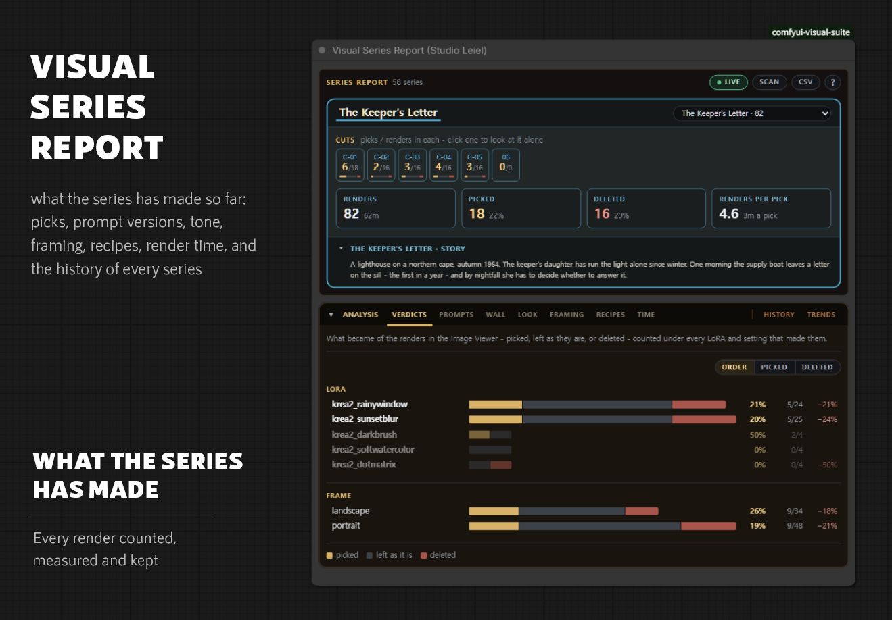
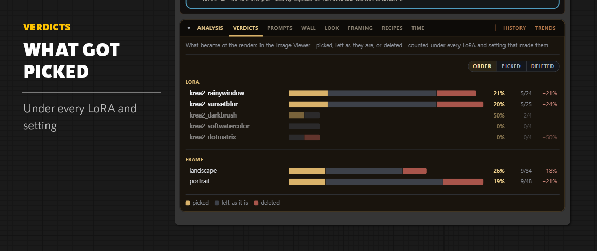
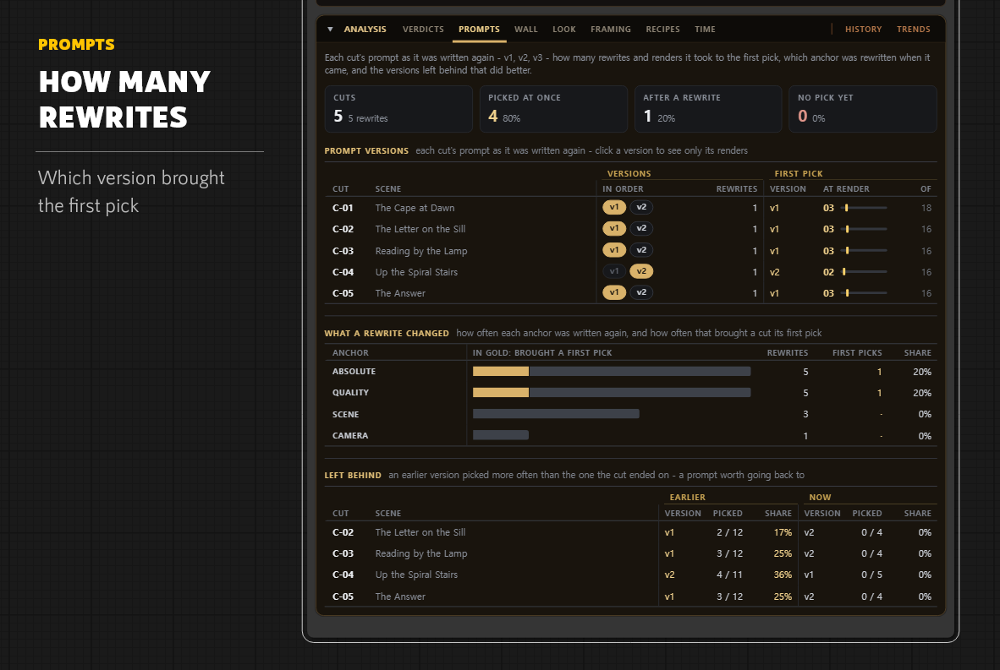
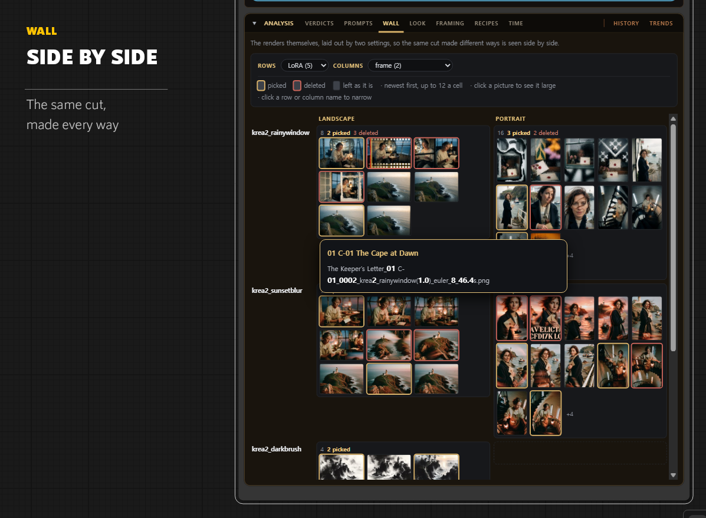
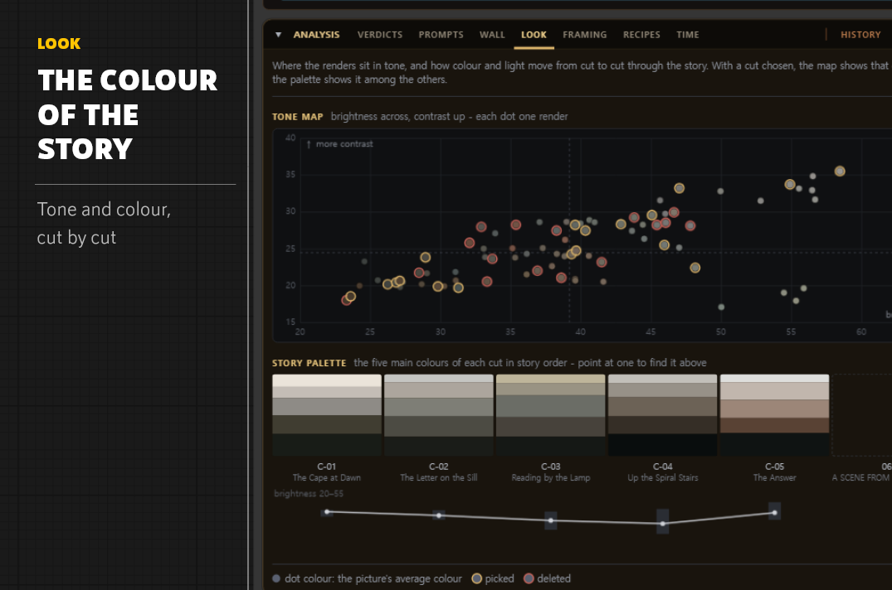
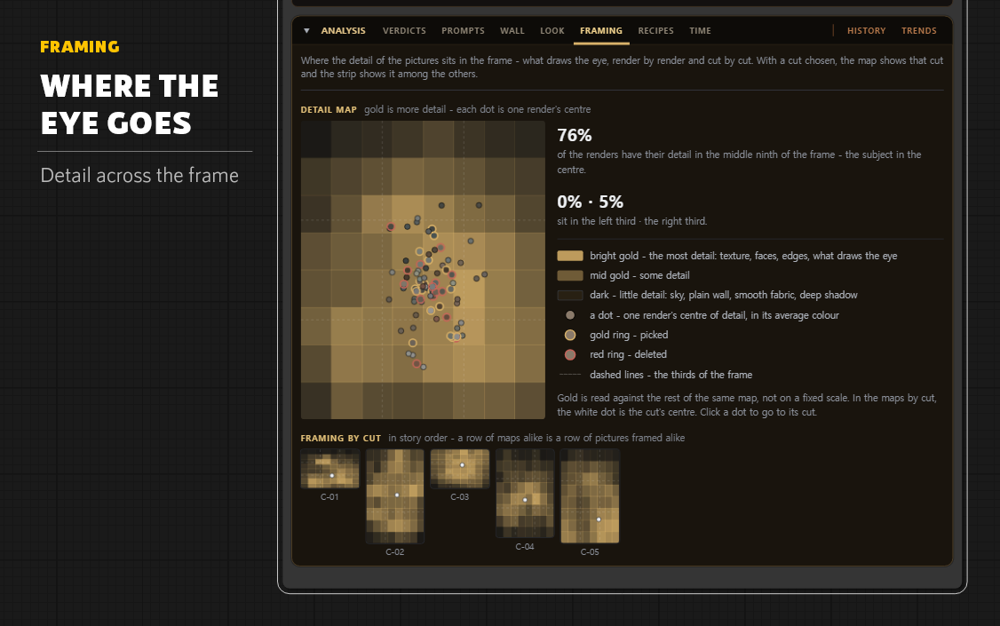
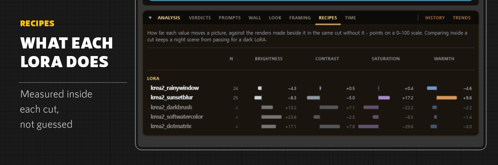
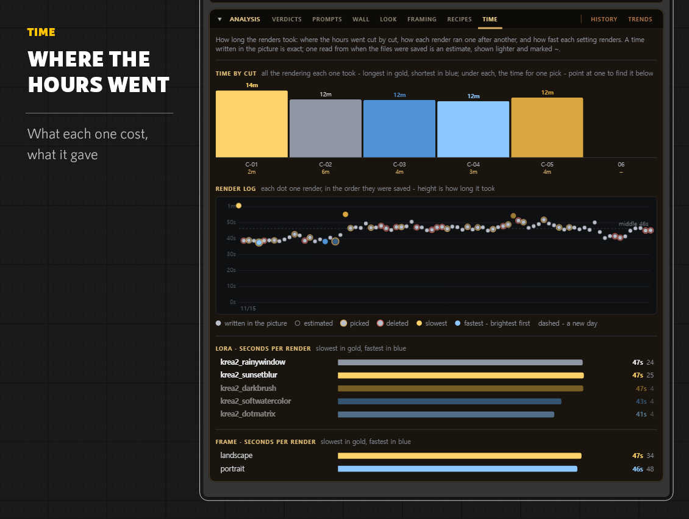

# Visual Series Report

What a series has made so far, and how it looks — where its renders sit in
tone, how its colour moves from cut to cut, and how far each LoRA, sampler or
option moves a picture.



---

## Why this exists

The [Series Lab](series-lab.md) makes it cheap to render a scene six ways, and
a series of fifteen scenes soon has four hundred pictures in it. Looking at them
one by one in the [Image Viewer](image-viewer.md) answers *which picture is
best*. It does not answer the questions that decide the next series:

- Does this episode hold together, or does one cut sit in a different light
  from the rest?
- Is the colour of the story moving the way the story moves?
- When a picture comes out dark, is it the scene, or the LoRA?

Those are questions about all the pictures at once, and an impression is a
poor answer to them. The report measures every render once — plain pixel
arithmetic, no model — and draws the answers: a tone map, a strip of colour in
story order, a table of what each recipe value does to brightness, contrast,
saturation and warmth.

What you picked and deleted in the viewer is kept too, under **Verdicts**, and
as a ring around each dot. But it is one side of the report, not its centre:
a pick says what you liked, after you looked; the measures say what the
pictures are.

---

## What each tab answers

The report is one question a tab. The first seven are about the series on
show; the last two, apart at the right in orange, are about every series of a
period.

| Tab | The question it answers |
| --- | --- |
| [**VERDICTS**](#verdicts) | What was picked - and under which LoRA and setting? |
| [**PROMPTS**](#prompts) | How many times did each cut's prompt have to be written again? |
| [**WALL**](#wall) | What do the pictures actually look like, side by side? |
| [**LOOK**](#look) | Where do the pictures sit in tone, and how does the colour move from cut to cut? |
| [**FRAMING**](#framing) | Where in the frame does the eye go? |
| [**RECIPES**](#recipes) | How far does each recipe value move a picture? |
| [**TIME**](#render-time) | How long did it all take? |
| [**HISTORY**](#history) | How has the work gone, series after series? |
| [**TRENDS**](#trends) | Which recipes still work, and which shots are hard to get? |

---

## Your first look

1. Add **Visual Series Report (Studio Leiel)** anywhere on the canvas. It has no
   sockets — it is a window, like the Image Viewer.
2. Press **SCAN**. Every render in the output folder is read and measured once;
   the button counts as it goes and can be pressed again to stop.
3. Pick a season, an episode or a series at the top left.

From then on, with **LIVE** on, each render is counted and measured as it is
saved, and a pick or a deletion made in the viewer shows here a few seconds
later.

Step 2 can be skipped when an Image Viewer is on the canvas: open a folder in
the viewer and the report reads that folder and shows its series — see
[Following the work](#following-the-work).

---

## Season, episode, cut

A series named the way a season is — `S1E4 The Burning Rose Garden`, `s01e04`,
`S1 E4` — is read as **episode 4 of season 1**. The report then has three
levels:

| Level | Shows | The strip under the path |
| --- | --- | --- |
| **Season** | every episode of that season together | one cell per episode |
| **Episode** | one series | one cell per cut |
| **Cut** | one cut of it | the cuts, with this one marked |

The path at the top — `S1 › E4 › C-04` — says where the page is. Click any part
of it to go back up. Click a cell in the strip, a column of the story palette,
or a dot on the tone map to go further in.

A series without that name works as before, with two levels: the series, and
one cut of it.

A cut goes by its number in the Series Book - `C-04`, or the number the
Series Lab wrote into the render. A series made before the Lab wrote numbers
down has none; its cuts are numbered `01`, `02`, `03` in the order they were
first rendered, and point at a cut for its name.

The series list at the top left lists each season with its episodes under it,
then the other series, then **All series**.

---

## Always on top

The report dresses as the [Series Book](series-book.md) beside it: it wears
the book's colour and brightness, read from the Series Book on the canvas and
kept with the workflow for when there is none. The report looks at the book
four times a second: change the book's colour, or a series' colour in the
book or in the Series Lab, and the report follows within a quarter of a
second.

The series on show sits in a frame drawn in **the series' own colour** in the
book, as the book draws it: the path in large type at the top —
`S1 › E4 › C-01`, the part on show underlined — with the name of that cut or
episode beside it and the series list on the right; the cuts and the four
numbers inside; and at the foot, folding as the book's notes do, the series'
story or the cut's note. A line under the path shows what else narrows the
page, only when anything does - with nothing narrowed it is not there at all,
so the page does not shift up and down between the whole series and a cut.

Below, apart from it with the node showing between them, the analysis sits in
a drawer of its own, **Analysis**, as the book's Drawer does. Its name or the arrow beside it folds it away, and a
tab clicked while it is folded opens it.

The node is as tall as what it shows, as the Series Book is: it grows and
shrinks with the tab on show and with what is folded. Only the **Wall** keeps
a height of its own and scrolls inside it — a whole series of pictures would
make the node taller than any screen.

Whatever tab is open, the frame holds the same overview of what is on show:

1. **The strip** — one cell per cut (or per episode, in a season). The large
   figure is the picks in it, beside it the renders they came from — `3/27`;
   the line under it is those renders split into picked, left and deleted. A
   cell with `0` has no pick yet. Point at a cell for its counts.
2. **Four numbers** — renders, picked, deleted, and **renders per pick**: how
   many renders it took for each one kept. `11` is one keeper in every eleven
   renders; lower is a cut or a recipe that works sooner.
   Under **Renders** is the time they took, and under renders per pick the
   time each pick cost — see [Render time](#render-time).
3. **The story box** — what the [Series Book](series-book.md) says. On an
   episode it is the series' note, its story; with a cut clicked it is that
   cut's own prompt note, the description and subtitle written for it. It is
   read from the Series Book's series file of the same name, and follows it
   when the note is edited.
   A story written in two languages shows **EN**, the second language (named
   after its script, **KO** for Korean) and **ALL** at the right of its bar,
   as the Series Book does: the English lines, the other lines or the whole.
   The choice is one with the Series Book's - set in either, every Series Book
   and Series Report on the canvas follows it.

Under it are the tabs: **VERDICTS**, **PROMPTS**, **WALL**, **LOOK**, **FRAMING**,
**RECIPES**, **TIME** - about the series on show - and, apart at the right behind
a thin rule, **HISTORY** and **TRENDS**, about every series of a period, set in
orange. While one of those two is open the whole drawer turns orange - its
background, headings, rules and buttons - so it is never taken for the series
on show; the gold, grey and red of picked, left and deleted stay as they are. Their
names sit in a dark band, the one on show in
gold with a thick gold rule under it. A line under the tabs says what the tab on
show is for; where the tab goes straight on into text, a thin rule sets that
line apart.

---

## Verdicts



What became of the renders in the Image Viewer — the page this report started
as.

| State | Means |
| --- | --- |
| picked | it carries a pick in the Image Viewer |
| left as it is | it is in its folder, without a pick |
| deleted | it was deleted in the Image Viewer |

The strip and the four numbers at the top are the overview of this tab too.

**Bars.** One block for LoRAs, one for each setting or option that took more
than one value, one for frame. In each row the length is how many renders;
gold, grey and red are picked, left and deleted; `13%  12/94  −12%` reads 13%
picked, 12 picks of 94 renders, 12% deleted.

A node switched off by its own **enabled** widget still writes every other
value it holds into the picture, though none of them made the render. Those
renders count under **off** for the node's other settings - an enhancer's
strength and scale are compared only among the renders it was on for, and the
renders it was off for stand together in one row. The same holds in every tab
and in the CSV.

Such a node - one with its own on/off switch and two or more other values -
is counted as one setting, its values read together: **Krea2T Enhancer
Advanced - strength · text_scale** has a row for `0.5 · 1.85`, one for
`0.75 · 2.1`, and one for `off`, since the values are chosen together and mean
little apart. The CSV keeps each value in a column of its own.

A LoRA in nearly every render - the base model's, the series' person - has no
renders without it to be compared against. Those are named in a gold box under
the LoRA bars, **IN NEARLY EVERY RENDER · NOT COMPARED**, so their absence
from the bars is not missed.

Everything is listed in the order it was first used and stays there while a run
adds to it. **PICKED** and **DELETED**, at the top of the tab, sort the rows by
those shares instead; **ORDER** puts them back.

---

## Prompts



The tab after **VERDICTS**. It has a tab of its own so that **VERDICTS** opens
on its LoRA bars.

A cut's prompt is seldom right the first time: it is written, rendered,
judged, and written again. Each time the cut's own words change, the renders
after it count as the next version - `v1`, `v2`, `v3`. The version a cut
ended on is nearly always its best - that is why the writing stopped there -
so the tab does not crown it. It asks how long each cut took, what the
rewrites changed, and which versions were left behind.

With a series on show, the tab is four numbers and three tables, set as the
history is: groups under gold rules, a head, one grid.

**The four numbers.** Cuts and rewrites; cuts picked on the first prompt;
cuts picked after a rewrite; cuts with no pick yet.

**Prompt versions** - one line a cut:

| Group | Column | Means |
| --- | --- | --- |
| | Cut, Scene | the cut's number and name |
| Versions | In order | its versions in slots that line up from cut to cut: the one that brought the first pick filled gold, the ones before it dim |
| | Rewrites | times the prompt was written again |
| First pick | Version | the version that brought it |
| | At render | the render that was the first pick, and a line of all the cut's renders with a gold mark where it came - early or late |
| | Of | the cut's renders |

Numbers under ten are written `03`, so the columns line up. Click a line to
open the cut, or a version to open the cut with that version only. A cut with
no pick yet is set faint.

**What a rewrite changed** - for each anchor, how many times it was written
again, and in gold how many of those rewrites brought the cut its first pick,
with the share. Looked at over a season or all series, it says which anchor
is worth rewriting when a cut is stuck, and which rewrites seldom help.

**Left behind** - an earlier version picked more often than the one the cut
ended on, with at least three renders: the earlier version and the one now
side by side - version, picks, share. The rewrite made it worse, and the old
prompt may be worth going back to. Click the line to see that version's
renders.

With **one cut** open: four numbers - versions, renders, the first pick and
the render it came at, picks - and a table of the cut's versions: the anchors
written again since the version before, the one that brought the first pick
marked **FIRST PICK**, its renders as a bar, picks, share picked and share
deleted. Click a version and every tab is about its renders alone; its chip
on the second row reads `prompt: v2`. Opening another cut lets go of it.

What counts as the cut's prompt: the words of its own anchors, as the Series
Book holds them. LoRA trigger words are not part of it, and neither is a
capsule swapped in from another scene - a render with a swap belongs to the
version whose own words it shares, so trying a capsule on a cut does not make
a new version. Writing a prompt back as it was returns its renders to the
earlier version. Spacing alone does not make a version. Older books named
their anchors `SUBJECT ANCHOR` and the like; they are counted as `SUBJECT`.

Renders counted before versions were kept are read once more by the next
**SCAN**; a render already moved to another disk cannot be, and stays out of
this tab.

---

## Wall



The renders themselves, laid out by two settings: **LoRA in the rows and sampler
in the columns** to begin with, or any other two settings that took more than one value
— scheduler, steps, a Series Lab option — chosen in the two lists at the top.
Choose **nothing** across for one column.

Each cell is one way of rendering: how many renders it made, how many were
picked or deleted, and the newest of them as small pictures — a gold ring is a
pick, a red ring a deletion. Click a picture to see it large; click again to
close it. Click a row or column name to narrow the page to it.

The numbers in **Recipes** say that a LoRA makes a picture brighter; the wall
shows what that looks like. Narrowed to one cut it is the same scene made every
way it was tried, side by side.

The small pictures are made when a render is measured and kept in
`user/visual_series_report/thumbs`, so a render emptied from the bin can still
be seen here.

---

## Look



**Tone map.** Every render is one dot: across, how bright it is; up, how much
contrast it has. Each dot is drawn in the picture's own average colour, so a
blue night cut and an amber fire cut separate at a glance. The dashed lines are
the middle of what is on show.

A tight cloud is an episode with one light. A cut whose dots sit apart from the
rest is a cut that will look out of place when the series is laid out — worth
knowing before it is upscaled. A **gold ring** is a picked render, a **red
ring** a deleted one: where the rings gather says which tone you keep choosing.

Hover over a dot to see its cut, file and measures; click it to go to its cut.

**Story palette.** One column per cut — per episode, in a season — in story
order. Each column is that cut's five main colours, light at the top and dark
at the bottom, each as tall as its share of the pictures. Read left to right it
is the colour of the story: whether the fire cuts are warmer than the chapel
cuts, whether the ending is darker than the start.

Point at a column and its renders light up on the tone map above, the rest
fading back - where one cut sits among all of them. With a cut chosen, pointing
at another one brings that one up beside it, so two cuts can be compared
without letting go of the first.

Under the columns is the **brightness line**: the middle brightness of each
cut, with a band for the middle half of its renders. A tall band is a cut whose
renders disagree about how bright the scene is.

---

## Framing



Where the detail of the pictures sits in the frame — the edges and texture
that draw the eye.

**Detail map.** The frame split into 8 × 8 cells, all renders on show together:
the more gold, the more detail sits there. Each dot is one render's centre of
detail, in its own average colour, with a gold or red ring for a pick or a
deletion. The dashed lines are the thirds. Beside it: how many renders keep
their detail in the middle ninth of the frame, and how many lean to the left
or right third. A series where nearly every dot sits in the middle is a series
of pictures with the subject in the centre. Click a dot to go to its cut.

Beside the map a key reads the colours: bright gold is the most detail —
texture, faces, edges, what draws the eye — mid gold some, dark little: sky,
plain wall, smooth fabric, deep shadow. Gold is read against the rest of the
same map, not on a fixed scale.

**Framing by cut.** The same map for each cut in story order, with its centre
marked. A run of maps alike is a run of pictures framed alike.

---

## Recipes



How far each value moves a picture. For every LoRA, sampler, scheduler, step
count and Series Lab option, four figures:

| Figure | Means |
| --- | --- |
| Brightness | `+6.2` — 6.2 points brighter, on 0–100 |
| Contrast | how much wider the spread of light and dark is |
| Saturation | how much more colour |
| Warmth | red over blue: `+` warmer, `−` cooler |

The comparison is made **inside each cut**. In one cut the subject, the light
and the place are the same, so renders with the value and renders without it
differ by the recipe — not because a night scene happened to sit next to a day
scene. Each cut where both are found gives a difference; the cuts are weighed by
how many renders they hold on both sides.

- **–** means the value was never rendered beside the others in one cut, so
  there is nothing fair to compare it with.
- A **faded row** has fewer than ten renders on one side. Its figures are a
  hint, not a result.
- Each column keeps one scale across the tab, so bars can be compared down a
  column.
- A LoRA in nearly every render compares nothing and gets no row.

Narrow first to read one thing at a time: click a LoRA that stands for a person,
and the sampler rows compare samplers on that person's renders only.

---

## Render time



How long the renders took is read two ways, the exact one first:

- **Written in the picture.** With the Visual Suite installed, every render
  carries its render time in the PNG's own text — from the moment the run
  started to the save, model loading, sampling and decoding included. This is
  exact, and needs nothing set: the elapsed chip of the
  [Filename Manager](filename-manager.md) is only for putting the time in a
  file name.
- **Estimated from when the files were saved**, for renders made before that.
  Renders run one after another, so the time between a render and the one
  saved before it is roughly that render — but it also holds whatever happened
  in between: a setting changed, a pause to look. A gap over 15 minutes is
  taken as a break and gives no time.

The **TIME** tab draws it out:

- **Time by cut** — all the rendering each cut took, in story order, the
  written part solid and the estimated part lighter on top. Under each cut, in
  gold, the time each of its picks cost. A tall bar with a long time per pick
  is the cut that is eating the evening.
- **Render log** — every render as a dot, in the order they were saved, as high
  as it took. A dashed line marks a new day, the flat dashed line the middle
  render time. A run of high dots is a slow recipe or a heavy setting; a ring
  is a pick or a deletion. Point at a dot for its cut, file and time; click it
  to go to its cut.
- **Seconds per render** — for each LoRA, sampler, scheduler, step count and
  option, the middle render time of the renders that used it, so one slow
  render after a pause does not pull it. Beside it, how many renders it is
  read from. Click a row to narrow to it.

In every TIME graph the ones that took longest are drawn in gold and the
ones that went fastest in blue — the brightest the first, the darkest the
third — so where the time went shows at a glance. Each side takes at most
three and never more than half of what is shown: with two samplers, one is
gold and the other blue.

Point at a cut in **Time by cut** and its renders light up in the render log
below, the rest fading back.

A figure that has any estimate in it is marked `~`. Point at **Renders** to see
how many renders are exact, how many estimated and how many have no time.
The CSV has each render's seconds and where they came from.

---

## History

The series of a period, the one begun last at the top, set as a table. The
period is chosen at the top right - **30 DAYS** (the first time), **90 DAYS**,
**6 MONTHS**, **1 YEAR** or **ALL** - and a series worked on within it comes
whole, its earlier renders too. Only the series of the period are worked
out, so a long history does not slow the tab.

Above the table, the period in four numbers: series and cuts, renders and
hours, picks, and renders for each pick.

The table is set in three groups under gold rules, and broken by month:

| Group | Column | Means |
| --- | --- | --- |
| | date, series | the day the series' first render was made, and its name |
| Output | Renders | how many, as a bar: picked, left as they are, deleted |
| | Picked | picks / renders |
| | Per pick | renders for each pick - the three lowest in blue, the three highest in gold, among series with five picks or more |
| | Hours | render time, written in the pictures or estimated |
| Cuts | 1st pick | the render at which a cut's first pick usually came (the median over its cuts), written `04` |
| | At once | cuts picked on the first prompt |
| | Rewrite | cuts picked after the prompt was written again |
| | None | cuts with no pick yet |
| Prompt | Rewritten | the anchor written again most; when another anchor's rewrites brought more first picks, it follows in gold - `CAMERA › POSE` |

A series with no pick is set faint. Point at a line for all of it in words;
click it to open the series.

Renders saved outside any series are not in the history. A series made only
to try something - `Drawer Test`, `Series 1` - is hidden with the faint **×** at
the end of its line, brighter while the line is pointed at: it leaves the history and the series together (**All
series**, a season), and stays in the series list to open on its own. Hidden
series are listed at the foot of the tab; click one to bring it back. They
are kept in `settings.json` under `"hidden"`.

The history is worked out again every few seconds while the tab is open,
and not at all while it is closed. A workflow always opens on **VERDICTS**,
even when it was saved on **HISTORY** or **TRENDS**: those two read every
series, and only when someone opens them.

---

## Trends

Across the series of a period - chosen as in **HISTORY**, and the same
choice for both tabs - two questions: which recipes are still working, and
which kinds of shot are hard to get. Hidden series are left out.

Four numbers on top: the series and their cuts, the recipes compared, the
hardest shot and the easiest - the shot sizes whose cuts took the most and
the fewest renders to their first pick (among sizes with five cuts or more).

**Recipe report card.** Every LoRA and sampler with ten renders or more in
the period, one line each, LoRAs first and the most used first:

| Group | Column | Means |
| --- | --- | --- |
| | Recipe | the LoRA or sampler |
| Series, oldest to newest | one column a series | share picked in that series - the last eight series of the period, `S1E5` for an episode, else the first word of the name; `·` where it was not used |
| Whole period | Picked | share picked over the period |
| | Renders | renders over the period |
| | Trend | the last three series it was used in against the ones before: `▲ 14` picked fourteen points more often lately, `▼ 15` less, `=` about the same; `·` with too few renders to tell |

A share is brighter the more was picked - 25% or more, 15%, 8%, under 8%;
`0` is grey. A share from fewer than ten renders is set lighter: a hint, not
a result. Recipes of the period not used in the eight series on show are
folded away under a line that brings them back. A LoRA in nearly every render
is named in the gold box under the table, not compared.

**Difficulty by shot.** How long each kind of cut took to its first pick, in
three groups: shot size, angle and frame.

| Group | Column | Means |
| --- | --- | --- |
| Cuts | Cuts | cuts of that kind |
| | At once | picked on their first prompt |
| | No pick | with no pick yet |
| Until the first pick | 1st pick at render | the render at which a cut's first pick usually came (the median), with a bar - the hardest of its group red, the easiest gold |
| | Per pick | renders for each pick |
| | Versions | prompt versions a cut took, on average |

Size and angle are read from the words of each cut's camera capsule in the
Series Book - `extreme long shot` or `drone` is **Wide**, `full-length` or
`head to toe` **Full length**, `three-quarter` or `thighs` **Three-quarter**,
`medium` **Medium**, `close-up` or `macro` **Close-up**; `high angle` or
`looking down` is **High**, `low angle` or `looking up` **Low**, anything else
**Eye level**. A capsule that names none of them is **Not named**. A cut whose
Series Book file is gone is counted under its frame only; the line above the
table says how many cuts were read.

---

## What is measured

Each render is measured once, on a copy 256 pixels long — a fraction of a
second for a full-size render, most of it spent opening the file:

- **brightness** — the mean light of the picture, 0–100;
- **contrast** — how far light and dark spread around it, 0–100;
- **saturation** — the mean colour strength, 0–100;
- **warmth** — red over blue, −100 to 100;
- **average colour** and **five main colours** with their shares;
- **a detail map** — where in the frame the edges and texture sit, in an 8×8
  grid, for **Framing**;
- **a small copy** of the picture for **Wall**.

Sharpness is not measured: on a small copy it says more about the copy than
about the render.

Measuring runs in the background. While it runs the second row says
`measuring · 120 left`, and the page fills in as it goes — the season or
episode on show is measured first.

---

## Narrowing

A cut, a bar or a row is a filter. **Click one** and everything else on the
page is counted among those renders only; click it again, or its chip on the
second row, to let go.

- Click a **cut**, and the tone map and recipes are about that cut alone.
- Click a **LoRA** that stands for a person, and every other figure is about
  that person's renders.
- Click a **prompt version** in **PROMPTS**, and everything is about that
  version of the cut's prompt.
- Click several: LoRAs stack, and each other block takes one value at a time.

Going up the path lets go of the cut and keeps the other filters.

---

## Following the work

With **LIVE** on the report stays on whatever is being worked on, without being
told:

- **A render is saved** — it is read and measured at once. If it belongs to the
  season or series on show, the page stays where it is; otherwise it turns to
  the render's series. The cell it landed in is outlined in green for a moment.
- **A series is opened in a [Series Book](series-book.md)** — from Files, or
  with a book file — and the report shows that series, as the Image Viewer goes
  to its pictures.
- **A folder is opened in an [Image Viewer](image-viewer.md)** — typed, browsed
  to, or reached by the viewer following a save — and the report shows the
  series the pictures in it belong to. A folder that is one cut of a longer
  series narrows the report to that cut; a day's folder with several series in
  it shows the one worked on last. Several folders picked together count as one.

A folder the report has not read yet is read at that moment, so following the
viewer needs no scan first. Finding unread renders also starts a scan in the
background: the rest of the series may be in another folder, and the page fills
in as it is found.

Only a change is followed. Turning the report to another view by hand leaves it
there until the viewer opens another folder or a render of another series
lands. With **LIVE** off the report stays where it is, whatever happens around
it.


**A series before its first render.** A series saved in the Series Book is
in the report's list at once, with `· 0`, even when nothing of it has been
rendered: its scenes are in the strip at `0/0`, its story under them, and the
tabs say there is nothing rendered yet. Open it in the book and the report
follows. Once renders come in, a scene of the book with none of its own yet
stays in the strip at `0/0`, so the strip always shows what is left to do.
---

## Two names, one LoRA

A LoRA file renamed half way through — `Purple_Grainy` shortened to `PG` to
keep file names down — is two names to the report, with the renders split
between them.

**Right click** a LoRA row, in Recipes or Verdicts, and choose the name it is
the same LoRA as. The two are counted together from then on, in every series,
and the row shows `+1` beside its name. Right click it again to count a name on
its own.

---

## What happens to a deleted picture

A picture deleted in the Image Viewer goes into a `_deleted` folder beside it,
and the report reads and measures it there — a deleted render is the only place
its recipe is written. When the viewer's bin is emptied the file is gone, but
the report has already written the render and its measures into its ledger and
keeps counting it as deleted. That is what the ledger is for.

---

## A finished series moved to another disk

When a series is done, its folders can go to another disk. The report keeps
it.

Every time the report looks, it writes down what it sees of each render:
picked, left as it is, or deleted. A render whose picture is no longer where
the report reads — moved to a disk that is not listed, or not connected — is
counted as it was last seen, and marked **archived**. Its measures, its render
time and the small picture kept for the wall all stay in the ledger, so every
tab still draws it; only the large view on the wall falls back to the small
picture.

In the series list an archived series says so, and the second row says how
many renders on show are archived.

The report writes down every render it knows when it starts and after each
**SCAN** — not only the series on show — so a series moved without being
opened again still keeps its picks. A series moved away before this was in
the report has no picks written down and is left out.

If an archived series is brought back to a folder the report reads, it is
recognised by what is written inside the pictures, not by their names, and
its picks come with it: the Image Viewer keeps picks by path and would not
know them at the new place.

---

## Buttons

| Button | Does |
| --- | --- |
| series list | The season, episode or series on show. **All series** shows every render the report knows. |
| **LIVE** | Follows the work: each render as it is saved, a series opened in a Series Book, a folder opened in an Image Viewer. Off, the page stays where it is. |
| **SCAN** | Reads and measures every render in the output folder that is not known yet. Safe to press at any time; a file already read is skipped. |
| **CSV** | The renders on show as a table, one line each, with their four measures and every setting in its own column. |
| **?** | A short version of this page, on the node. |
| **VERDICTS · WALL · LOOK · FRAMING · RECIPES · TIME** | The six sides of the report. |
| **ORDER · PICKED · DELETED** | In Verdicts: the rows as first used, or by share picked or deleted. |

---

## Where it reads, and what it keeps

The report reads the places the Image Viewer may open, except the input
folder: ComfyUI's output folder and whatever is listed in
`user/visual_image_viewer/allowed_folders.txt`. Nothing outside them is
opened.

It also reads the Series Book's series files in `user/visual_series_book/series`
for the story box, and never writes to them.

It writes `user/visual_series_report/ledger.sqlite3` — one line per render with
its recipe, a short fingerprint of each anchor of its prompt (never the words
themselves), its last known state and its measures, and the LoRA names that were
joined — and the small pictures in `user/visual_series_report/thumbs`. Deleting that file forgets everything; **SCAN** reads
and measures back what is still on disk, but the renders whose files are gone
are gone from the report too.

No picture is changed, moved or deleted by this node.

**What is counted.** Beside the ledger is `settings.json`, written with its
defaults the first time the report runs:

```json
{
  "from": "2026-09-12",
  "skip_folders": ["upscale"],
  "hidden": []
}
```

- `from` - renders of an earlier day are left out of every count, every tab
  and the series list; empty counts everything. The day is the dated folder
  a render was saved in (`output/2026-09-12/...`), or, outside a dated
  folder, the day its file was saved. Useful when the pictures took a step
  up from a certain day and the ones before it would only blur the numbers.
- `hidden` - series left out of the series together and of the history,
  set with the **×** in **HISTORY**.
- `skip_folders` - folders, by name, that **SCAN** never reads, and whose
  renders already in the ledger are left out too. `upscale` is skipped from
  the start: an upscaled copy is the same render again. A folder whose name
  ends in ` - Package` - a [Series Layout](series-layout.md) package, wherever
  it was written - is never read or counted either: its pictures are copies of
  picks, made for printing.

Nothing is deleted from the ledger: change the file - the report reads it
again as soon as it changes - and what was left out is counted again.

---

## Kept with the workflow

The view on show, the tab, the filters, the sort, **LIVE**, which parts are
folded, and the book's colour and brightness as last seen are kept in the node's properties and travel with the
workflow.
